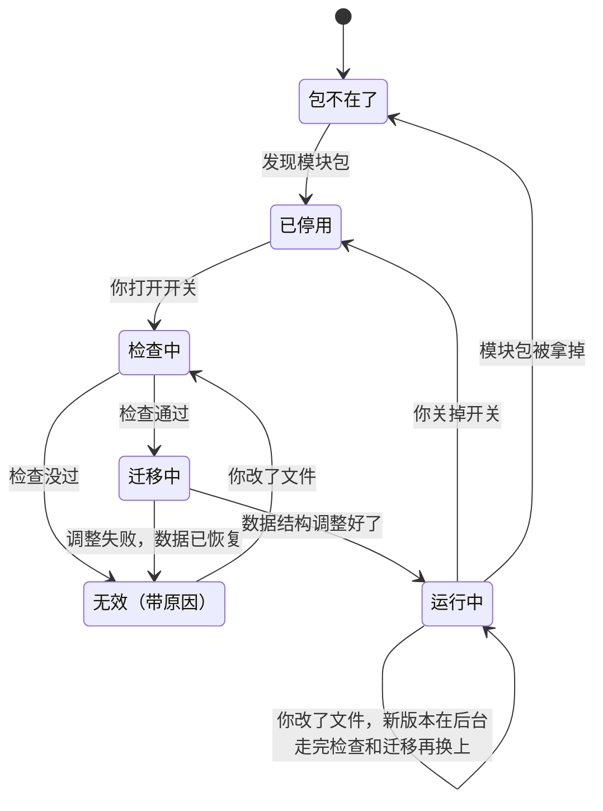

# 领域模块架构设计

这份设计只出方案，不改宿主代码。它只描述一种情况，就是你自己写或自己装的模块跑在你自己的机器上。防备陌生作者的那些机制不在这里，第 9 节列出它们，完整的严格版保存在提交 `1a05dc3`，标签是 `module-design-strict`。

配套文件有四组。类型、校验器和三份测试原是这里的 `sketch/`，已搬进 `src/modules/` 和 `tests/module-*.test.ts`。`sample/personal-health/` 和 `sample/personal-tax/` 是两个领域的模块包。`sample/broken/` 是 13 个各带一处常见错误的包。`sample/update/` 是同一个模块的五个版本。括号里的编号对应 `requirements.md`。写「实测」的句子，是在这台机器上（macOS，Node 26.5）运行得到的结果。

## 1. 一页概览

**模块是一个文件夹。** 它装着一个领域要的全部东西（G4）。放进去一个子文件夹，就多一个组成。没有总清单要登记，也没有权限要申请。

```
personal-health/
  module.json          是谁、哪个版本
  rules.md             什么情况下开任务
  knowledge/<名字>/    知识：出处和正文
  data/<名字>/         数据：一类数据长什么样
  tools/<名字>/        工具：一段确定的计算或查询，文件夹里可以带任何文件
  skills/<名字>/       技能：教 Worker 怎么做一件事
  feeds/<名字>/        feed：外面的东西怎么进来
  agents/<名字>.md     专家：一位团队成员
  evals/<名字>.md      考题：预演时用
```

`module.json` 只有身份和版本：

```json
{ "schema": 1, "name": "personal-health", "version": "0.1.0", "title": "个人医疗健康",
  "description": "体检和检验报告、用药、指标跟踪和越线提醒、多学科会诊", "team": "健康顾问团" }
```

**模块包和实例数据分开放（D1）。** 判断一样东西放哪边，只问一句「换一个人用，它还一样吗」。一样的进模块包，不一样的进实例数据。

```
<stateDir>/modules/<名字>/                 你的模块包（仓库里的 modules/ 是内置的）
<stateDir>/module-store/<名字>/<版本>/     宿主留的只读副本，一个版本一份
<stateDir>/modules-data/<名字>/            实例数据：data.db、blobs/（原件）、knowledge/（你导入的全文）、index/
```

- 宿主从不往模块包里写（I1）。它要稳定的一份时，复制到自己的 `module-store/`。
- 实例数据一个模块一个目录，只有宿主的 `InstanceData` 打开它（I2）。
- 拿掉模块包，数据原样留着。包回来就接上（I3）。删除数据是单独的动作，建议要再输入一次模块名。

**你的三个目标，设计各用什么回应。**

| 目标 | 设计怎么做到 |
|---|---|
| 通用，任何领域都能接入（G1） | 六类组成是固定的，领域只是往里填内容。宿主没有任何一行代码认识「医疗」或「报税」。`sample/personal-tax/` 用同一个布局做了报税，实测通过校验 |
| 好做，好改（G3） | 加一个组成就是复制一个文件夹。有三种模板，有一个用聊天带你做的制作模块，有一条检查命令和一条预演命令（第 6 节） |
| 灵活，便宜，热插拔（G2） | 打开开关就是全部授权。之后改一个文件、存盘，宿主自己接上，新任务用新版本，不问你任何问题，也不用重启（第 4 节） |

安全和功能分开处理（G5）。这一版里，功能一样都没有为安全让步，模块的代码能联网、能读自己带的文件、能用密钥。安全只留下四条便宜的规则，它们不看模块是谁写的。外来内容只是数据（第 2 节的表）。密钥不进模块包。模块代码不进宿主进程。碰过私密数据的任务，它自己的汇报、问题卡片、你对它的回答和私密数据上的提醒，在 Telegram 上只发一行提示（第 5 节）；幕僚长之后的回复引用到这些内容，这一版还管不到。

## 2. 一个模块里有什么

六类组成，各有一个固定位置。例子都取自 `sample/personal-health/`。

**知识（K1）。** 一份知识一个文件夹，`source.json` 写出处、版本和权威程度，正文是旁边的 Markdown。

```json
{ "title": "肿瘤标志物跟踪要点（模块自编）", "version": "0.1", "published": "2026-11-11",
  "authority": "reference", "license": "bundled", "origin": "模块作者整理，可随模块分享" }
```

受版权保护的指南写 `"license": "user-import"`，包里只放出处，全文由你在模块页导入到实例数据。宿主按标题切段，建全文索引，Worker 用 `knowledge` 工具检索，每段带文档名、版本和章节。检索先不用向量，用 SQLite 的 FTS5 全文索引（D6）。上一轮实测，Node 26.5 自带的 SQLite 有 FTS5 和 trigram 分词，中文按子串能查到。`knowledge` 的接口不暴露检索方式，以后加向量不改接口。

**数据（K2）。** 一类数据一个文件夹，`collection.json` 写字段、种类和级别。

```json
{ "title": "检验指标", "kind": "series", "class": "private",
  "fields": { "item": { "type": "text", "title": "项目" }, "value": { "type": "number", "title": "数值" },
              "takenAt": { "type": "date", "title": "采样日期" }, "lab": { "type": "text", "title": "实验室" } },
  "watch": { "key": "item", "value": "value", "at": "takenAt" } }
```

原件（PDF、图片）进 `blobs/`，结构化的行进 `data.db`。Worker 用 `data` 工具读写，每次调用在访问记录里记一笔，带结果：成功，或者被拒和拒绝的原因。没走到这份数据就被拦下的调用（模块停用、成员的 `uses` 没列、推断任务想写、参数不成形）只记在宿主日志里。Worker 从一份报告里提取出的行，带着 `from` 指向那份原件。`record` 的一行后来按 id 从别的来源改了几项，这几项各自的来源另记在 `sources` 里，`from` 不变。模型读数值会读错，所以出处一直留着，你随时能对照。提取出的行直接生效，不等你确认。`class` 只有 `shareable` 和 `private` 两个值，它的作用见第 5 节。

**提醒条件（K4 D7）。** 写了 `watch` 的 `series` 可以设提醒条件。条件是你的实例数据。种类是宿主内置的一小组：`above`、`below`、`rising-streak`、`falling-streak`、`change-pct`、`crosses-average`。有新的行写进来时，宿主对这个 key 的条件算一遍，满足了就直接提醒你。提醒的文字由程序拼出来，带数值、时间和数值来自哪份原件，模型不参与。时间照存的原样写；`watch` 多写一个 `"zone"`（IANA 时区名，例如 `"America/New_York"`）时，带时区的完整时刻换算到那个时区再写，`America/New_York` 标「美东」，别的时区标时区名。行情数据写 `zone`，个人读数不写。这是今天盯盘条件（tripwire）的通用版，和数据层在同一步实现。us-market 的盯盘是它的第一个使用者，肿瘤标志物预警是第二个。

**工具（K3 D2 S1）。** 一个工具一个文件夹。`tool.json` 写输入输出，`index.ts` 默认导出一个函数，`cases.json` 是测试用例。

```ts
// tools/insulin-sensitivity/index.ts
export default function insulinSensitivity(input: { fastingGlucose: number; fastingInsulin: number }) {
	return { homaIr: (input.fastingGlucose * input.fastingInsulin) / 22.5, quicki: /* … */ 0 };
}
```

- 文件夹里可以放任何别的文件，例如更多代码、数据表和依赖。报税样例的 `tax-bracket` 把税率表放在 `rates-2025.json` 里由代码读取，实测用例通过。
- 工具可以联网。它在 `tool.json` 里多写一个 `"effect"`。`"read"` 表示只向外查询，`"write"` 表示会改变外面的东西。不写就是只做计算，这时 `cases.json` 必须有，每次检查都跑。
- 要用密钥就写名字，例如 `"secrets": ["MASSIVE_API_KEY"]`。值在宿主的密钥文件里，宿主把它作为环境变量交给这个工具的进程。实测，进程拿得到写了名字的密钥，拿不到宿主别的密钥。
- **模块的代码在子进程里运行，每次调用一个新进程（S1）。** 宿主把输入写成一行 JSON 交给它，读回一行 JSON。这样做是为了热插拔和不拖累宿主，不是为了安全。一次调用崩了只是这一次失败，换了新版本不用重启宿主，停用以后没有东西留着。进程是普通的 Node 进程，没有沙箱。实测，每次调用大约 43 毫秒，包括启动 Node 和加载一个 `.ts` 文件。和备忘相比这里答得轻，S1 只取了「不进宿主进程」，没有做隔离。
- **模块的代码有一个自己能写的地方，`files/`。** 每个工具和 feed 的进程都拿到环境变量 `PSA_MODULE_DATA`，值是这个模块的实例数据目录 `<stateDir>/modules-data/<模块>/`。代码只往其中的 `files/` 写，宿主在调用前建好它。同一个目录里的 `data.db` 和 `knowledge/` 归宿主管，代码只读。`just module purge` 删整个目录，`files/` 跟着删。检查时跑的用例和 fixtures 拿到的是一个临时目录，跑完删掉，看不到真实数据；临时 `files/` 里只链着这个模块已装好的 venv。`just module try` 的临时状态目录里是真实 `files/` 的副本，预演只写副本。
- **包里可以带一个 Python 子项目 `py/`。** 里面是 `pyproject.toml` 和 `uv.lock`，两个都要有，检查时缺一个就拒绝。`just module setup <名字>` 用 `uv sync --frozen` 把它装进 `files/venv-<uv.lock 的 sha256 前 12 位>`，环境不进包目录，包不被改动。有 `py/uv.lock` 的包，进程多拿到一个 `PSA_MODULE_VENV`，指向和**这份包副本**的锁文件对得上的环境，所以换了依赖版本以后，钉在旧版本上的任务照样用旧环境。setup 留当前和上一个环境，更老的删掉。装完才写 `.psa-lock`，没有它的环境算没装完，下次重装。`__pycache__` 不算进版本，Python 跑一次不会让宿主以为包变了。入口还是 Node 的 `index.ts`，由它去调环境里的可执行文件（`$PSA_MODULE_VENV/bin/...`），运行时不需要 `uv`。
- 现在只有 Node 一种运行方式。哪个领域需要 Python 的库时，下一步是加第二种。接入点是 `tool.json` 的一个字段 `"runtime": "python"`，入口换成 `index.py`，宿主用 `uv run` 启动，进程两头的 JSON 约定不变。这一版没有做。

**技能（K4）。** 和今天一样，一个文件夹一个 `SKILL.md`。问诊、复诊、多学科会诊、报告复核、指标跟踪都是技能。Pi 从任务钉住的副本里读它们。

**Feeds（K5）。** 见第 3 节。

**专家团队（K6）。** 一位专家一个 Markdown 文件。开头几行写它有哪些 Pi 工具，能用模块里的哪些能力，正文是它的提示词。

```
---
name: clinical-pharmacist
title: 临床药师
description: 药物相互作用、用法用量是否和处方一致。问「这两种药能一起吃吗」找它
tools: read
uses: knowledge, data/lab-results
---
```

`uses` 没列的能力它调不到。临床药师只读得到检验指标，影像科顾问读得到报告原件，这就是按数据权限分工。会诊做成一个技能（`skills/mdt`）。领队把同一份材料同时派给几位专家，各自回复，再汇总并列出分歧。今天的派活机制已经支持并行，不用改宿主。

### Worker 怎么用到这些

不管任务属于哪个模块，Worker 只多出四个工具：`domain_tool`、`knowledge`、`data`、`watch`。它们都走宿主里的同一个入口 `Gateway.call`。这个入口做四件事。

1. 只在任务所属的模块、任务钉住的那个版本里找能力。别的模块的东西根本不在目录里。今天「拿到 `lookup` 就能查宿主上所有 feed」的缺口因此关上。
2. 模块停用了就拒绝。
3. 专家调用时，对照它的 `uses`。
4. 对照下面这张表，然后交给宿主的默认实现（知识、数据、提醒条件）或模块的代码（工具），并在访问记录里记一笔。

| 这次调用会 | 例子 | 只听过你的 request 任务 | 其他 request 和 rule 任务 | 推断任务 | 模块页 |
|---|---|---|---|---|---|
| 只读 | 查知识、读数据、看提醒条件、只计算或只查询的工具 | 可以 | 可以 | 可以 | 可以 |
| 写 | 写数据、`effect` 是 `write` 的工具 | 可以 | 可以 | 不行 | 可以 |
| 替你做主 | 设、改、删提醒条件 | 可以 | 不行 | 不行 | 可以 |

这张表就是 ADR-0003（S4）。feed、邮件、文件和模型说的话都只是数据，不是你的话。推断任务只读。只有一个只听过你本人的 request 任务，才能改提醒条件。医院邮件里写「请立即停药」，在哪一步都只是一行数据。这是今天 `#tripwireRefusal` 的规则，从盯盘专用变成对所有模块通用。实测，`tests/module-protocol.test.ts` 把 11 种请求乘 5 种调用者逐格核对过。

模块要声明的只有这几样（S2）：feed 用哪个连接器，代码要哪些密钥的名字，数据属于哪一级，工具的 `effect`，专家的 `tools` 和 `uses`。宿主只给写了名字的密钥，只让专家够到 `uses` 里的能力。和备忘相比这里答得轻，网络地址和额度不用声明，宿主也不限制模块代码去哪里。

## 3. feed 和模块的关系

外面世界的每一样东西，都是经一个 feed 进来的（K5 D4）。它分两层。

**连接器属于宿主，和领域无关。** 它只管怎么够到一种外部服务，授权、限速、重试都归它。第一批有八个：`inbox`、`timer`、`rss`、`http-poll`、`literature-search`、`webhook`、`mail`、`google-drive`。连接器的授权存在 `<stateDir>/connectors/`，不属于任何模块。连接器先放在宿主源码里，以后要不要能单独安装，现在不定。

**feed 属于模块，是一份声明。** `feed.json` 回答四个问题：看什么，多久看一次，要你填什么，结果去哪里。结果的去处是一类数据（`into`），或者一条给幕僚长的触发（`notice`），或者两样都有。

```json
{ "title": "医院发来的邮件", "connector": "mail", "every": "15m",
  "ask": { "senders": { "title": "哪些发件人是医院或体检机构", "type": "email-list" } },
  "into": "documents", "notice": "邮箱里有一份医院发来的报告已经归档。" }
```

- 一个 feed 只属于一个模块，来源名是 `<模块>/<feed>`。几个模块可以用同一个连接器，各有各的设置和进度。
- 给已有的连接器再加一个 feed，不写代码。多放一个 `feeds/<名字>/feed.json` 就行。医疗样例四个 feed 里有三个是纯声明。
- **接一种宿主没有连接器的服务，模块自己带代码。** `feed.json` 写 `"handler": "index.ts"`，这段代码直接联网，私密数据也可以。报税样例的 `brokerage-statements` 就是这样去一个虚构的券商接口取交易记录，用到的密钥只写名字。实测，用样例应答代替网络运行这段代码，得到两行记录、一条触发和新的进度。
- feed 的代码是一个「输入到输出」的函数。宿主的调度器到点调用它，把连接器给的内容、你填的设置、上次的进度交给它，拿回要存的行、要发的触发和新的进度。存、发、记进度都由宿主做。同一批内容跑两次，行和触发按 `id` 去重。
- 一次调用默认最多 20 秒。要更久的 feed 在 `feed.json` 写 `"limit"`，例如 `"5m"`，最多 `"10m"`，调度器照这个时限停掉这一次调用。模块关掉或宿主停下时，调度器马上杀掉还在跑的调用的整个进程组。
- feed 可以写 `ignore`，一组正则表达式。触发的正文匹配上任何一条就丢掉。这是今天 `sources[].ignore` 的原样搬迁。
- feed 跟着模块走。模块运行，它的 feed 就排上。模块停用或被拿掉，它的 feed 立刻停（H3）。
- feed 拿不到任何权威。它送来的内容一律是数据，读过它的任务改不了提醒条件。

webhook 不开公网入口。`webhook` 连接器挂在已有的网页服务上，只在本机和 tailnet 内可达。只能推到公网的设备，改成从厂商云端定期拉取。

| 今天的入口，或样例里的 feed | 连接器 | 模块里的 feed |
|---|---|---|
| 宿主里运行的行情 feed（us-market） | 没有 | `us-market/quotes`，一段联网的代码取报价，写进 `quotes`，发行情触发 |
| 收件箱投递（toy-market） | `inbox` | `toy-market/ticks`，用 `ignore` 滤掉小波动 |
| 定时器 | `timer` | 只有 `every` 和一句 `notice` |
| 网盘体检报告、医院邮件 | `google-drive`、`mail` | 原件进 `documents`，发一条触发 |
| 设备数据 | `webhook` | 一段不联网的代码把厂商格式转成读数 |
| 药物研究进展 | `literature-search` | 结果进 `research-updates`，触发里带标题和链接 |
| 券商交易记录（报税样例） | 没有 | 一段联网的代码取成交，写进 `transactions` |

## 4. 模块怎么装上、更新、拿掉

一个模块在宿主上有一条记录，记录里是它的状态（L1）。状态带原因，显示在模块页上，宿主重启后还在。



**打开开关就是授权（S3）。** 没有确认卡片。和备忘相比这里答得轻，备忘要你对每个版本点一次卡片，这一版只要你打开过开关。宿主仍然用内容哈希认版本，任务钉住的就是它。开关由你在模块页、TUI 或 `just module on|off` 上操作。包不在的时候关掉开关，包回来以后它仍然是关的。仓库自带的 `modules/` 下的新布局包第一次被发现时默认打开，状态目录里的默认停用，要你自己打开。

**改一个文件，存盘就生效（G2 D3）。** 文件监视器看到模块包变了，宿主算出新版本，在后台检查。通过了就换上，新任务用新版本。没通过，旧版本继续服务，模块页写出是哪个文件的哪一处。整个过程不问你任何问题。每次换上新版本，宿主在本机留一条收据，写明改了哪些文件，所以模块不会在你不知道的时候变样。状态机和文件监视器都实测过。`tests/module-lifecycle.test.ts` 的 8 条测试覆盖了这几条路径，其中一条随机测试跑 5000 轮，每轮 30 步，最后服务的总是你最后一次存下的好版本。`tests/module-watch.test.ts` 在真的文件夹上存盘，测改了就换上、坏的修改旧版本继续服务、一秒内连存五次只换一次。热插拔在迁移的第 2 步就落地，因为它只是一张不可变的表加一次赋值。

**怎么做到不重启。**

| 今天启动时冻结的东西 | 怎么换 |
|---|---|
| `Modules` 这张表 | 变成不可变的快照。大家不再握着快照，改握 `LiveRegistry`，要用时问 `current()`。换表是一次赋值，读的人要么看到整张旧表，要么看到整张新表（H1） |
| 内核的领域表 | 今天内核把传进来的表自己存下，所以要改内核。`domains` 选项从一张表变成一个函数 |
| 幕僚长的名单和规则 | 今天写死在系统提示词里。改成模块表变了以后，程序在下一次给幕僚长的输入前面加一段：当前名单和当前每条规则的全文（H2）。表没变的输入不再加，那一段留在会话里，以最近的一段为准 |
| feed 表和定时器 | 换成调度器，它跟着模块表走，每个模块的 feed 各自启停（H3） |
| Worker 的技能目录、页面上的成员称呼 | 都改从任务钉住的副本读 |
| `FEEDS`、`DOMAIN_GATED_TOOLS`、`worker.lookup`、`worker.tripwire` | 迁移完成时一起删掉，同一件事只留一条路 |

**正在跑的任务用开始时的版本跑完（H4）。** 任务开出来时记下版本。它的技能、专家定义、工具代码都从这个版本的副本来。没有任务钉着的旧副本自动回收。

**停用（H5 S5）。** 关掉开关，记录一存下就生效。这个模块开着的任务保留技能和专家定义，但每一次能力调用都被拒绝，任务卡片上标「所属模块已停用」，Worker 收到一条说明后收尾。没有常驻的进程要停，正在进行的那一次调用最多活到时限。和备忘相比这里答得轻，没有权限可收回，停用就是不再运行。

**改数据结构（H6）。** 实例数据只有一份，不分版本。规则是存下来的结构只增不减，模块包决定显示哪些。

| 你在 `collection.json` 里做的 | 宿主做的 | 钉着旧版本的任务 |
|---|---|---|
| 加一类数据，加一个字段 | 自动加上。旧的行里新字段是空的 | 看不见新的，不受影响 |
| 改名，新名字旁边写 `"was": "旧名字"` | 把存下的值搬到新名字下，旧名字留作别名 | 用旧名字读写照常，经别名落到新名字 |
| 拿掉一类数据或一个字段 | 不再显示，存下的值留着。以后加回来就又看得见 | 写进去的值照存，只是不显示 |
| 改字段的类型或单位，改 `kind` | 拒绝，并建议加一个新字段。存下的数字换一个单位来读就是错的 | 旧版本继续服务 |

你不用写迁移代码。宿主把一次调整整个放进一个 SQLite 事务，调整失败或中途崩溃都由 SQLite 回滚到调整前，新版本停在「无效」，旧版本继续服务。拿掉和改名时，检查命令会提示一行，说明数据去了哪里。`sample/update/` 是这四种情况的例子。实测的是检查这一步，加、改名和拿掉都通过，改名和拿掉各提示一行，改单位被拒绝。搬数据和别名是宿主在迁移时做的事，草图里没有。

**崩溃不丢动作。** 记录里除了状态，还带着一串没做完的动作（`pending`）。宿主一个一个做，做完一个划掉一个。中途崩了，重启后接着做。每次迁移带一个只增的编号，迟到的旧结果对不上编号，被忽略。一个坏模块只是自己停在「无效」，宿主照常启动。

## 5. 数据和隐私

这一节很短，因为这一版只做一件事。

**数据分两级（D5）。** `shareable` 是公开信息，例如行情和文献。`private` 是你的个人数据，例如检验指标和交易记录。

**执行点只有一个。** 读过 `private` 数据的任务，或者由写进 `private` 数据的 feed 触发的任务，在网页和 TUI 上完整显示，在 Telegram 上只有一行「个人医疗健康 有新内容，请在网页上查看」。这一行规则管的是带着这个任务的几样东西：幕僚长转述它的汇报、它的问题卡片、你在网页或终端对这个问题的回答（转到 Telegram 的那一句）。`private` 数据上的提醒条件触发时也一样。别的地方不看级别。

还没管到的一处：幕僚长之后在对话里回你的话不带任务，它从转述里知道的私密数值可能出现在这些回复里，原样发到 Telegram。要不要管、怎么管，是待定的决定（见实施计划 G2 的说明）。

你需要清楚的四个事实：

1. **任务读了私密数据，这些数据就发给了这个任务用的模型。** 这一版不区分模型提供方。主模型不可用时任务会换到回退模型，那一家同样读得到。要不要接受，是第 8 节的第一个决定。
2. Worker 带着 `bash`，和宿主是同一个系统用户，没有沙箱。它本来就读得到状态目录。这是今天的事实，这份设计没有改变它。
3. 实例数据不做应用层加密，靠 FileVault 和状态目录的权限。
4. 存盘就生效，对 Worker 也一样。带 `bash` 的 Worker 今天就能改模块包里的文件，只是要等宿主重启才生效。有了热插拔，它改了 `rules.md` 或工具代码会立刻生效。这一版的处理是每次换版本留一条本机收据，加上今天已有的写文件事后检查（ADR-0015），不拦。

密钥不进模块包。模块包里只写密钥的名字，值只在宿主的密钥文件里。

## 6. 做一个新模块

- **模板（B1）。** 模板就是模块包，三种：`notes`（知识加技能）、`team`（再加专家和考题）、`full`（再加数据、feed 和一个工具）。`just module new <名字> --template <模板>` 是复制文件夹加改名。
- **检查（B3）。** `just module check <目录>` 就是 `src/modules/validate.ts`。它的任务是帮你找出错，不是把关。它查的是：拼错的键，缺的文件，指向不存在的东西的引用，没通过的工具用例，写了别的模块来源的规则。每个问题一行，带路径和原因。宿主的「检查中」跑的是同一段代码，所以本地检查过了，宿主就会接受。

```
$ just module check ~/.pi-super-agent/modules/personal-tax
ok personal-tax@0.1.0 | knowledge=0 data=1 tools=1 skills=1 feeds=1 agents=2 evals=1 | rules=1 | data-classes=shareable:0,private:1 | secrets=PERSONAL_TAX_BROKER_TOKEN | digest=5bc4e20c5b2c
$ just module check sample/broken/unknown-key
module.json: unknown key "descripton" (known keys: schema, name, version, title, description, team)
```

- **预演（B3）。** `just module try <名字>` 起一个临时状态目录，连接器换成读 `feeds/<feed>/fixtures/` 里的样例，Telegram 和提醒换成记录器，实例数据是空的。它把 `evals/` 里的每道考题当成一个任务跑一遍，核对用没用到该用的能力、答案里有没有该有的话。预演要调用模型，用的是你给 Worker 配的模型。
- **制作模块（B2 D8）。** 制作工具本身是一个模块 `module-builder`，由一支团队（访谈、搭结构、整理知识、出考题、检查）和几份技能组成。它的专家有 `write`、`edit` 和 `bash`，直接在 `<stateDir>/modules/<名字>/` 里写文件，自己跑检查和预演。宿主为它加了三处通用的改动，都不认它的名字，任何 Worker 都一样：Worker 的环境变量里有 `PSA_REPO`（代码仓库的位置，好跑检查和预演命令），Worker 扩展也保留它；成品规则写明模块包放 `<stateDir>/modules/<名字>/`；写文件事后检查把这个模块目录算在里面，对每个任务都是。最后一处正合第 5 节第 4 条：Worker 本来就能改模块包，改了留换版收据，不进外写提示。新做的模块停在「已停用」，你看过检查结果和预演对话，再打开开关。改已有的模块也走它，存盘就生效。
- **模块页（P1）。** 每个模块一张卡。卡上有状态和原因、版本、它有哪些组成、用到哪些连接器和哪些密钥的名字、每个 feed 上次成功的时间和问题、实例数据占用、还钉着旧版本的任务数、还没导入的知识、还没填的设置。按钮有开关、导入知识、填设置、看数据和访问记录、删除数据。和备忘相比这里答得轻，「权限」一栏只是如实列出模块用到什么，没有要你批准的东西。

## 7. 从现在走到那里

**新旧两种布局共存。** 今天的三个模块不符合新布局。规则只有一条。`module.json` 里写着 `"schema": 1` 的文件夹是新布局，交给新的扫描。别的照旧交给今天的加载器，行为不变。一个模块在一步里整个转换。最后一个模块转换时，同一步删掉旧加载器。

| 步骤 | 内容 | 做完以后你看得见的 |
|---|---|---|
| 1 | 扫描器和 `just module check`，按 `"schema": 1` 分流。新布局的坏包只标「无效」，不阻止宿主启动。修正把 PR #27 说成没合并的四处过期文档 | 新布局的包能被检查。今天的模块不变 |
| 2 | 副本目录、任务记版本、`LiveRegistry`、状态机、文件监视器、幕僚长每次输入前的名单和规则。内核的 `domains` 改成函数。开关从 `config.json` 一次性导入。转换 pi-pi。模块页第一版 | 纯内容的模块改了就生效，不重启 |
| 3 | `Gateway`、那张表、每次调用一个进程的启动器、`domain_tool` | 模块能带工具 |
| 4 | 实例数据、`data` 和 `watch`、提醒条件、知识检索、Telegram 那一行提示 | 模块能有数据、提醒和知识 |
| 5 | 连接器和调度器：`inbox`、`timer`、`rss`、`http-poll`。转换 toy-market，作为转换 us-market 之前的演练 | 加一种数据源不改宿主 |
| 6 | 转换 us-market，一步做完。`lookup` 拆成几个 `effect` 为 `read` 的工具，行情 feed 搬进模块，自选股搬进一类数据，盯盘条件搬成提醒条件。同一步删掉旧加载器和旧的两套检查 | 改自选股不用重启 |
| 7 | `module-builder`、模板、预演、模块页完整版 | 用聊天从零做出模块 |
| 8 | 试点（D9）。`mail`、`google-drive`、`webhook` 连接器在医疗健康之前落地 | |

转换时要留意的四样东西：`sources[].ignore` 搬成 `feed.json` 的 `ignore`。`config.json` 的开关在第 2 步导入后只归状态记录管。来源名从 `us-market` 变成 `us-market/quotes`，规则里的来源行和 `config.json` 里的来源设置要在同一步改，旧的触发留在旧名字下当历史。内核的 `isMarketSource` 删掉，「行情」这个 Worker 角色改由模块的规则和技能表达，这一条没有试过，是第 6 步最大的风险。us-market 的切换放在休市时做。

## 8. 要你定的事

别的决定这份设计都已经给了做法，可以直接采用。下面是只有你能定的。

| 要定的事 | 我的建议 |
|---|---|
| 医疗数据会被任务用的模型读到，回退模型也一样（D5）。接受吗？ | MVP 阶段接受。不接受的话，最小的做法是给模块加一个开关「读过私密数据的任务不换到回退模型」，要多做一处判断 |
| 试点先做哪个（D9） | 先做一个「文献和 RSS 跟踪」模块。它风险小，又正好是医疗模块的第四个 feed，做完直接并进去 |
| 要不要开任何公网入口来收 webhook（D4） | 不开，只在 tailnet 内收 |
| 要不要提供一键删除一个模块的全部数据（D1） | 提供，但要再输入一次模块名 |
| 什么时候加 Python 运行方式 | 等第一个真的需要 Python 库的工具出现时再加 |
| `sketch/` 留不留 | 第 1 步已把它搬进 `src/modules/`，草图目录已删 |

哪天知识多到全文索引不够用，再考虑向量检索。那时嵌入模型用哪家、怎么计费由你定，本机的嵌入模型没有按量费用。

## 9. 以后开放给别人用时要加回来的

这一版假设模块都是你自己的。哪天要装别人写的模块，或者把宿主给别人用，下面这些要加回来。每一样的完整设计和能跑的草图都在提交 `1a05dc3`（标签 `module-design-strict`）。

| 机制 | 它防的是什么 | 加回来大概的代价 |
|---|---|---|
| 确认卡片和授权哈希。改了规则、代码、专家的工具、feed 的设置都要重新确认 | 一个模块更新后悄悄多拿权力 | 状态机多三个阶段，一套卡片流程，校验器多一个哈希 |
| 模块代码的沙箱（macOS `sandbox-exec` 加 `node --permission`），宿主代发网络请求，密钥不交给代码，声明网络地址和额度 | 模块代码读别的模块的数据、偷密钥、把数据发到别处 | 一个启动器，一个代理，每个平台一份沙箱配置。代价是工具不能带多个文件，不能直接联网 |
| 包里只许有入口代码，拒绝符号链接和点开头的文件 | 没列在卡片上的代码被运行 | 校验器多几十行。代价是技能不能带脚本 |
| 第三级数据 `local-only`，按模型提供方的路由表，会话记住读过的最高级别，换提供方前先查，幕僚长也受限 | 私密数据到达你没同意的模型提供方 | 一张配置表，五个执行点，回退时任务可能要等 |
| 提取出的行先标「未确认」，由你在模块页确认 | 模型读错的数值被当成定论 | 一个确认页面和重算提醒的逻辑 |
| feed 的级别规则：联网的代码只许碰公开数据，私密 feed 的触发不许带字段 | 私密内容经 feed 的代码或触发流出去 | 校验器多几条规则。代价是私密服务只能靠宿主的连接器接 |
| 宿主代管的制作工具，工具用例的期望值不交给被测代码 | 制作模块改了别的模块包（模块目录对每个任务都不算外写，只留换版收据）或写到别处，工具伪造测试结果 | 一个宿主工具，用例在隔离的副本里跑 |
| Worker 沙箱 | 带 `bash` 的 Worker 绕过上面所有规则 | 一个独立的工程，不在这份设计里 |

## 10. 附录：为什么这样设计

**主要的选择和没选的路。**

- **文件夹就是清单，不写总清单。** 另一条路是在 `module.json` 里列出全部组成，那样每加一个组成要改两处，两处会对不上。
- **一个入口服务所有能力。** 另一条路是每类组成各有一套宿主机制，那样版本、`uses`、那张表要写四遍。今天 `lookup` 和 `tripwire` 两套检查各有各的缺口，就是这样来的。
- **模块代码不进宿主进程，每次调用一个新进程。** 进程内加载最省事，但一个坏模块能拖垮宿主，换版本要重启。常驻子进程省掉启动时间，但要管闲置、崩溃重启和停用时杀进程，实测启动只要几十毫秒，不值得。
- **模块代码能联网。** 另一条路是联网只靠宿主的连接器，那样每接一种新服务都要改宿主，和「加一个领域不改宿主」冲突。
- **留副本，任务钉版本。** 不留副本的话，你一存盘，正在跑的任务就变了行为。
- **数据结构由宿主按声明调整，模块不带迁移代码。** 带迁移代码能做任何改动，但要在子进程里跑、要等任务结束、旧任务要换版本。只增不减加上 `was`，覆盖了加、改名和拿掉。
- **记录自己带着没做完的动作。** 另一条路是重启后从状态推算该补做什么，停用、删数据这两种动作从状态里推不出来。

**接受的代价。**

- 文件多。医疗样例有 31 个文件，每个都很小。
- 技能和专家定义不走那个入口，Pi 直接读文件。版本一致靠钉住的副本。
- feed 被压成「到点调用、函数返回」。长连接的数据源（websocket 行情）放不进这个形状。
- 宿主不再统一管额度。us-market 今天自己管的 12 秒间隔队列，迁移后由 feed 的代码在一次调用内自己控制节奏。几个工具和 feed 共用一份免费额度时，没有东西替它们排队。第 6 步如果不够，再给宿主加一个按密钥名排队的额度。
- 每次调用付一次启动开销。一个任务连续调用一百次工具，光启动就是四秒多。
- 起错的字段单位改不了，只能加新字段。拿掉的字段一直占着地方，直到你删除这个模块的数据。
- 模块代码和你有一样的权限。制作模块写出来的代码也是。这是「只跑自己的模块」这个前提换来的，见第 9 节。

**上一轮对抗审查的 24 条，现在各在哪里。** 上一轮两个对抗者假设模块作者不怀好意，找出 24 条，当时全部当成必须修的。对一个只有你自己用的 MVP，这是错的威胁模型。按「你自己写模块时也会碰到吗」重新分。

还修着的 9 条，因为它们和谁写的模块无关：

| 编号 | 问题 | 现在怎么守着 |
|---|---|---|
| A1-F5 | 校验器把宿主的全部环境变量传给工具 | 进程只拿到 `PATH`、`HOME`、写了名字的密钥，和自己模块的 `PSA_MODULE_DATA`、`PSA_MODULE_VENV`。测试 `module code gets the secrets its descriptor names…` |
| A1-F9（一半） | 专家的 `tools` 和 `uses` 不校验 | 拼错的工具名和不存在的能力被指出来。坏包 `agent-unknown-tool`、`agent-unknown-capability`。「改了要出卡片」那一半搁置 |
| A1-F12（两项） | 改单位不算结构变化。`watch` 能指向不存在的字段 | 改单位被拒绝，`sample/update/0.2.0-changes-unit`。坏包 `watch-names-missing-field`。「地址加一个尾点算两个」那一项随网络声明一起搁置 |
| A2-1 | 包不在时关掉的开关被丢掉 | 测试 `a disable while the package is away…` |
| A2-2 | 崩溃会丢动作 | 记录带着 `pending`。测试 `a crash loses nothing…` |
| A2-3 | 迁移的迟到结果被认错，两次迁移重叠 | 迁移带编号。测试 `the result of an earlier migration is ignored…`。「动作一个一个做」是驱动器的规则，草图里没有驱动器，要等实现时验证 |
| A2-7 | 今天的三个模块全被新扫描拒绝 | 按 `"schema": 1` 分流，第 7 节 |
| A2-8 | 「内核的构造约定不变」不是事实 | 第 4 节的表写的是要改的地方 |
| A2-11 | 那张表表达不了「只有你能改提醒条件」 | 表按「这次调用会做什么」和调用者两头查。测试 `allowed agrees with the written table…` |

搁置的 15 条，它们防的是不怀好意的模块作者，都归到第 9 节：

| 编号 | 问题 | 归到第 9 节的哪一行 |
|---|---|---|
| A1-F1 | `node:sqlite` 绕过 Node 的权限模型，工具能读写别的数据库 | 沙箱 |
| A1-F2 | 校验器看不见符号链接 | 入口代码规则 |
| A1-F3 | 工具能给宿主进程发信号 | 沙箱 |
| A1-F4 | 工具能伪造用例的判定 | 制作工具和用例隔离。比较仍然在进程外面做 |
| A1-F6 | 授权哈希的拼接有歧义 | 确认卡片 |
| A1-F7 | 代码藏在 `tool.json` 里，改它不出卡片 | 确认卡片 |
| A1-F8 | 点开头的代码在检查时会运行 | 入口代码规则 |
| A1-F10 | 改 feed 的 `into` 和设置不出卡片 | 确认卡片 |
| A1-F11 | 去掉 `into`，私密内容就能写进触发 | feed 的级别规则 |
| A2-4 | 只有规则的模块改规则不出卡片 | 确认卡片 |
| A2-5 | 私密连接器的内容到达联网的代码和幕僚长 | feed 的级别规则。由这类 feed 触发的任务在 Telegram 上仍只有一行提示 |
| A2-6 | 模型回退时换了提供方 | 路由表 |
| A2-9 | 被拒绝的卡片能用同一个 id 再被接受 | 确认卡片 |
| A2-10 | 更新失败会抹掉正在服务的版本的授权 | 确认卡片。「更新失败时旧版本继续服务」仍然成立并有测试 |
| A2-12 | 读权限的规则遇到不认识的输入会放行 | 路由表 |

**草图里有什么，没有什么。** `validate.ts` 是完整的扫描和启动模块代码的那个函数。`lifecycle.ts` 是完整的状态机。`protocol.ts` 里那张表和 Telegram 那一条规则有函数体，`Gateway` 只有签名。`registry.ts` 只有签名。驱动器、调度器和入口本身都没有实现，它们是迁移第 2 到第 5 步的工作。
