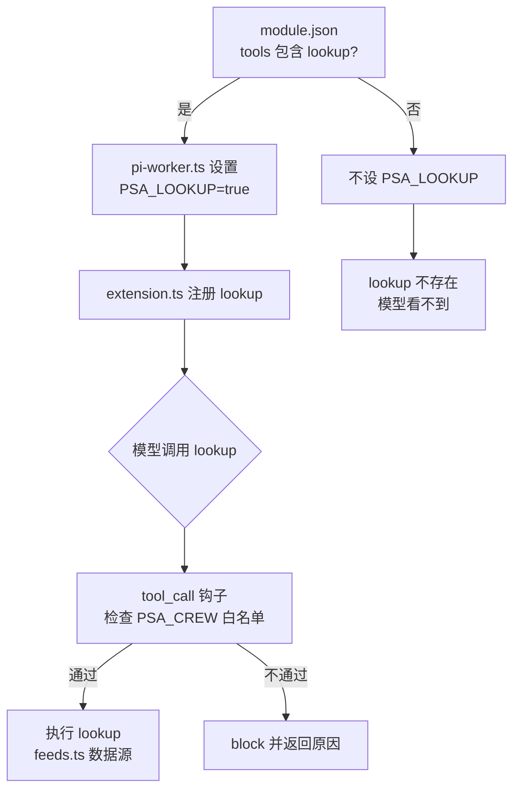

# lookup 工具权限控制：Team 层 + Worker 层两级方案

- 类型：设计 memo
- 日期：2026-11-10
- 来源：使用者的设计思路
- 状态：已实现，见 PR #55 和 ADR-0013。实现和本文有出入，差异和原因见第 8 节
- 说明：第 1 到 7 节的文件路径、变量名和函数名按使用者的描述记录，当时未对照仓库代码核验；实现时的核对结果见第 8 节
- 相关文档：`worker-agent-team-domain-capability-loading.md`、`worker-agent-team-upgrade.md`

---

## 1. 背景

- `lookup` 工具目前在 `src/worker/extension.ts` 里通过 `pi.registerTool` **无条件注册**。
- 它同时被放进 `src/worker/tools.ts` 的三个宽泛列表：`READ_TOOLS`、`INFERENCE_TOOLS`、`MEMBER_TOOLS`。
- 结果是所有 worker 默认都能用 lookup。

**目标**：只有特定 agent team 的成员才能使用 lookup。

---

## 2. 方案一：Team 层的源头控制（三步）

决定工具**存不存在**。

1. **module.json 声明**：在 `module.json` 里新增 `tools` 字段（数组）。team 要用 lookup 就显式写入，不写就没有。

   ```json
   {
     "tools": ["lookup"]
   }
   ```

2. **宿主注入环境变量**：宿主在 `src/host/pi-worker.ts` 拼 worker 子进程的环境变量时，读取该 team 的 `module.json`。
   - `tools` 包含 `lookup`：设置 `PSA_LOOKUP=true`
   - 不包含：不设，或设为 `false`

3. **条件注册**：`extension.ts` 在 `pi.registerTool` 之前判断 `PSA_LOOKUP` 是否为 `true`，只有为 `true` 才注册。

   ```ts
   if (process.env.PSA_LOOKUP === "true") {
     pi.registerTool(lookupTool);
   }
   ```

**效果**：对未授权 team 的 worker 来说，lookup 根本不在工具列表里。模型看不到，也不会尝试调用，没有无效调用。

---

## 3. 方案二：Worker 层的运行时拦截（兜底）

决定工具**能不能调**。

- 不改注册逻辑。在 `extension.ts` 已有的 `pi.on("tool_call")` 策略钩子里加一条规则：调用 lookup 时检查当前 worker 的 `PSA_CREW` 值，对照 team 白名单，不在名单内就 block，并返回原因。

  ```ts
  pi.on("tool_call", (call) => {
    if (call.name === "lookup" && !LOOKUP_ALLOWLIST.has(process.env.PSA_CREW)) {
      return { block: true, reason: "lookup 未对当前 team 开放" };
    }
  });
  ```

| | 方案二的表现 |
|---|---|
| 优点 | lookup 仍然注册，只是调不了；支持动态调整，不需要重启 |
| 缺点 | 工具仍出现在列表里，模型可能先尝试、再被拒，体验略差 |

（代码片段仅为示意，具体接口以 Pi ExtensionAPI 实际签名为准。）

---

## 4. 组合使用：两层互补



- **Team 层（环境变量）**决定工具存不存在，平时靠它，干净利落。
- **Worker 层（`tool_call` 钩子）**是最后一道防线，应对紧急情况。
- 例子：某个 team 开了 lookup，但临时想禁掉其中某个成员，钩子直接 block 即可。

---

## 5. 关键文件

| 文件 | 作用 |
|---|---|
| `src/worker/extension.ts` | lookup 注册点、`tool_call` 策略钩子 |
| `src/worker/tools.ts` | `READ_TOOLS`、`INFERENCE_TOOLS`、`MEMBER_TOOLS` 宽列表 |
| `src/host/pi-worker.ts` | worker 子进程环境变量拼装 |
| `src/host/workers.ts` | worker 管理 |
| `src/sources/feeds.ts` | lookup 数据源实现，`FEEDS` 注册 `massive-stocks` 等 feed |

## 6. 参考文档

- `docs/modules/module-design-review.md`
- `docs/modules/module-skills-memo.md`
- `docs/modules/lookup-discussion-memo.md`

---

## 7. 待确认的问题

1. **宽列表怎么处理**：条件注册之后，`tools.ts` 的三个列表里是否要移除 lookup，或者改成按 `PSA_LOOKUP` 动态拼接？否则列表和实际注册状态可能不一致。
2. **成员级禁用的粒度**：`PSA_CREW` 对照的是 team 白名单，而「临时禁掉某个成员」需要成员级标识。是否要加成员 ID，或者再加一个成员级 blocklist？
3. **白名单放在哪里**：钩子的白名单是从 `module.json` 读取、单独配置，还是支持运行时热更新？这决定「无需重启」能否真正实现。
4. **通用化**：`tools` 字段是否只管 lookup，还是作为所有可选工具的统一声明方式？这和「插件接口标准化」的开放问题相关，见 `worker-agent-team-domain-capability-loading.md`。

---

## 8. 实现和本 memo 的差异（2026-11-10，PR #55）

实现前对照了仓库代码。本文第 1 到 6 节保留原样，下面逐条说明实际做法和原因。决定记录在 `docs/adr/0013-lookup-is-turned-on-by-the-domain.md`。

### 8.1 方案一：开关不用新变量 `PSA_LOOKUP`，沿用 `PSA_LOOKUPS`

- **memo 的写法**：宿主设 `PSA_LOOKUP=true`，扩展看到它才注册 lookup。
- **实际做法**：宿主本来就通过 `PSA_LOOKUPS` 把「可查哪些来源」的说明交给 worker。现在只把它交给能查的进程，扩展拿到它才注册 lookup。领域开了 lookup 但宿主没配数据源时，宿主照样发一句「宿主没有配置可查询的来源」。
- **原因**：再加一个 `PSA_LOOKUP`，就有两个变量要始终保持一致，改一个忘一个就会出错。另外扩展在启动时会把所有 `PSA_*` 变量从 `process.env` 里删掉（`src/worker/extension.ts`），新变量必须在删除之前读，这一点 memo 没有考虑到。

### 8.2 方案一：真正的检查放在宿主，不在扩展里

- **memo 的写法**：在 `extension.ts` 里按条件注册，模型看不到就不会调用。
- **实际做法**：条件注册照做，但它只管模型看不看得见。真正的检查在宿主的 `WorkerExecutor.handleRequest`（`src/host/workers.ts`）：收到 `worker.lookup` 时，助手看任务领域的 module.json 开没开 lookup，成员看它自己的 `tools`，不许就拒绝，数据源收不到请求。
- **原因**：worker 进程里的模型有 `bash`，可以不经过工具，自己往宿主的 socket 发请求。请求和规则任务的助手也没有 `tool_call` 拦截（钩子对它们直接放行）。只靠扩展里不注册，挡不住这类调用。宿主是唯一不受模型控制的地方。

### 8.3 方案一：`module.json` 的 `tools` 要校验，写错启动就报错

- **memo 的写法**：没有提到校验。
- **实际做法**：`tools` 只能写成非空列表，目前能写的只有 `lookup`（清单在 `src/worker/tools.ts` 的 `DOMAIN_GATED_TOOLS`）。写成字符串、空列表或清单外的名字，宿主启动报错，报错以 module.json 的路径开头。
- **原因**：原来的加载代码会悄悄忽略不认识的字段。不校验的话，`"tool": ["lookup"]` 这种拼写错误不会有任何提示，lookup 就是不开。

### 8.4 方案二：不用 `PSA_CREW` 和 `tool_call` 钩子，改用成员文件已有的 `tools` 行，由宿主执行

- **memo 的写法**：在 `tool_call` 钩子里拿 `PSA_CREW` 对照 team 白名单，不在名单内就拦下。
- **实际做法**：成员文件 `agents/*.md` 里本来就有 `tools:` 一行，它就是逐个成员的白名单。成员实际能用的工具是「任务依据允许的」∩「领域开的」∩「成员自己写的」。宿主收到成员的 `worker.lookup` 时，通过 `DispatchDesk.holder` 认出是哪一位成员，再看它的 `tools` 里有没有 lookup。
- **原因**有三条：
  1. **`PSA_CREW` 不是 team 标识。** 它是「助手可以派活的成员名单」，用逗号分隔（`src/host/pi-worker.ts`）。成员进程根本拿不到这个变量，所以 `LOOKUP_ALLOWLIST.has(PSA_CREW)` 永远判断不对。
  2. **钩子在不可信的进程里**，理由同 8.2。
  3. **再加一份名单，就是同一件事有两种做法。** 每位成员的工具会写在两个地方，改一个看不到另一个，迟早对不上。

### 8.5 方案二：改成员权限要重启宿主，不支持热更新

- **memo 的写法**：方案二的优点之一是「支持动态调整，不需要重启」。
- **实际做法**：改成员文件的 `tools`，或改 module.json 的 `tools`，都要重启宿主才生效。
- **原因**：模块（包括成员文件）只在宿主启动时加载一次（ADR-0009）。做热更新等于在 module.json 之外再维护一份可变配置，两份配置会互相打架。memo 设想的紧急场景（临时禁掉某位成员）现在的做法是：删掉那位成员 `tools` 里的 `lookup`，重启宿主。

### 8.6 新增：成员写了 lookup、模块却没开，启动报错

- **memo 没有提到。**
- **实际做法**：成员文件的 `tools` 写了 `lookup`，而它所在模块的 module.json 没开，宿主启动报错，报错以成员文件路径开头，告诉你去 module.json 打开，或者从成员里删掉。
- **原因**：悄悄去掉的话，成员的提示词还以为自己能查，任务会做到一半才发现查不了。启动就报错，问题当场暴露。

### 8.7 新增：没有领域的助手不再有 lookup

- **memo 没有明说。** 目标「只有特定 agent team 的成员才能使用 lookup」推下去的结果就是这样。
- **实际做法**：任务没有领域时，助手拿不到 lookup。没有领域的任务有三种：对话里幕僚长没给领域的、使用者自己 `rules.md` 里的规则开的、所属模块已经删掉的。
- **影响**：本机状态目录没有 `rules.md`，所以第二种目前不存在。本机一共有 4 个没有领域的任务，其中 3 个是查行情，全都开在 2026-11-09 20:34 领域机制合并（#38）之前。合并之后，对话里开的 6 个查行情任务都被幕僚长归到了 us-market。剩下的风险只在于：幕僚长偶尔没给一个查价请求填领域。

### 8.8 已知缺口：偷到令牌可以绕过宿主的检查

- 宿主按 worker 连接时报上的 `ticketId` 和令牌认人，令牌是持有即可用的凭证。令牌放在 worker 启动时的环境变量里，macOS 上同一用户用 `ps eww` 能看到别的进程的启动环境（扩展从 `process.env` 删掉变量，不影响 `ps` 看到的内容）。
- 所以：有 `bash` 的助手可以读到别的任务助手的令牌，用它的身份查数据。成员也可以用自己助手的令牌，绕过成员一级的限制。
- 这个缺口在本次改动之前就有。同一个令牌还能用来汇报、交回和读任务，不只是 lookup。要补，得换掉令牌交给 worker 的方式（例如通过管道而不是环境变量），另开一项处理。

### 8.9 第 7 节待确认问题的答案

1. **宽列表怎么处理**：`tools.ts` 里的 `READ_TOOLS`、`INFERENCE_TOOLS`、`MEMBER_TOOLS` 保留 `lookup`。它们表示「这种依据最多允许什么」，领域开关是另一道限制。`--tools` 里写了一个没注册的工具名，Pi 会直接忽略，不报错，所以两者不会冲突。
2. **成员级禁用的粒度**：用成员文件的 `tools` 行，见 8.4。
3. **白名单放在哪里**：团队一级放在 `module.json` 的 `tools`，成员一级放在成员文件的 `tools`。都在启动时读取，不热更新，见 8.5。
4. **通用化**：`tools` 字段按「领域打开的工具」设计，清单 `DOMAIN_GATED_TOOLS` 目前只有 `lookup`。以后别的工具也要领域打开，加进这份清单就行。

