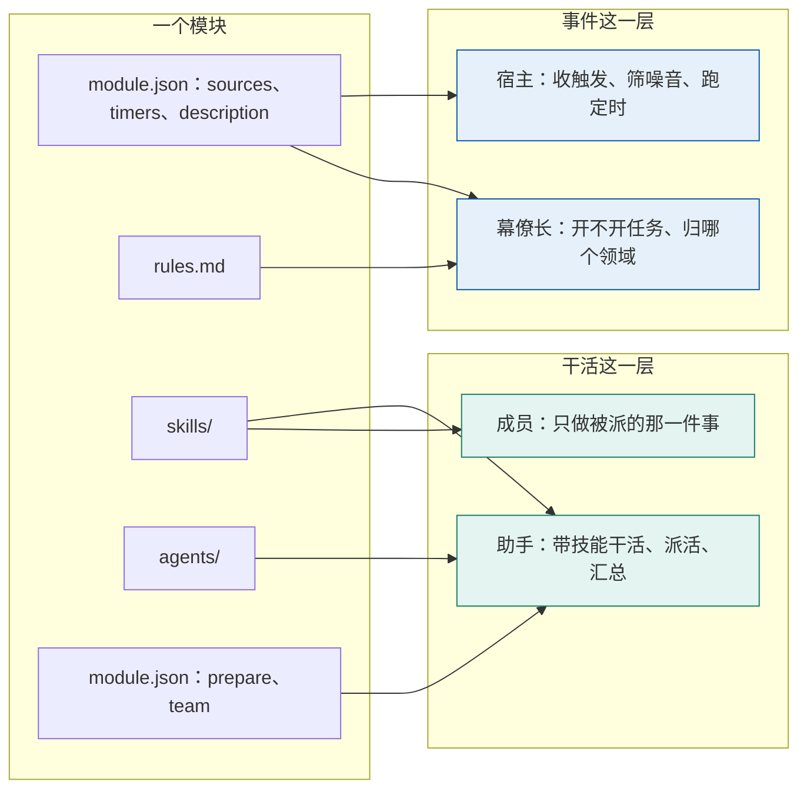
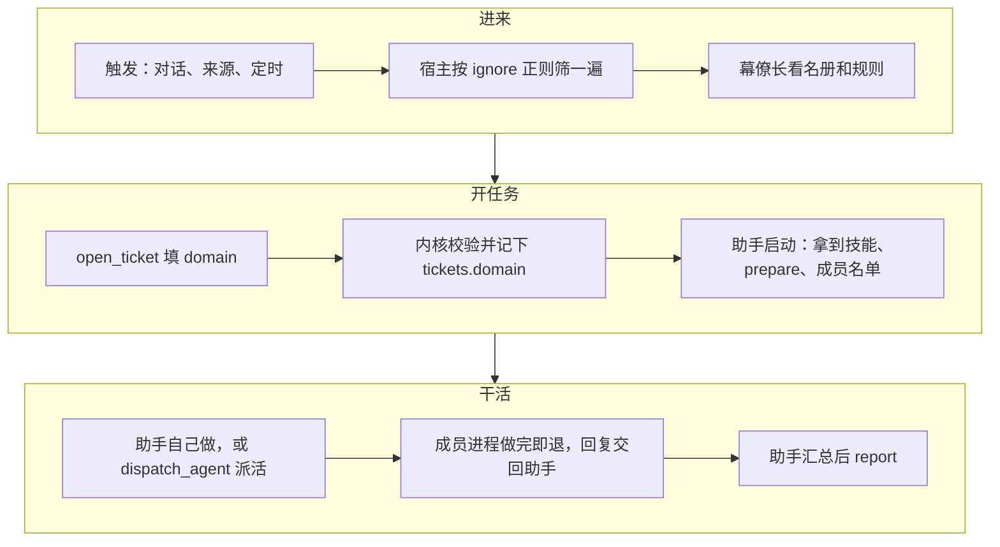

## 摘要

这份文档回答三个问题：领域模块现在是怎么设计和实现的；Pi专家队为什么耗 token、看盘队算不算好；以后想加更多领域的 Agent Team，怎样做才又容易又专业。

结论有四条：

- **模块的骨架是对的。** 一个文件夹就是一个领域，启动时严格校验。纯知识和靠网页的领域，现在不写代码就能加。
- **Pi专家队不适合当范本。** 两个真实任务各用了 389 万和 463 万输入 token，是看盘队最重那个任务的 15 倍以上。原因在队伍的设计，四个原因里有三个只改文字就能缓解。
- **看盘队的设计更适合当范本，但答复质量现在没法判断。** 只有 4 个真实任务，也没有任何评测。
- **加新领域建议用「模板 + AI 辅助 + 评测」，以看盘队为范本。** 真正的门槛是带实时数据的领域，那要写宿主代码，模板帮不上。

文中的数字来自 2026-11-10 的代码（`main` 分支，提交 `8dbc7ee`）和本机状态目录里的真实会话文件。

## 一、模块现在的设计

### 1.1 一句话

一个任务最多属于一个领域，领域就是一个模块，模块就是一个文件夹。这是 ADR-0009 定下的。

模块从两处加载：仓库的 `modules/`，和状态目录的 `~/.pi-super-agent/modules/`。宿主启动时读入并校验全部模块，写错就报一行以文件路径开头的错，宿主不启动。改了模块要重启宿主才生效。

### 1.2 文件夹里有什么

| 文件 | 内容 | 必需 |
|---|---|---|
| `module.json` | 模块清单，见下表 | 是 |
| `rules.md` | 规则。每个二级标题是一条，编号是「模块名/标题」 | 否 |
| `skills/` | 领域知识，Pi 的技能格式。助手和每位成员都拿到 | 否 |
| `agents/*.md` | 成员定义。这个文件夹里的全体成员就是模块的队伍 | 否 |

`module.json` 的字段：

| 字段 | 含义 | 校验 |
|---|---|---|
| `name` | 模块名，也是领域的英文名 | 必须等于文件夹名，不能叫 `user` |
| `title` | 领域的中文名 | 写了 `description` 就必须写 |
| `description` | 给幕僚长看的一句话 | 最多 60 字。不写，幕僚长的名册里就没有这个领域 |
| `team` | 队名，例如「看盘队」 | `agents/` 里有成员时必须写，没有成员时不能写 |
| `sources` | 这个模块关注的来源 | `ignore` 里必须是合法的正则 |
| `timers` | 定时触发 | 无 |
| `prepare` | 助手第一次启动前在任务目录跑一次的命令 | 推断开的任务不跑 |

成员文件是带 frontmatter 的 Markdown，正文就是系统提示词：

| 字段 | 含义 | 校验 |
|---|---|---|
| `name` | 成员的英文名，派活时用 | 小写字母、数字和连字符，模块内不重名 |
| `title` | 中文职称，页面上显示 | 必需 |
| `description` | 给助手看的一句话 | 最多 300 字 |
| `tools` | 成员能用的工具 | 只能从 9 个成员工具里选 |
| `skills` | 成员自己的技能 | 路径必须在成员文件所在目录内 |
| `model` | 成员用的模型 | 提供方必须是幕僚长或助手已经在用的 |

### 1.3 模块服务两类读者

模块的内容分两半，各有各的读者。这是理解整个设计最要紧的一点。

幕僚长只知道领域的名字和一句说明，不认识成员，不拆任务，不汇总。领域里怎么分工是助手的事。

### 1.4 一个任务怎么走

几条要紧的规则：

- **领域由谁定。** 模块规则开的任务，内核强制归规则所在的模块，幕僚长填了别的也会被改回。其余任务由幕僚长在名册里选，填了不存在的领域就拒绝，不填就是没有领域的通用助手。
- **技能跟着领域走。** 不管任务是规则开的还是对话里开的，助手和成员都拿到模块的 `skills/`。
- **有成员才是团队。** 领域有成员时，助手多一个 `dispatch_agent` 工具，提示词末尾附上本队名册，名字用四字名加队名（「高山流水 · 看盘队 #2」）。没有成员的领域是带技能的单个助手。
- **成员是一次性的进程。** 每次派活起一个 `pi -p` 进程，做完就退出。同一任务里再派给同一位成员，它接着自己上次的会话。成员不能再往下派。
- **权限只收窄。** 成员的工具是「任务依据允许的」和「成员自己写的 `tools`」的交集。推断开的任务里，成员即使写了 `bash` 也只读。
- **回复有上限。** 成员的回复超过 2000 字就截断，用随机边界框住，作为数据交给助手。
- **并发和时限。** 全宿主同时最多 4 位成员在跑，其余排队；使用者可以把当天的上限放宽到 10。一次派活限时 15 分钟，能写代码的成员 60 分钟；连续 3 分钟没有动静就结束。

### 1.5 现有三个模块

三个模块正好是三种形态：

| 模块 | 来源和规则 | 技能 | 成员 | 形态 |
|---|---|---|---|---|
| `toy-market` | 有，演示用 | 1 个 | 无 | 带技能的单个助手 |
| `us-market` | 有，真实行情 | 1 个 | 4 位，看盘队 | 来源、规则、知识、团队都有 |
| `pi-pi` | 无 | 1 个 | 9 位，Pi专家队 | 只有知识和团队，只从对话进来 |

### 1.6 模块里放不进去的东西

- **数据来源的代码。** `module.json` 里 `feed.kind` 必须是 `src/sources/feeds.ts` 里登记过的，目前只有 `massive-stocks` 一种。成员的 `lookup` 工具也走同一套。所以要一个新的实时数据源，就得在宿主里写 TypeScript。
- **领域数据。** 案例库、棋谱这类数据还没有位置，ADR-0009 写明等有具体数据时再设计。
- **开关。** 停用一个模块只能删文件夹，或把它所在的目录从 `config.json` 的 `modulesDirs` 里拿掉。PR #27 加了开关和 `just modules`，还没有合并。
- **信道。** 邮件、IM、GitHub 不放进模块，因为它涉及「谁算使用者」，是授权问题。

## 二、Pi专家队为什么耗 token

### 2.1 实测

我查了状态目录里全部领域任务的会话文件。Pi专家队有两个真实任务：开发古诗扩展和开发笑话扩展。

| | Pi专家队 | 看盘队 |
|---|---|---|
| 任务数 | 2 | 4 |
| 每个任务的输入 token | 389 万、463 万 | 4 万到 26 万 |
| 每个任务的输出 token | 3.2 万、4.0 万 | 0.2 万左右 |
| 助手的轮数 | 34、52 | 7 到 15 |

古诗扩展这个任务的 389 万是这样分的：

| 谁 | 轮数 | 新输入 | 缓存读取 | 最大上下文 |
|---|---|---|---|---|
| 助手 | 34 | 7.4 万 | 192.9 万 | 9.1 万 |
| ext-expert（派了 3 次） | 17 | 9.5 万 | 100.6 万 | 9.6 万 |
| tui-expert | 13 | 11.2 万 | 67.8 万 | 9.3 万 |

有一点要说明：**记账里的「输入 token」把缓存读取也算进去了。** 两个任务里没有命中缓存的新输入分别是 28 万和 36 万，只占 7% 到 8%。缓存读取在 Codex 订阅的额度里怎么计，我没有查，所以「389 万」不能直接当成花掉的额度。但不管怎么计，这两个任务都比看盘队重得多。

### 2.2 四个原因

1. **队伍和任务不匹配。** 九位专家是只读的顾问：只有 `read`、`grep`、`find`、`ls`、`web_get`，只回答问题。而两个任务都是「开发一个扩展」。代码全由助手自己写，专家被反复咨询：一个任务派了 5 次，另一个派了 10 次。
2. **回复上限太小，助手只好自己再读一遍。** `ext-expert` 在一个任务里读了约 35 到 40 万字符的文档和源码，只能交回 1800 字以内的答复。助手拿这点内容写不出完整的扩展，于是自己又去读：`extensions.md` 读了 4 遍，`types.d.ts` 读了 5 遍。本队技能里写着「专家已经读过的文档，你不再读一遍」，实际没有做到。
3. **提示词强制重读。** 每位专家的提示词都写着「回答任何问题之前，必须先读最新的文档」。成员在同一任务里是接着上次会话的，文档已经在它的上下文里，但它照这句话第二次、第三次派活时又从头读。`ext-expert` 在一个任务里把 `extensions.md` 从第 1 行开始读了 3 次。
4. **会话越滚越大。** 成员的会话在任务内一直累积。`ext-expert` 的上下文涨到了 10 万 token，之后它的每一轮都带着这 10 万。

还有一个结构上的问题：九位专家是按 Pi 文档的章节切的（扩展、主题、技能、配置……），不是按任务里要做的判断切的。这是原仓库 `pi-vs-claude-code` 的做法，搬过来时只改了工具和回复长度。

### 2.3 怎么改

按「改动大小」从小到大排，建议按这个顺序做，每做一步都重跑同一个任务比一次：

| 改什么 | 改哪里 | 改动 | 针对的原因 |
|---|---|---|---|
| 「本任务里读过的文档不再读，只读还没读过的部分」 | 9 个成员文件 | 只改文字 | 3、4 |
| 技能里写明：写代码的任务由助手自己读文档和动手，专家只回答具体的疑点 | `pi-pi-desk` 技能 | 只改文字 | 1、2 |
| 把常用知识提炼成技能（最小扩展的骨架、常见坑），专家先读技能，不够再读原文 | `skills/` 加文件 | 写内容 | 2、3 |
| 把九位专家并成三四位，按任务切 | `agents/` | 重写成员 | 1 |
| 给长结果一条出路：成员把结果写进任务目录的文件，回复只给路径和摘要 | 宿主 | 改代码 | 2 |
| 记账把缓存读取和新输入分成两列 | 宿主和状态库 | 改代码 | 看不清开销 |

最后两项要改宿主，也都要先由你决定。第五项会让只读的成员能写文件，涉及成员权限，需要一份 ADR。

`keybinding-expert` 是一个现成的对照：它把快捷键的知识直接写在 9KB 的提示词里，不用每次读文档。代价是文档更新后提示词会过时。提炼成技能时要写明依据的是哪个版本的文档。

## 三、看盘队好不好

### 3.1 从设计看，它是更好的范本

| 做法 | 看盘队 | Pi专家队 |
|---|---|---|
| 成员数 | 4 位 | 9 位 |
| 怎么切分 | 按要做的判断：盘面、技术面、新闻、财报 | 按文档章节 |
| 成员提示词 | 约 1.5KB，只写分工和汇报格式 | 2.7KB 到 9KB，写知识清单 |
| 共同知识 | 在技能里：数字从哪来、查多细、回复多长 | 技能只写派活，知识在各自的提示词里 |
| 汇报格式 | 固定三段：结论、证据、来源和时间 | 只限长度 |
| 什么时候不派 | 写明了：只问一个价格就自己查 | 写的是「只问一个主题也派」 |
| 数字 | 程序算好，模型照抄 | 模型读文档后自己写 |

看盘队的技能还处理了几件容易出错的事：行情延迟要写明、查不到就写查不到、两位成员结论冲突时两边都写出来。这些是一支队伍「专业」的地方。

### 3.2 答复质量现在判断不了

我只能从文件判断设计，判断不了它答得对不对、有没有用：

- 真实任务只有 4 个，其中只有 2 个派过活。
- 没有任何评测。没有固定的问题，也没有「答成什么样算好」的标准。

你说「不知道好不好，只知道能跑」，原因就在这里：现在没有东西能量它。这也是加新领域时最缺的一环，下一节的第三条专门讲。

## 四、怎样更容易、更专业地加新领域

### 4.1 新领域分三档

先分清要加的领域属于哪一档，难度差得很远：

| 档 | 例子 | 要写什么 | 要不要改宿主 |
|---|---|---|---|
| 只有知识 | 写作规范、某个工具的用法 | `module.json` 和技能 | 不用 |
| 知识加团队 | 靠网页和文件做研究、审稿 | 再加成员文件 | 不用 |
| 带实时数据 | 行情、监控、任何要 `lookup` 的 | 再加来源的代码 | 要，在 `src/sources/` 写 TypeScript 并登记 |

前两档现在就能做，缺的是顺手的工具和好的范本。第三档是真正的门槛。有一条折中的路：模块可以带一个外部脚本，往 `inbox/` 投触发（`toy-market` 就是这么做的），这样不用改宿主也能有事件进来，只是没有 `lookup`。

### 4.2 建议：模板 + AI 辅助 + 评测

你问是不是用「模板 + AI 辅助」。我的建议是：是，但要再加一样评测，而且范本用看盘队。只有模板和 AI，能很快生成一支看起来像样的队伍，但你还是不知道它好不好。

**第一，更新脚手架。** PR #27 的 `just module-new` 是 ADR-0009 之前写的，现在已经对不上：

- 不生成 `title`、`description`，生成出来的模块幕僚长看不到。
- 不生成 `team` 和 `agents/`。
- 技能说明里写着「处理本模块规则开出的任务时加载」，现在技能是跟着领域走的。

合并 PR #27 之前先把它改对，并让它分两种：`just module-new NAME` 生成只有技能的模块，加 `--team` 再生成共同技能的骨架和一位示例成员。

骨架照看盘队的技能分节，这几节任何领域都用得上：

- 事实从哪里来，什么不能编。
- 查多细，一次查多少。
- 回复多长，什么格式。
- 什么问题派给谁，什么问题不派。
- 成员意见冲突怎么写。
- 汇总的答复怎么写。

**第二，写一个建模块的技能。** 它在 Claude Code 或 Pi 里用，做三件事：

1. 问你几个问题：这个领域管什么、不管什么；三到五个典型问题；事实从哪里来；这些问题里有没有可以并行、或需要不同工具的部分。
2. 按回答生成 `module.json`、共同技能和成员文件。
3. 跑一遍加载校验，把报错修掉。

现有的校验很严，报错都带文件路径和改法，正好兜住 AI 写错的地方。

**第三，每个模块带几道固定的考题。** 这是「专业」的来源。建议在模块里加一个 `evals/`（或一份 `evals.md`），每道题写：

- 问题，用使用者的原话。
- 检查点，能用程序查的优先：写没写来源和时间、是否按固定格式、是否派给该派的成员、用了多少 token。
- 需要人看的那部分，写成一两句「好的答复应该做到什么」。

有了考题，改提示词、换模型、合并成员之后都能重跑，比较前后。第二节那张改进表里的每一步，就是靠它判断有没有用。这一项要设计，需要一份 ADR：考题放在哪、怎么跑、用真模型还是只查结构。

**第四，把分寸写进模板。** 模板的注释和建模块的技能里都写明：

- 先做只有技能的单个助手。确有可以并行的部分，或需要不同的工具和数据时，才加成员。
- 成员 2 到 4 位，按要做的判断切，不按资料的章节切。
- 知识放技能，成员的提示词只写分工、判断方法和汇报格式，1 到 2KB。
- 技能里写明什么时候不派。
- 每位成员的汇报格式固定，并写明长度。成员的回复超过 2000 字会被截断。

### 4.3 不建议的做法

- **照搬 Pi专家队。** 按文档章节切出很多只读顾问，会把第二节的问题一起复制过去。
- **只让 AI 生成，不留考题。** 生成很快，但之后每次改动都只能凭感觉。
- **现在就做模块市场、成员跨模块复用、一个模块多支队伍。** ADR-0009 已经写明目前没有用例。

## 五、建议的顺序

| 顺序 | 做什么 | 改动 | 为什么排在这里 |
|---|---|---|---|
| 1 | Pi专家队：改成员提示词和技能里的两处文字，重跑一次扩展任务比较 | 只改文字 | 最小，马上能看到差别 |
| 2 | 定下考题的设计（ADR），先给看盘队和 Pi专家队各写三五道 | 设计加内容 | 后面每一步都靠它判断 |
| 3 | 更新脚手架，合并 PR #27 | 小段代码 | 加新模块的入口 |
| 4 | 写建模块的技能，用它建一个新的「知识加团队」领域试一次 | 写技能 | 验证模板和范本够不够用 |
| 5 | Pi专家队：提炼知识进技能，并成三四位成员 | 重写内容 | 有了考题才知道并得对不对 |
| 6 | 成员把长结果写进文件；记账分开缓存读取 | 改宿主 | 改动最大，要 ADR |

## 六、需要你决定的事

1. **顺序。** 上面的顺序可以吗？尤其是「先定考题，再动脚手架」。
2. **Pi专家队保留九位还是并成三四位。** 并了之后和原仓库的差别更大，`NOTICE.md` 要跟着改。
3. **成员能不能往任务目录写文件。** 这是给长结果的出路，但会放宽只读成员的权限。
4. **考题用什么模型跑。** 真模型要花订阅额度；只查结构的假模型不花，但查不了答得对不对。
5. **第一个新领域选什么。** 建议选一个不需要实时数据的，用来验证模板。
6. **带实时数据的领域要不要降低门槛。** 例如让模块自带来源的代码。这会让模块里的代码跑在宿主进程里，是安全上的决定，现在不建议做。

## 附：依据

| 类别 | 依据 |
|---|---|
| 设计 | `docs/adr/` 下的 ADR-0008、0009、0010 |
| 模块加载 | `src/modules.ts`、`src/teams.ts` |
| 助手和成员 | `src/host/workers.ts`、`src/host/pi-worker.ts`、`src/host/dispatch.ts`、`src/worker/tools.ts` |
| 领域校验 | `src/kernel/kernel.ts` |
| 数据来源 | `src/sources/feeds.ts` |
| 现有模块 | `modules/us-market`、`modules/pi-pi`、`modules/toy-market` |
| 脚手架 | PR #27（分支 `psa/modules-admin`，未合并）的 `src/cli/module-new.ts` |
| 用量 | 状态目录的 `state.db`（`tickets` 表），以及 `sessions/workers/` 和各任务 `team/` 目录下的会话文件 |

用量的核对：每个任务里助手和各成员的「新输入加缓存读取」相加，和 `tickets.tokens_in` 完全对得上。
