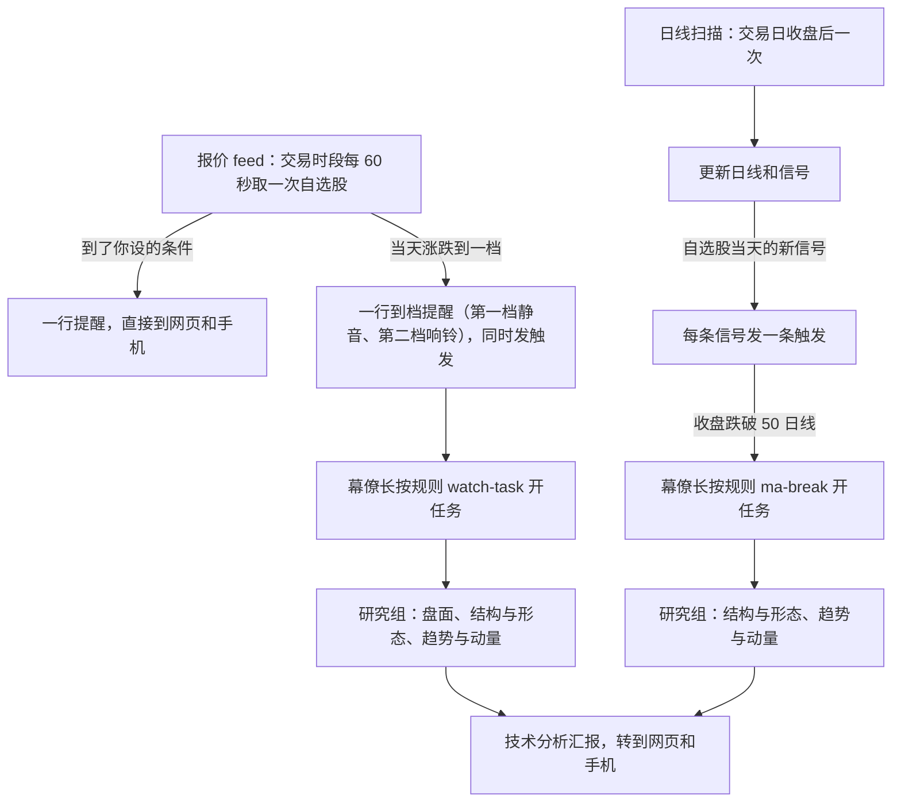

# 股票技术分析模块使用手册：你这样问，会得到什么

# 读这本手册之前

这本手册写给每天用 Pi Super Agent 看美股的你。它只讲一个模块，股票技术分析（stock-ta），按「你这样问，会得到什么」来组织。每一章先给几句可以直接照抄的问法，再说谁来回答、大概多久、回答长什么样，最后说它做不到什么。第 2 章讲自动规则：你不问时它盯着什么、会告诉你什么，这是全书最要紧的一章。第 10 章讲你怎么改它。

**例子是真跑出来的。** 书里带「实测」标记的回答，都是 2026-11-13（周五）美东收盘以后，在笔记本上起一个临时宿主、装上真实的 stock-ta 包、连真实的 Massive 和 Finnhub 数据问出来的。模型是 Codex 订阅里的 openai-codex 系列。那时美股已经收盘，所以报价都是**收盘后的盘后价**，数据时间写的是美东 16:1x，时段写「盘后」。你在交易时段问，得到的是盘中价，形式一样。回答为了排版做了删节，删掉的地方用「……」标出，数字和措辞没有改。

**几个词。** 你在网页或 Telegram 上对话的对象是幕僚长（Router）。幕僚长把股票问题交给 stock-ta 的**领队**，领队要么自己答，要么派给技术分析研究组里的**专家**。专家只用模块自己的工具和笔记说话。

**例子里的代码。** 个股多用 NVDA、TSLA、GOOG、MSFT，指数和 ETF 用 QQQ。SPCX 这个代码在 Massive 上查得到（实测 2026-11-13 收盘后 138.48 美元），但它不在测试用的自选股里，所以书里拿它当「自选股以外的代码」的例子：问价可以，问技术面要先加进自选股。

**它不是投顾。** 所有回答都是技术分析，不是交易指令。它不下单，不碰你的券商账户，不承诺收益。


# 它和 ChatGPT 问答有什么不同

ChatGPT 这类问答，你问一句它答一句，你不问它就不动，它怎么答也不归你管。stock-ta 有两点不一样。

**它是主动的。** stock-ta 是一直在运行的 Pi Super Agent 的一部分。交易时段它每 60 秒看一遍你的自选股，到了你设的线就往网页和手机发一行提醒。自选股里一只（或者 SPY、QQQ）当天涨跌到一档，它先发一行提醒，再自己开一个分析任务，几分钟后把技术分析汇报推给你。每个交易日收盘后，它自己把日线和信号更新好。你什么都不说，这些也在发生。哪些规则今天就在跑、哪些已经定了还没做、每条命中以后你会收到什么，都在第 2 章。

**它是一个模块，可以边用边改。** stock-ta 是装在你机器上的一个文件夹，规则、专家的提示词、技能、盯盘规则表（`watch-rules.ts`，到档的默认档位写在这里）都是里面的文件。你在对话里改的层级和门槛存在 `rule-levels` 集合里，不在包里。改一个文件存盘，宿主约一秒内检查并换上新版本，不用重启；检查不过，旧版本照常服务。也可以在对话里让模块工坊替你改。第 10 章讲怎么改、怎么先检查、怎么退回。


# 一页速查卡

| 你想知道 | 这样问 | 谁来答 | 多久 | 你会得到 |
|-------|---------------|-------|----|----------------|
| 现价、涨跌 | 「NVDA 现在多少」「QQQ 今天跌了多少」 | 领队自己答 | 约 20 秒 | 价格、较昨收涨跌幅、数据时间（美东）、时段、延迟 15 分钟 |
| 离某个价位多远 | 「NVDA 离 170 还有多远」 | 领队自己答 | 约 20 秒 | 现价、差多少美元、差百分之几 |
| 支撑阻力、形态 | 「NVDA 的支撑在哪」「GOOG 有没有在做双底」 | 结构与形态 | 2 到 3.5 分钟 | 最近的支撑区和阻力区、离现价百分比、突破回踩状态、笔记出处 |
| 趋势、均线、MACD、九转 | 「NVDA 趋势怎么样」「TSLA 的 MACD 有没有背离」 | 趋势与动量 | 2 到 3.5 分钟 | 均线排列、MACD 位置、九转计数、道氏结构、相对 QQQ 强弱 |
| 当天是个股还是板块 | 「NVDA 今天跌了 3%，是个股还是板块」 | 盘面 | 1 到 2 分钟 | 结论、个股和 SPY/QQQ/板块的差值、几点急动、VWAP、数据时间 |
| 止损、目标、盈亏比 | 「在 162 买 NVDA 止损放哪」 | 风险与交易计划 | 2 到 3.5 分钟 | 失效位、止损距离、盈亏比、下一次财报日和跳空风险 |
| 大盘环境、能不能抄底 | 「QQQ 大盘环境怎么样，能不能抄底」 | 市场情绪 | 2 到 3.5 分钟 | QQQ/SPY 结构和动能，按笔记讲抄底条件 |
| 最近的信号 | 「自选股最近有哪些信号值得看」 | 信号分诊 | 2 到 3.5 分钟 | 一张信号简表，挑两三条值得看的 |
| 价格提醒 | 「NVDA 跌破 150 提醒我」 | 领队记下条件 | 10 到 40 秒 | 确认已设；条件满足时网页和手机提醒你 |
| 当天涨跌提醒 | 「NVDA 当天涨跌超过 2% 提醒我，用 day-move，按昨收算」 | 领队记下条件 | 10 到 40 秒 | 同一天同一方向只一次；不说 day-move 可能被设成固定价（第 7 章） |
| 改自选股 | 「把 AMD 加进自选」「把 TSLA 划掉」 | 领队 | 约 15 秒 | 下一轮报价就用新名单 |
| 新闻、原因 | 「NVDA 最新新闻」 | 通用助手（不是 stock-ta） | 约 3 分钟 | stock-ta 只报涨跌，原因请另问新闻 |
| 不问也替你看着 | 什么都不用说 | 宿主和研究组 | 每 60 秒 | 今天：条件到线、涨跌到档各一行提醒；到档和收盘跌破 50 日线自动出分析汇报；出了问题一行通知。已定的规则和每条的状态见第 2 章 |
| 改它的做法 | 改包里的文件，或说「帮我改 stock-ta」 | 宿主、模块工坊 | 约 1 秒 | 不用重启；检查不过旧版本照常（第 10 章） |

**三条记牢。**

1. 价格延迟 15 分钟，回答里一定写数据时间。
2. 技术面只算日线和周线，数据是每个交易日收盘后扫一次的。盘中问技术面，用的是上一个收盘。
3. 技术面只对自选股有数据。新代码先「加进自选」，等下一次收盘后的扫描。


# 第 1 章　它是谁，里面有什么

## 一个领队，六位专家

stock-ta 的队名叫「技术分析研究组」。领队按问题分活，几件事可以同时派，再汇总。

| 专家 | 管什么 | 你可以这样叫它 |
|---|---|---|
| 结构与形态 | 支撑阻力区、突破与回踩、通道、缺口、双底头肩等形态候选 | 「NVDA 的支撑阻力在哪」「突破站稳了吗」 |
| 趋势与动量 | 均线排列、MACD、九转、道氏高低点、相对 QQQ/SPY 的强弱 | 「TSLA 现在什么趋势，动量强不强」 |
| 信号分诊 | 自选股最近的技术信号、关注度、持续状态 | 「今天有哪些信号值得看」 |
| 市场情绪 | QQQ、SPY 的趋势和强弱，抄底的条件 | 「大盘环境怎么样，能不能抄底」 |
| 风险与交易计划 | 止损、目标、盈亏比、分批，查下一次财报日 | 「在 162 买 NVDA 止损放哪」 |
| 盘面 | 当天的涨跌是个股还是大盘、板块，几点急动，量在哪段 | 「今天跌这么多是个股还是板块」 |

只问价格时领队不派专家，自己调一次报价工具就答，所以快。

## 工具

专家只能用分给自己的工具。你不用记工具名，但知道它们能做什么，就知道该怎么问。

| 工具 | 做什么 | 联网吗 | 关键限制 |
|---|---|---|---|
| `quote` 现价快照 | 现价、昨收、涨跌幅、成交量、数据时间、时段 | 是，Massive | 一次 1 到 10 个代码；自选股以外也能查；延迟 15 分钟 |
| `intraday` 分钟线和小时线 | 当天的跳空、急动时刻、反弹、VWAP | 是，Massive | 最多回看 4 个交易日，一次最多 500 根 |
| `earnings-date` 下一次财报日 | 日期、盘前或盘后、离今天几个交易日 | 是，Finnhub | 只看 120 天内；只回日期，不回预期和业绩；ETF 没有 |
| `structure` 支撑阻力与结构 | 支撑阻力区、突破回踩、通道、形态候选、缺口、成交量分布、动能 | 否，读模块数据库 | 只有自选股和 QQQ、SPY；日线或周线 |
| `signals` 技术信号 | 已算出的信号，带规则、方向、数据时间、关注度、笔记出处 | 否 | 只有日线 1d 和周线 1w |
| `conditions` 规则状态 | 持续满足的状态，例如「在 MA200 上方」，持续了几根 | 否 | 状态不是新信号 |
| `prices` 缓存里的最新价 | 数据库里的收盘价和是否过期 | 否 | 是日线收盘，不是现价 |
| `rules` 规则定义 | 每条规则的参数、周期、冷却期和出处 | 否 | 只读，不改参数 |
| `note` 笔记原文 | 按「TA02」或「TA02#标题」取一篇或一节 | 否 | 要先导入笔记 |
| `risk-reward` 盈亏比 | 给开仓、止损、目标，算盈亏比、止损距离、几个 ATR | 否，纯计算 | 不心算，一律用它 |
| `hits` 当天命中 | 盯盘规则这几天的命中（第 2 章）：规则、方向、层级、事实、那一行的原文，升没升级、是不是来回翻 | 否，读命中文件 | 「待部署（第 2 期）」；只有报价 feed 盘中算的规则 |

## 它自己会做的事

报价、条件提醒、到档提醒和自动分析、收盘后扫描和跌破 50 日线的自动分析、出了问题告诉你，你不问它也在做。以后还会加放量、52 周新高新低、200 日线、持仓止损和收盘小结。第 2 章专门讲，每条规则都标了今天有没有上线。


# 第 2 章　自动规则：它自己盯什么，会告诉你什么

别的章都是「你这样问」。这一章反过来讲你什么都不说时它盯着什么，每条规则命中以后你会在网页和手机上看到什么，以及很多条嘈杂的信号怎样收成少数几条值得看的提醒。手册里别的章讲到主动行为时都指回这一章。

**先看状态。** 这一章写的不全是今天就有的。2026-11-13 你定下了一整套盯盘规则，设计写在 [stock-ta 盯盘规则和事件层级设计](stock-ta-rules-design.md) 里，分五期做，大部分还没写代码。所以每条规则、每个层级都带一个状态：

| 状态 | 意思 |
|---|---|
| 「已上线」 | 主干上已经合并，旧 Mac 部署以后就在跑，你可以依赖。第 1 期（规则表、第一档静音、在对话里改档位）合并以后要等你说「部署」，旧 Mac 才换上 |
| 「待部署（第 N 期）」 | 代码写好、测过，在第 N 期的 PR 里。合并、你说「部署」、旧 Mac 换上以后改成「已上线」 |
| 「已定，待实现（第 N 期）」 | 你已经拍板，排在五期计划的第 N 期，还没上线 |
| 「待定」 | 还没拍板，下文写的是建议，不是定论 |

有些细节是设计替你定的，你没有逐条拍板，例如某条新规则的默认层级。这些标「设计稿的做法」，你不同意可以直接说。

## 一页总览

「层级」一栏的数字见下一节「事件层级」。到档和 50 日线以外的规则都还没上线，表里的层级是上线以后的默认值。门槛是 2026-11-13 从历史数据测的（设计第 5 节）。

| 规则 | 盯什么 | 什么时候算 | 层级，你会看到什么 | 状态 |
|---|---|---|---|---|
| 你设的盯盘条件 | 你在对话里给一只票设的线（第 7 章）。它不是规则表里的规则 | 交易时段，每存一行报价 | 一行响铃提醒，不开任务 | 「已上线」 |
| 到档第一档 `move-1` | 个股当天相对昨收涨跌 5%，SPY、QQQ 2% | 交易时段每 60 秒 | 5 层：一行静音提醒加一个三人分析任务 | 「已上线」 |
| 到档第二档 `move-2` | 个股 8%，SPY、QQQ 3% | 交易时段每 60 秒 | 5 层：一行响铃提醒，并进第一档开的同一个任务 | 「已上线」 |
| 收盘跌破 50 日线 `R-MA-2-50:down` | 收盘价从 50 日均线上方跌到下方 | 收盘后的扫描 | 今天是 5 层，不发提醒行，开两人分析任务。以后改成 2 层静音一行，进收盘小结，不再开任务 | 「已上线」（开任务）。改 2 层「已定，待实现（第 3 期）」 |
| 收盘站上 50 日线 `R-MA-2-50:up` | 收盘价从下方站上 50 日均线 | 收盘后的扫描 | 今天发一条触发，幕僚长一般不开任务。以后 0 层，只记录 | 「已上线」。改 0 层「已定，待实现（第 3 期）」，设计稿的做法 |
| 数据出问题 | 没有密钥、取不到报价、报价旧了、扫描失败 | 每一拍 | 一行通知，同一个问题只说一次 | 「已上线」 |
| 盘中放量 `volume` | 当天累计成交量到 20 日均量的 3.5 倍，均量按已经过去的交易时段折算。美东 10:30 以前不算 | 交易时段每 60 秒 | 2 层静音，进收盘小结 | 「待部署（第 2 期）」 |
| 52 周新高 `high-52w` | 当天最高价高过此前 252 个交易日的最高 | 交易时段每 60 秒 | 2 层静音，进收盘小结 | 「待部署（第 2 期）」 |
| 52 周新低 `low-52w` | 当天最低价低过此前 252 个交易日的最低 | 交易时段每 60 秒 | 3 层响铃，进收盘小结 | 「待部署（第 2 期）」 |
| 组合：放量加 52 周新高或新低 | 同一只票同一天两条都命中，而且方向一致（放量上涨加新高，放量下跌加新低） | 交易时段每 60 秒 | 5 层，开三人分析任务。新高那一行静音，新低那一行响铃 | 「待部署（第 2 期）」 |
| 收盘站上或跌破 200 日线 `R-MA-2-200` | 收盘价穿过 200 日均线 | 收盘后的扫描 | 5 层。不发提醒行，开两人分析任务 | 「已定，待实现（第 3 期）」 |
| 组合：收盘放量加跌破 50 日线 | 同一天收盘量大，又跌破 50 日线 | 收盘后的扫描 | 5 层，开两人分析任务 | 「已定，待实现（第 3 期）」 |
| 组合：收盘放量加 200 日线 | 同一天收盘量大，又穿过 200 日线 | 收盘后的扫描 | 不另开任务，200 日线的任务里写「放量确认」 | 「已定，待实现（第 3 期）」 |
| 大盘日合并 | SPY 或 QQQ 当天已经到档 | 交易时段每 60 秒 | 之后个股到档不再各开一个任务，并进指数的「大盘日」任务 | 「待部署（第 2 期）」 |
| 收盘小结 | 当天 1 到 4 层的命中和已开的任务 | 收盘后约 20 分钟 | 4 层，一行静音 | 「已定，待实现（第 3 期）」 |
| 波动 `vixy-1`、`vixy-2` | VIXY 当天涨 10%、20%，代替 VIX | 交易时段每 60 秒 | 第一档 2 层静音；第二档 5 层，开盘面一人的任务 | 「待部署（第 2 期）」，层级是设计稿的做法 |
| 组合：VIXY 第一档加 SPY 或 QQQ 到档 | 同一天波动和大盘一起到档 | 交易时段每 60 秒 | 不另开任务，指数的任务里写「VIXY 同日涨 +12.30%」这样一句；VIXY 后到时它那一行写「同日 SPY 已到 -2% 档」 | 「待部署（第 2 期）」，设计稿的做法 |
| 持仓：触到止损线 `stop-loss` | 价格触到你的止损线，没设时是成本 −8% | 交易时段每 60 秒 | 6 层。一行响铃，再来一张问你的卡片 | 「已定，待实现（第 4 期）」 |
| 持仓：回撤 `drawdown` | 从建仓以来的最高点回撤 15% | 交易时段每 60 秒 | 3 层响铃 | 「已定，待实现（第 4 期）」 |
| 持仓：跌破成本 `below-cost` | 价格跌破成本价 | 交易时段每 60 秒 | 2 层静音 | 「已定，待实现（第 4 期）」 |
| 开盘跳空 `gap` | 开盘相对昨收跳空 3% 以上 | 交易时段 | 1 层，先只记下（页面标记第 5 期） | 「待部署（第 2 期）」，门槛和层级是设计稿的做法 |
| 盘中反转 `reversal` | 盘中曾涨（跌）3% 以上，之后翻成跌（涨） | 交易时段 | 1 层 | 同上 |
| 相对强弱背离 `rel-strength` | 个股和 QQQ 当天方向相反，差 3 个百分点以上 | 交易时段 | 1 层 | 同上 |
| 50 日和 200 日均线金叉死叉 `cross-50-200` | 50 日均线上穿或下穿 200 日均线 | 收盘后的扫描 | 2 层静音 | 「已定，待实现（第 3 期）」，层级是设计稿的做法 |
| RSI 70/30 `rsi` | RSI(14) 上穿 70 或下穿 30 | 收盘后的扫描 | 1 层 | 同上 |
| 财报临近 `earnings` | 下一次财报在 5 个交易日内，一次财报只报一次 | 收盘后的扫描 | 1 层 | 同上 |
| `ta` 的重点信号 `ta-key` | 形态（`R-PAT-*`）、道氏趋势结束（`R-DOW-1-UE`、`-DE`）、九转 13（`R-TD-2`）、MACD 背离（`R-MACD-3`） | 收盘后的扫描 | 1 层 | 同上 |
| `ta` 的其余信号 `ta-other` | 支撑阻力、EMA 8/21、MACD 其余几条、九转 9 等 | 收盘后的扫描 | 0 层，只记录 | 今天存进库、等你来问是「已上线」。0 层的记法「已定，待实现（第 3 期）」 |

到档第一档、跌破 50 日线、站上 50 日线、大盘日合并这四行，上线以后会改掉今天的行为，见下文「会改掉今天行为的决定」。开盘跳空、盘中反转、相对强弱、金叉死叉、RSI、财报临近，这些「常用规则都要能支持」是你定的。门槛和层级是设计稿提的，上线以后可以照下文「在对话里改一条规则的层级」改。

## 事件层级：命中以后做到哪一步

每条规则有一个层级，从 0 到 6。数字越大越打扰你。一次命中只取一个层级。

| 层级 | 名字 | 网页上 | 手机（Telegram）上 | 进收盘小结 | 叫醒幕僚长 | 状态 |
|---|---|---|---|---|---|---|
| 0 | 只记录 | 不显示。你问「今天有哪些信号」时列出来 | 无 | 只写条数 | 否 | 「待部署（第 2 期）」 |
| 1 | 页面标记 | stock-ta 的模块卡片上按代码列出当天的标记，例如「NVDA · 52 周新高 · 放量」 | 无 | 是 | 否 | 卡片标记「已定，待实现（第 5 期）」。在那之前先记下，第 3 期起进小结 |
| 2 | 静音提醒 | 「今天」里多一行，不高亮 | 一行，手机不响 | 是 | 否 | 静音的一行「已上线」（到档第一档那一行就是这样发的）。单独的 2 层规则（放量、52 周新高、VIXY 第一档）「待部署（第 2 期）」 |
| 3 | 响铃提醒 | 「今天」里多一行，高亮 | 一行，手机响 | 是 | 否 | 「已上线」。到档第二档那一行和你设的盯盘条件是这一层 |
| 4 | 收盘小结 | 收盘后约 20 分钟一行小结 | 一行，手机不响 | 它就是小结 | 否 | 「已定，待实现（第 3 期）」 |
| 5 | 自动开分析任务 | 任务卡片，几分钟后汇报全文 | 汇报全文。规则写了的话先来一行静音或响铃的提醒 | 写「已开任务」 | 是 | 「已上线」（到档、跌破 50 日线）。到档照规则表派人「已上线」，跌破 50 日线第 3 期搬进规则表 |
| 6 | 问你 | 任务里一张问题卡片，2 到 4 个按钮 | 同一张卡片，带按钮 | 写「已开任务」 | 是 | 「已定，待实现（第 4 期）」 |

几点要知道：

- **只有 5、6 层花模型调用。** 0 到 4 层由模块自己处理，不叫醒幕僚长。所以多开几条低层级的规则，不多花钱。
- **6 层的卡片只提议，由你决定。** 卡片可以提议改自选股、持仓或某条规则的层级。你点了按钮才写，这和「只有你能改自选股」（ADR-0024）不冲突。卡片改不了你的盯盘条件：宿主只让听过你本人说话的对话任务改条件（ADR-0003）。要改条件时，卡片的选项写成你要在对话里说的那句话。
- **永远没有「自动下单」这一层。**

## 组合升级：把嘈杂的信号收成少数提醒

规则一多，信号就多。组合升级是把它们收拢的主要办法。它只看**同一只票、同一天**的命中，先看事先定义好的组合，没对上再看同向共振。

报价 feed 里的这一套「待部署（第 2 期）」，收盘的两条（50 日线、200 日线）在第 3 期。

**每条命中都有方向。** 52 周新高、向上跳空、盘中由跌翻涨、个股逆着 QQQ 涨是看多，反过来是看空。放量的方向跟命中那一刻当天的涨跌走，平盘时没有方向。VIXY 涨算看空。

**定义好的组合。** 前三个是你定的，200 日线和 VIXY 两个是设计稿的做法。

| 组合 | 结果 | 期 |
|---|---|---|
| 放量（上涨）加 52 周新高 | 5 层：一行静音，开三人分析任务 | 第 2 期 |
| 放量（下跌）加 52 周新低 | 5 层：一行响铃，开三人分析任务 | 第 2 期 |
| 收盘放量加跌破 50 日线 | 5 层：开两人分析任务。单独跌破 50 日线只是 2 层静音 | 第 3 期 |
| 收盘放量加 200 日线突破 | 不另开任务。200 日线的任务里写「放量确认（成交量是 20 日均量的 2.4 倍）」 | 第 3 期 |
| VIXY 第一档加 SPY 或 QQQ 到档 | 不另开任务。指数的任务里写「VIXY 同日涨 +12.30%」 | 第 2 期 |

凑成组合的那一条不另发一行，组合那一行把两条的事实都写上。

**同向共振。** 你 2026-11-13 定的。同一只票同一天，第二条 1 到 3 层的命中进来时：

- 前面的命中**方向相同**，这一行升一层：1 变 2，2 变 3，最多升到 3 层响铃。那一行写明「AMD 今天第 2 条同向信号，前一条是开盘跳空（看多），升一层」。
- 前面有**方向相反**的，不升，那一行写「多空分歧：前一条是 52 周新高（看多）」。
- 没有方向的命中不算。

几种情况不升。这几条是设计稿的做法：

- **这只票今天已经开了任务。** 任务已经在看它了，后来的命中照自己的层级走。不这样的话，第一档改静音的决定会落空。实测两年里个股到 5% 的 177 天里有 62 天同时放量，几乎每次到档都会被放量升成响铃。
- **这只票今天已经升过一次。**
- **0 层的命中不算数。** 今天 `ta` 每个交易日给 10 只票出大约 11 条信号（实测）。把 0 层也算进去，几乎每只票每天都会升级。

**来回翻降成只记录。** 你 2026-11-13 定的。开盘跳空、盘中反转、逆大盘这三条，同一只票在最近 10 个交易日里方向翻了 3 次以上，这一次降到 0 层，不推送，只记一句「NVDA 开盘跳空近 10 个交易日反复 3 次」。一年回放里降下来的几乎都是逆大盘，每个交易日约 0.2 条。

**每一行都写理由，理由是事实。** 你 2026-11-13 定的。推送的一行先写命中的事实，再写当天涨跌和这只票今天的其他命中，例如「NVDA 创 52 周新高 112.30（此前最高 110.00）。当天涨 +4.00%。同日：放量 3.8 倍。」不写分数，也不写胜率。

**只用当时知道的。** 一条命中在发生那一刻定好层级，以后不改。下午的事不会回头把上午那一行改成响铃。

下面五个例子是示意，代码和数字是编的，机制照设计。

**例一：放量加新高，开任务。** NVDA 11:20 创 52 周新高，你收到一行静音提醒。13:05 它还在涨，累计成交量过了放量门槛。这两条对上了「放量加 52 周新高」，于是这一次是 5 层：再来一行静音提醒，同时开一个三人分析任务，几分钟后汇报到你手上。没有这个组合，你只会收到两行静音提醒，没有人去细看。

**例二：收盘确认，只多一句话。** META 收盘跌破 200 日线，收盘后的扫描给研究组开了两人任务。当天收盘量是 20 日均量的 2.4 倍，对上「收盘放量加 200 日线突破」。结果不是第二个任务，也不是第二行提醒，而是任务说明里多一句「放量确认（成交量是 20 日均量的 2.4 倍）」，汇报会把它写进去。（第 3 期）

**例三：两条同向的小信号，升成响铃。** AMD 开盘向上跳空 3.5%，这是 1 层，只记下。上午 AMD 创 52 周新高，本来是 2 层静音。它是 AMD 今天第 2 条同向的命中，也没有对上定义好的组合，所以升一层，手机响：「AMD 创 52 周新高 ……。同日：开盘跳空 +3.50%。AMD 今天第 2 条同向信号，前一条是开盘跳空（看多），升一层。……」

**例四：任务已开，不升。** TSLA 上午跌 5.3%，第一档开了任务。下午 TSLA 放量，这一行照 2 层静音发，不升成响铃，也不另开任务。研究组已经在看 TSLA。

**例五：方向相反，写分歧。** NVDA 上午创 52 周新高（看多），一行静音。下午它跌回昨收以下，成交量过了放量门槛，这次放量是看空。两条方向相反，不凑「放量加新高」，也不升层，放量那一行照 2 层静音发，后面写「多空分歧：前一条是 52 周新高（看多）」。

## 冷却、合并和免打扰

这三个修饰是你定的，细节写在设计里。

**冷却：同一只票同一条规则，一天一次。**

- 「已上线」的部分。到档每只每个方向每天只升不降：回落再上来不重报，跳空直接到 8% 只报 8% 档。你的 `day-move` 条件同一天同一方向只响一次。
- 「已定，待实现」的部分。每条新规则跟着它那一期上线，一只票一天只算一次。财报临近按财报日期算，一次财报只报一次。
- 状态型规则只在进入状态那天提醒（设计稿的做法，第 4 期）。跌破成本价、在止损线下这些状态会持续好多天，只在进入的那天发一行，之后每天的小结里写一句「仍在止损线下」。

**合并：同一只票同一天，进同一个任务。**

- 「已上线」的部分。报价 feed 里同一只票同一天的触发进同一个任务，例如先到 5% 档再到 8% 档。扫描里同一只票同一天的几条信号也进同一个任务。
- 今天的限制（「已上线」的行为）。白天到档开的任务和收盘跌破 50 日线开的任务是两个，因为两个 feed 的线程合不上。
- 「已定，待实现（第 3 期）」。两个 feed 共用线程，同一只票白天到档、收盘又跌破 200 日线，进同一个任务。任务已经结束时，幕僚长读这条线程，接着转交。
- 大盘日合并，「待部署（第 2 期）」。SPY 或 QQQ 当天到档的日子，个股到档不再各开一个三人任务，而是并进指数的那一个「大盘日」任务。这个任务的汇报列出自选股里当天到档的每一只，你想细看哪只，再问那一只。合并只在指数已经到档的那天发生。指数还没到档时，个股到 5% 照旧开自己的三人任务。实测个股到档的任务有 42% 落在这种日子（177 次里 75 次）。

**免打扰时段：夜里只记录，在小结里补报。** 报价 feed 里的部分「待部署（第 2 期）」，补报的小结在第 3 期。

- 美股常规时段里不免打扰。盘中的命中照自己的层级实时送到，不管旧 Mac 的本地时间是几点。所以在美国西部时，开盘头 30 分钟（西部 6:30 到 7:00）的命中也不会压到收盘小结。
- 常规时段以外按夜里的时段算。设计稿写的是 22:00 到 07:00，按旧 Mac 的本地时间。
- 时段里命中的 2、3 层只记录，5、6 层的触发先留着。它们都进下一份收盘小结，小结发出时补开留着的任务。小结本身落在时段里时，等时段结束后再发。
- 今天没有免打扰。不过今天常规时段以外本来就没有报价，夜里会出现的只有收盘后扫描开的任务和数据问题的通知。
- 第 2 期报价 feed 只在收盘后多跑 20 分钟。旧 Mac 在美国时，那是本地中午到下午，不在时段里，所以免打扰要到第 3 期的收盘扫描和小结才真正用上。

## 收盘小结

「已定，待实现（第 3 期）」。每个交易日收盘后，扫描跑完时发一行静音提醒，把当天的命中按代码收在一起。设计估算美东 16:17 到 16:22 之间发出（旧 Mac 上扫 9 只约 73 秒），提前收盘日跟着提前。下面是设计里的示意：

> 收盘小结 11-13（美东）：NVDA 52 周新高、放量 2.4 倍；TSLA 跌 5.3%，已开任务；META 收盘跌破 200 日线，已开任务；AAPL 财报还有 3 个交易日；SPY 跌 2.1%，已开任务。只记录的 12 条，问「今天有哪些信号」。

- 列 1 到 4 层的命中。5、6 层写「已开任务」，状态型规则写仍在持续的状态，免打扰时段留下的命中也在里面。0 层只写条数。
- 提醒行最多 1000 字。超过时，从层级低的开始收成「另有 n 条」。
- 扫描失败时照发盘中的命中，加一句「今天的日线扫描失败，收盘规则没有算」。扫描一直没成功，美东 17:30 照这个样子发。
- 当天什么都没命中时不发。
- 小结不经模型，不花模型调用。

## 持仓：唯一和你的钱有关的例外

「已定，待实现（第 4 期）」。stock-ta 平时只管客观数据。自选股里的票可以另带一行持仓，让它替你盯止损。

| 字段 | 必填吗 |
|---|---|
| 成本价（平均成本） | 必填 |
| 建仓日期 | 选填 |
| 止损线，写价格或成本的百分比 | 选填 |
| 数量 | 选填 |

- 一只票一行。加仓以后你自己说新的平均成本，例如「NVDA 成本改成 152」。
- 它不记成交流水、卖出、已实现盈亏、账户和税。
- 持仓存在私密集合里，只有你能改。
- 票从自选股划掉以后，持仓那一行留着，但不再盯。你说「NVDA 不持有了」，持仓规则就停下来，这不是卖出记录（设计稿的做法）。

三条持仓规则：

| 规则 | 默认 | 层级 |
|---|---|---|
| 触到止损线 | 没设止损线时用成本 −8% | 6 层：一行响铃，再来一张卡片 |
| 从最高点回撤 | 从建仓以来的最高点回撤 15%。没写建仓日期时用 52 周最高 | 3 层响铃 |
| 跌破成本价 | 价格低于成本价 | 2 层静音 |

止损卡片的选项大致是「派研究组看一眼」「止损线不变」「从持仓划掉」。要改成新的止损价，你在对话里说一个数。

**你的数字不给幕僚长看。** 提醒行直接到你，写着价格和止损线。给幕僚长的触发只写代码、现价和「触到你的止损线」，不写成本和止损价。

**今天怎么办（「已上线」）。** 持仓还没有。想让它在止损价响，设一个盯盘条件：「NVDA 跌破 138 提醒我」，或者「NVDA 相对我的成本 150 跌了 8% 提醒我」（第 7 章）。

## VIX：用 VIXY 代替

「待部署（第 2 期）」。

- **为什么不用 VIX 本身。** 2026-11-13 实测，Massive 套餐对指数 `I:VIX` 的快照和聚合都回 `NOT_AUTHORIZED`。VXX、VIXY、UVXY 的快照能用。
- **怎么算。** 看 VIXY 当天的涨幅：涨 10% 静音一行，涨 20% 开一个盘面一人的任务。两个门槛是用两年日线测的：涨 10% 以上大约一个月一次，其中八成是 SPY 或 QQQ 也到 2% 的日子；涨 20% 以上一年大约三次。VIXY 只走自己的两档，不算进个股和指数的到档，也不存进自选股报价。
- **要知道的。** VIXY 跟的是短期 VIX 期货。它的价格不等于 VIX 点位，涨跌幅比 VIX 小，长期有损耗。
- **真正的 VIX 点位**「待定」，不在五期里。以后可以经 FRED 拿日数据（晚一天），或者升级套餐。
- **今天能做的（「已上线」）。** 问「VIXY 现在多少」，问价不看自选股，照样查得到。「VIX 现在多少」答不出来（第 9 章）。

## 今天已经在跑的：报价、条件、到档、收盘扫描

这一节只讲「已上线」的部分，是你今天可以依赖的。



### 报价：交易时段每 60 秒看一遍

报价 feed 在交易日从开盘到收盘后 20 分钟运行，每 60 秒向 Massive 要一次整张自选股的快照，另外总带 SPY、QQQ，每只存一行：价格、相对昨收的涨跌幅、成交量、数据时间。行情延迟 15 分钟，它只存数据时间落在当天常规时段（9:30 到 16:00，提前收盘日到 13:00）的行。所以开盘后头一刻钟取回来的还是盘前的数据，不存。按这个推算，第一行在美东 9:45 左右存下，最后一行在 16:15 左右。盘前、盘后、节假日没有新行，条件提醒和到档也就不会发生。

### 你设一次，它一直看着

你在对话里设的条件（第 7 章）存在报价上。之后每存一行报价，宿主就对一遍，到线时直接往网页和手机发一行，例如：

> 提醒 · 股票技术分析：NVDA 105.30，相对昨收 100.00 涨了 5.30%，到了你设的涨跌 5% 提醒线（2026-11-12 10:05 美东，延迟行情）

这一行由宿主直接发，不经过幕僚长，不开任务，不等模型。条件一直有效，第二天接着看。

### 涨跌到档：先一行提醒，再开分析任务

自选股里一只，或者 SPY、QQQ，当天相对昨收涨跌到一档，报价 feed 先直接往网页和手机发一行提醒。第一档那一行是静音的，手机不响；第二档那一行响铃。例如：

> 提醒 · 股票技术分析：NVDA 涨 +5.31%，到达 +5% 档。现价 105.31，昨收 100.00。报价时间 10:05 ET（延迟行情）。

档位是盯盘规则表 `watch-rules.ts` 里的两条规则：第一档 `move-1` 是个股 5%、SPY 和 QQQ 2%，第二档 `move-2` 是个股 8%、SPY 和 QQQ 3%，你在对话里的改动叠在上面（见下文「在对话里改一条规则的层级」）。涨跌幅不取整，4.996% 不算到 5%。和你的 `day-move` 同一轮到线时合成一行，这一行照你的条件响铃。

同时 feed 发出一条触发，正文是这一行加上「（规则 move-1，层级 5，做法 band-move）」。幕僚长看到它，按 `rules.md` 里的通用规则 `watch-task` 给技术分析研究组开一个任务，照做法同名的技能 `band-move` 做：

1. 领队在同一轮里派盘面、结构与形态、趋势与动量三位看这只股票。
2. 领队汇总成一份汇报，先写盘面的结论，再写结构和动量，写明数据时间、用到的数据和笔记出处，摘要里原样写一句「这是技术分析，不是交易指令」。
3. 幕僚长把汇报转给你，网页和手机上都有，Telegram 上是全文。

派专家的问题实测 1 到 3.5 分钟（附录 B），再加 15 分钟的行情延迟，汇报大约在真实波动之后 17 到 20 分钟到你手上。这是推算，没有在交易时段实测。

这种任务是数据触发的，不是你开口要的，所以权限更窄：只能读模块自己的文件，不能读网页，不能执行命令，也不能替你设条件。汇报里不会有新闻和原因。

### 幕僚长坐在前面

stock-ta 发出的每一条触发都先到幕僚长。它对一条触发只有两种处理：开任务，或者忽略。开任务有两种依据：命中规则（`watch-task` 或 `ma-break`），或者它自己判断值得看（推断任务只读，开始时不打扰你，每天有总数上限）。它不会为一条触发再给你发一句「TSLA 跌了 5%」。到档那一行是报价 feed 直接发的，条件提醒也是，都不经过它。

### 收盘以后：扫描，跌破 50 日线开任务

日线扫描每小时看一次。交易日收盘 15 分钟后的第一拍，它用模块自己的 `ta` 扫一次自选股（最早加入的 30 只）和 QQQ、SPY，把两年日线、分红和信号写进模块的数据库，在扫描记录里写一行。当天改了自选股，下一拍再扫一次。

换上的扫描里，自选股当天出现的、编号在 `feeds/scan/feed.json` 的 `settings.signals.rules` 里的信号，每条发一条触发。默认只有 `R-MA-2-50`（收盘站上或跌破 50 日线）。幕僚长按规则 `ma-break`，在收盘跌破 50 日线时给研究组开任务，派结构与形态、趋势与动量，汇报写明是哪一天的日线、跌破时的收盘价、最近的支撑在哪。站上 50 日线不开。扫描不发提醒行。空库第一次扫描补出的两年信号、宿主关着那天的信号都不发。名单以外的信号不叫醒任何人，你问「自选股最近有哪些信号值得看」时才看到。

## 出了问题它说不说

说。「已上线」。两个 feed 用宿主的「报问题」口子，出问题时网页和手机上各一行通知。宿主按问题的种类去重：同一个问题只说一次，之后文字变了也不再说；哪一轮问题没了就清掉，再坏时再说一次；宿主重启后还没修好的会再说一次。

| feed | 出了什么事 | 什么时候说 | 那一行说什么 |
|---|---|---|---|
| 报价 | 没有 `POLYGON_API_KEY` | 第一轮 | 报价没去取，提醒都不会响；去宿主的密钥文件里加一行 |
| 报价 | 取不到报价 | 连着 5 轮（约 5 分钟） | 写上最近一次的错误，例如「（最近一次：行情服务返回 HTTP 401）」。401、403 是密钥失效或套餐到期，不会自己好，让你检查 `POLYGON_API_KEY`；别的错误说恢复后自动接着取 |
| 报价 | 报价旧了 | 常规时段里 20 分钟没有新报价 | Massive 可能在维护，或者套餐变了。开盘头 20 分钟、收盘以后、休市日都不报 |
| 扫描 | 没有 `POLYGON_API_KEY` | 第一拍 | 扫描没跑，日线和信号不会更新；去宿主的密钥文件里加一行 |
| 扫描 | 扫描失败 | 收盘后那一晚说一次；一直坏着就每个交易日说一次 | 旧数据照用，下一拍再试；原因在扫描记录里，问「最近一次日线扫描怎么样」能看到 |

取不到报价的那几轮，网页卡片上写「取到 0 行」，原因在那一行通知里。

下面两种不发通知，你问技术面时工具在回答里说：日线旧了一天以上，工具说数据旧了，让你等下一次扫描；还没装好环境或还没扫过，工具说「先跑 just module setup stock-ta」或「还没有数据」。

宿主的健康警报会把这些问题改成网页上一直亮着、修好才撤下的警报，那是宿主的功能，还没合并，见 [PR #135](https://github.com/aicoder2048/pi-super-agent/pull/135)。

## 噪音预算：一天会打扰你几次

**第 2 期（报价 feed 的规则）是实测回放。** 把一年的分钟线（2025-11-14 到 2026-11-13，251 个交易日，8 只个股加 SPY、QQQ、VIXY）一分钟一拍喂给报价 feed 自己的判定代码，用默认层级，数每个交易日送到你面前多少。「今天」一栏是同一段回放只开到档的结果。

| 你感到的 | 第 2 期以后，每个交易日 | 来自 | 今天（只有到档） |
|---|---|---|---|
| 手机响 | 0.35 | 到档第二档 0.24，同向升级成响铃的放量 0.06 和 52 周新高 0.02，52 周新低 0.03，放量加新低 0.01 | 0.24 |
| 静音一行 | 1.83 | 到档第一档 0.84，放量 0.43，52 周新高 0.33，同向升级的逆大盘 0.14，放量加新高 0.06，VIXY 0.03 | 0.84 |
| 自动开的任务 | 0.77 | 到档、组合和 VIXY 第二档 | 0.90（个股各开各的，没有大盘日合并） |
| 只记录 | 约 1.6 | 1 层 1.35（逆大盘、跳空、反转），0 层 0.23（来回翻） | 0 |

- **手机多响 0.1 次**，一天约 0.35 次，两三天一次。多出来的是 52 周新低和同向升级。
- **静音的行多了一倍**，主要是放量和 52 周新高。这一年是牛市，52 周新高偏多。
- **任务少了 0.13 个。** 大盘日合并把 53 次个股到档并进指数的任务；组合和 VIXY 第二档只多开很少几个。
- 回放一年里，同向升级 55 次，多空分歧 35 次，来回翻降级 57 次，组合 17 次。

**第 3 期的部分还是估算。** 收盘规则的频率来自旧 Mac 上的两年日线（2024-11-12 到 2026-11-13）：`R-MA-2-200` 开任务每个交易日约 0.26，`R-MA-2-50:down` 改成静音一行约 0.38，`cross-50-200` 0.04，小结一行，`rsi`、`ta-key`、`earnings` 只记录。

- **大涨大跌的日子不再扎堆开任务。** 实测两年里最多的一天要开 9 个（个股 5% 加指数 2%），有 10 天在 4 个以上。个股到档的任务有 42% 落在指数也到档的那天（实测，177 次里 75 次），这些以后并进一个大盘日任务。

## 在对话里改一条规则的层级

「已上线」，现在能改的是到档的第一档 `move-1` 和第二档 `move-2`。第 2 期的放量、52 周新高新低、跳空、反转、逆大盘、VIXY 两档「待部署（第 2 期）」，部署以后也能这样改。组合、同向升级、来回翻不能改。你在对话里说一句，Worker 照技能 `rule-levels` 往 `rule-levels` 集合记一行，下一轮报价（约一分钟内）就按新的算，不用重启：

- 「TSLA 的第一档改成 7%」
- 「第一档改成响铃，不开任务」（3 层）
- 「把刚才对 TSLA 的改动撤回」，回到默认
- 「52 周新高改成只记录」「放量对 NVDA 改成响铃」「放量的门槛改成 4 倍」：第 2 期部署以后

改动只记你改过的那几条，没改的照默认走：表里的默认，叠上你对全部票的最新改动，再叠上对这只票的最新改动。门槛不说代码时只改个股，SPY、QQQ 的档要说代码。当天已经报过的档不会因为改了门槛再报一次。层级 0、1、4 现在都不推送（页面标记在第 5 期，收盘小结在第 3 期）。记下的一行要是规则不存在、层级不在 0 到 6、门槛不是正数，模块报一个问题，说是第几行，这一行不生效，其余照算。只有你本人能改，自动开的任务不改。

2026-11-13 实测：在临时宿主上用真模型（`openai-codex`）在 Telegram 说「把 stock-ta 里 TSLA 的第一档改成 7%」，14 秒后记下一行，TSLA 涨 5.5% 不再提醒，涨 7.1% 来一行静音提醒。

**部署第 1 期时要注意。** `settings.bands` 删掉了，档位搬进规则表。你要是在旧 Mac 的包里改过档位，部署后在对话里把它说一遍，记成改动；复制新包时包里的档位会被换回默认值，你的改动在集合里，不会被复制冲掉。

## 它不做的事

**永远不做。**

- **不自动交易。** 没有哪一层会下单，它也不碰你的券商账户。
- **不看新闻和分析师评级。** 自动汇报只有技术面，触发开的任务连网页都读不了。新闻以后另做一个新闻模块。
- **不替你改设置。** 自选股、持仓、规则层级只有你能改。6 层的卡片可以提议，你点了才写。盯盘条件连卡片都改不了，只能你在对话里说。
- **不给交易指令。** 汇报写明「这是技术分析，不是交易指令」。
- **自选股以外不看。** 报价只取自选股，另外总带 SPY、QQQ（第 2 期部署以后加 VIXY，它只用来算波动，不存）。别的代码上的条件永远不响。

**今天还不做，计划里会变。**

- **大多数信号不推。** 今天只有到档、收盘跌破 50 日线和你设的条件会主动找你，其余等你来问。放量、52 周新高新低「待部署（第 2 期）」，200 日线在第 3 期。
- **没有收盘小结，没有免打扰。** 分别在第 3 期和第 2 期。
- **常规时段以外不响。** 盘前、盘后、节假日都没有新报价，所以没有条件和到档提醒，也不因涨跌开分析任务。收盘后的扫描照跑。五期计划也不改这一点。

## 会改掉今天行为的决定

下面这些你已经定了，上线以前旧 Mac 上照旧是今天的样子。上线那一期合并、部署以后，「已上线」那一节说的行为就跟着变。

| 今天（「已上线」） | 以后 | 状态 |
|---|---|---|
| 到档第一档那一行响铃 | 静音，任务照开 | 「已上线」，部署第 1 期后旧 Mac 换上 |
| 档位写在 `settings.bands` | 档位搬进规则表，在对话里改 | 「已上线」，部署第 1 期后旧 Mac 换上 |
| 大盘日每只到档的个股各开一个三人任务 | 并进指数的一个「大盘日」任务，汇报列出到档的每一只，细看哪只你再问 | 「待部署（第 2 期）」 |
| 收盘跌破 50 日线开两人任务 | 2 层静音一行，进收盘小结，不开任务。只有收盘放量加跌破 50 日线才开任务；200 日线照开 | 「已定，待实现（第 3 期）」 |
| 收盘站上 50 日线发一条触发，幕僚长读了一般不开任务 | 0 层，只记录，不叫醒幕僚长 | 「已定，待实现（第 3 期）」，设计稿的做法 |
| 没有免打扰 | 常规时段以外按夜里的时段只记录，常规时段里不免打扰 | 报价 feed 的部分「待部署（第 2 期）」，小结补报第 3 期 |

后面四行里的三件（大盘日、跌破 50 日线、免打扰在常规时段不生效）是 2026-11-13 你照设计稿的建议定的。

## 一天下来（示意，今天的行为）

假设自选股是 NVDA、TSLA、GOOG、MSFT、AMD，你设过两个条件：NVDA 当天涨跌 2%（`day-move`）、NVDA 跌破 150。时间是美东时间。**这张表是示意，写的是今天「已上线」的行为。** 时间和数字是编的；每一步的机制和你看到的形式来自代码和文档；分析用时取附录 B 的实测。

| 时间 | 它在做什么 | 你手机上 |
|---|---|---|
| 8:00 盘前 | 报价 feed 不跑。你这时问价，拿到的是盘前价 | 无 |
| 9:30 开盘 | 报价 feed 开始每 60 秒一次；头一刻钟取回的数据时间还在 9:30 以前，不存 | 无 |
| 9:45 左右 | 存下第一行常规时段报价，条件开始对 | 无 |
| 10:20 | NVDA 数据时间 10:05，相对昨收涨 2.1%，到了 `day-move` 2% | 一行：「提醒 · 股票技术分析：NVDA ……，到了你设的涨跌 2% 提醒线（…… 10:05 美东，延迟行情）」 |
| 11:40 | TSLA 数据时间 11:25 跌 5.2%，到了 -5% 档，feed 发提醒和触发，幕僚长按 `watch-task` 给研究组开任务 | 一行静音提醒，手机不响：「提醒 · 股票技术分析：TSLA 跌 -5.20%，到达 -5% 档。……报价时间 11:25 ET（延迟行情）。」 |
| 11:43 左右 | 三位专家看完，领队汇总 | TSLA 的技术分析汇报全文：盘面结论、支撑阻力、趋势动量、数据时间、出处，「这是技术分析，不是交易指令」 |
| 14:00 | TSLA 跌到 6%，不到 -8% 档，不再提醒，也不另开任务；NVDA 涨到 3%，`day-move` 同方向今天响过了 | 无 |
| 16:00 收盘 | 报价 feed 跑到 16:20，存到数据时间 16:00 为止 | 无 |
| 16:15 以后第一拍 | 扫描自选股和 QQQ、SPY，换上新库；AMD 收盘跌破 50 日线，发信号触发，幕僚长按 `ma-break` 开任务 | 几分钟后 AMD 的技术分析汇报 |
| 晚上、周末 | 报价不跑；扫描每小时照样看一眼，已经扫过或不是交易日就什么都不做 | 无 |

**后两期上线以后，同一天会有这些不同。** TSLA 下午要是放量，再来一行静音，不升级，因为任务已经开了（第 2 期）。16:15 以后 AMD 收盘跌破 50 日线，不再开任务，只在 16:20 左右的收盘小结里写一句；小结是一行静音，也列出 NVDA 的 `day-move` 和 TSLA「已开任务」（第 3 期）。


# 第 3 章　问价

## 这样问

- 「NVDA 现在多少」
- 「NVDA 离 170 还有多远」
- 「QQQ 今天的收盘价多少」（收盘以后问，报正式收盘价和日期，再报盘后价）
- 「SPCX、GOOG、MSFT 和 QQQ 今天涨跌多少」
- 「英伟达现在多少」（中文名领队会换成代码，拿不准时会反问你）

## 会得到什么

领队按技能 `quick-quote` 自己调一次 `quote`，不派专家。每只一行：价格、较昨收涨跌幅、数据时间（美东）、时段，再写一次「行情延迟 15 分钟」。

> **实测**　「NVDA 现在多少」　用时 19 秒，领队自己答
>
> NVDA 报 161.8029 美元，较昨收下跌 2.64%。行情时间为 2026 年 11 月 13 日美东时间 16:18（盘后），延迟 15 分钟。

> **实测**　「NVDA 离 170 还有多远」　用时 21 秒，领队自己答
>
> NVDA 报 161.50 美元，距离 170 美元还差 8.50 美元，需上涨约 5.26%。行情时间为 11 月 13 日美东时间 16:20（盘后），延迟 15 分钟。

> **实测**　「SPCX、GOOG、MSFT 和 QQQ 今天涨跌多少」　用时 21 秒，一次报价查四只
>
> 相对昨收：SPCX 跌 1.13%（138.3548 美元）；GOOG 跌 1.61%（290.6034 美元）；MSFT 跌 0.19%（522.00 美元）；QQQ 跌 1.81%（675.74 美元）。报价时间为 11 月 13 日美东 16:21（盘后），延迟 15 分钟。

SPCX 不在自选股里，照样查得到：问价不看自选股。

## 要知道的

- **时段看数据时间。** 4:00 起是盘前，9:30 到 16:00 是盘中，到 20:00 是盘后。数据日期早于今天就写「休市」，价格是上一交易日最后一笔（可能是盘后的）。周末、节假日、夜里都这样认，不靠猜。收盘 20 分钟以后（提前收盘日从 13:00 算），当天的数据都算盘后并带正式收盘价，没有盘后成交、分钟线停在 15:59 的票也一样。
- **一次最多 10 个代码。** 超过 10 个领队会说明，不发请求。分两次问。
- **查不到的代码会点名。** 代码写错或者 Massive 没有这只，回答里写「查不到」，不编数字。
- **价格不是成交明细。** 套餐里的快照是延迟 15 分钟那根分钟线的收盘价。交易日凌晨 3:30 美东 Massive 清空当天日线，所以盘前看到的当天成交量是 0，不代表没有成交。周末和节假日清不清空没有实测。
- **收盘后问，涨跌幅含盘后。** 实测 NVDA 当天收盘跌 2.01%，16:18 以后的盘后快照是跌 2.64%。盘后快照的涨跌幅不是收盘涨跌幅，技术面专家用的才是收盘价。
- **只问价格不会给你技术面。** 想要技术面就直接问技术面，见下一章。


# 第 4 章　技术面：支撑阻力、趋势、形态

## 这样问

- 「NVDA 的支撑在哪」
- 「NVDA 趋势怎么样」
- 「NVDA 的支撑在哪，趋势怎么样」（一句问两件事，领队同时派两位专家）
- 「GOOG 有没有在做双底」「TSLA 跌破头肩顶的颈线了吗」
- 「MSFT 周线的阻力在哪」（说了周线就看周线，不说默认日线）

## 会得到什么

问支撑阻力、突破、形态，派给**结构与形态**；问趋势、均线、MACD、动量，派给**趋势与动量**。专家先调 `structure`，再按需要查 `signals`、`conditions`、`rules`，最后用 `note` 引一段笔记。回答分四块：结论、依据（数值和数据时间）、风险、出处。

> **实测**　「NVDA 的支撑在哪，趋势怎么样」　用时 2 分 47 秒，派给结构与形态、趋势与动量
>
> NVDA 日线偏空，尚无反转确认。现价下方未发现已确认的聚类支撑，150 美元仅是整数参考；169.14–174.23 美元原支撑已转为阻力。EMA8 低于 EMA21，MACD 在零轴下方。盘后报价 161.51 美元（美东 16:25，延迟约15分钟）；分析基于当日收盘价 162.85 美元。

这是幕僚长转给你的一段话。网页的任务卡片上有专家的完整汇报，还会存成一份 Markdown 报告。同一个问题的完整报告里多了这些（节选）：

| 价位或区域 | 性质 |
|---|---|
| 150 | 下方整数关口参考，不是已确认支撑 |
| 164.18 | 已跌破的 S2 枢轴参考（R-SR-6） |
| 169.14–174.23 | 最近的主要阻力，原支撑转阻力；11 月 10 日放量跌破，量比 3.54（R-SR-1），11 月 12 日空头反抽确认（R-SR-1-RT） |
| 176.46–181.38 | 下一阻力区 |

趋势部分写了 EMA8 176.98 低于 EMA21 194.17、已持续 22 根日 K，收盘 162.85 低于 MA50、MA120、MA200，MACD 的 DIF −14.22 在零轴下且低于 DEA，相对 QQQ、SPY 的强弱读数为负。最后引了 TA09「支撑阻力是区域，不是一条线」。

注意它说「下方没有已确认的聚类支撑」时，不会替你编一个支撑位。算法没给，它就照实说。

## 怎么读这类回答

- **数据时间（`data_end`）** 是最后一根完整日线的结束时间。盘中问，它是上一个收盘。
- **支撑阻力是算法给的候选区**，带触碰次数和离现价的百分比。回踩没确认，专家不会说「站稳」。
- **结构滞后几根 K 线。** 高低点要后面几根确认才算数（`pivot_confirm_lag_bars`），最新几天的拐点还没进结构。
- **形态是候选，不是定论。** 量度目标是教科书参考，不是价格预测。
- **相对强弱** 是和 QQQ、SPY 比的，不是和同板块个股比。

## 新代码怎么办

技术面工具只读模块自己的日线库，库里只有自选股和 QQQ、SPY。问一只不在自选股里的代码（例如 SPCX），专家会说明没有数据，请你先把它加进自选，等下一次扫描。收盘后加的，下一个整点就会补扫。

> **实测**　「SPCX 的支撑和趋势怎么样」　用时 1 分 20 秒
>
> SPCX 的日线技术数据不足，目前无法可靠判断支撑位和趋势。最新取得的盘后报价为 138.40 美元，跌 1.10%（11 月 13 日美东 16:58，延迟约 15 分钟）。可将其加入自选并等待扫描取得足够日线后再分析；这次没有修改自选。

它没有替你加自选。要加，你说一句「把 SPCX 加进自选」。

## 最近有哪些信号

问「自选股最近有哪些信号值得看」，派给**信号分诊**。它先列一张事实简表，再挑两三条值得看的。

> **实测**　「自选股最近有哪些信号值得看」　用时 3 分 18 秒，派给信号分诊
>
> 自选股优先关注 AMD、NVDA 的新增下行风险：AMD 放量跌破区间及 MA50；NVDA 的旧低9失效并跌破 164.18。MSFT 回踩站稳但有偏空信号冲突；GOOG 跌破价值区下沿；TSLA 暂无新的日线信号。数据截至 11 月 13 日美东收盘，信号并非交易指令。

第 2 期部署以后还可以问「今天有哪些信号」，用新工具 `hits` 列出当天全部规则命中，包括只记录、不推送的那些（见第 2 章「事件层级」）。「待部署（第 2 期）」，今天还不行。

信号新不新，它只按数据时间算，不按发现时间算。刚装好、第一次扫描时会把两年里的历史信号一次算出来，它们的发现时间都是那一刻，专家不会把它们当成新信号。


# 第 5 章　盘面：今天是个股还是板块

## 这样问

- 「NVDA 今天跌了 3%，是个股还是板块」
- 「TSLA 今天怎么走的」
- 「GOOG 今天几点开始跳水的，后来有没有反弹」

## 会得到什么

派给**盘面**。它用一次 `quote` 同时查这只股票、SPY、QQQ 和一两只同板块的 ETF 或代表（半导体看 SMH 或 AMD、AVGO），比涨跌幅的差值；再用 `intraday` 看当天走势：开盘跳空还是盘中走低、急动在几点、有没有反弹、量集中在哪段、现价在 VWAP 上方还是下方。

回复固定三段：**结论**、**证据**、**数据时间**，全文不超过 600 字。

> **实测**　「NVDA 今天跌了 2.6%，是个股还是板块」　用时 1 分 17 秒，派给盘面
>
> 更偏向半导体板块普跌：NVDA 跌 2.70%，SMH 跌 3.73%、SOXX 跌 4.61%；AMD 跌 10.03%、AVGO 跌 6.11%。NVDA 弱于 QQQ（跌 1.81%），但比两只半导体 ETF 抗跌。数据为美东 11 月 13 日约 16:29 盘后快照，延迟 15 分钟；走势共振不等于证明下跌原因。

它自己挑了 SMH、SOXX 两只半导体 ETF 和 AMD、AVGO 两只同行来比，最后一句守住了「不猜原因」。

## 要知道的

- **它不找原因。** 行情数据给不出原因，盘面只写「原因不在行情数据里」。想知道原因，另问「NVDA 最新新闻」。
- **K 线回看最多 4 个交易日**（只跳过周末，节假日也算一天），一次最多 500 根。一整天的分钟线有 960 根，所以要看开盘那段，问的时候说清时段，例如「NVDA 今天 9:30 到 10:30 怎么走的」。
- **盘前 4:00 以前没有当天的 K 线**，那时问「今天怎么走的」，它会改看上一个交易日。


# 第 6 章　风险、止损和财报日

## 这样问

- 「NVDA 在 162 买进，止损放哪」
- 「这个位置买 NVDA，止损和目标怎么定，盈亏比多少」
- 「我在 180 买了 TSLA，目标 220，止损 165，盈亏比多少」（三个价都给了，它直接算）
- 「我长拿 MSFT，上方哪些阻力可以先减一部分」

## 会得到什么

派给**风险与交易计划**。它用 `structure` 找失效位（最近支撑区下沿、形态失效位、ATR），定下开仓、止损、目标后一律调 `risk-reward` 算盈亏比和止损距离，不心算。每次给计划都同时调一次 `earnings-date`：

- 财报日在持有期内，或 10 个交易日内：单独一行「财报日 某月某日（盘前/盘后），持有过财报有跳空风险，止损可能按跳空价成交」。
- 不在窗口内：一行「下一次财报在 某月某日，不在持有期内」。
- 查不到：「没查到财报日」，不编日期。

> **实测**　「NVDA 在 162 买进，止损放哪」　用时 3 分 24 秒，派给结构与形态、风险与交易计划
>
> **162 美元买入目前偏向弱势反弹试错，没有已确认的下方支撑区保护，不宜给出唯一「安全止损」。**
>
> `quote`：NVDA 161.42 美元，−2.87%，数据时间 2026-11-13 16:33 美东，盘后，行情延迟 15 分钟。`structure` 截至当日 16:00，缓存收盘 162.85 美元；最近阻力 169.14–174.23，下一阻力 176.46–181.38。……日线 ATR 约 9.98 美元。
>
> | 止损 | 每股计划损失 | 成本风险 | ATR 倍数 | 到 169.14 的盈亏比 |
> |---|---|---|---|---|
> | 157.50 | $4.50 | 2.78% | 0.45 | 1.59 : 1 |
> | 152.50 | $9.50 | 5.86% | 0.95 | 0.75 : 1 |
> | 149.00 | $13.00 | 8.02% | 1.30 | 0.55 : 1 |
>
> 以上由模块 `risk-reward` 计算。157.50 容易被正常波动扫出；另外两档空间更大，但到附近阻力的盈亏比偏弱。150 只是整数心理位，不是确认支撑。不能接受紧止损时，优先考虑降低仓位，而不是不断下移止损。
>
> 财报日 2026-11-17（盘后），持有过财报有跳空风险，止损可能按跳空价成交
>
> 参考：TA09……「支撑阻力是区域，不是一条线」。

**实测里的一个坑。** 这份计划在网页的任务卡片上，可幕僚长在对话里只转了专家附带的一个追问：「这笔交易你最多能承受多少美元的总亏损？」计划本身没转过来。遇到这种情况，打开网页看任务卡片，或者回一句「不按金额算，就按技术位给止损和盈亏比」。想一次拿全，问的时候就把能承受的亏损说进去，例如「NVDA 在 162 买进，最多亏 500 美元，止损放哪」。

## 要知道的

- **它还不记你的持仓。** 「我在 180 买了 TSLA」只用于这一次计算。让它记住成本并替你盯止损、回撤，是第 4 期的持仓规则，见第 2 章「持仓」。
- **只给计划的参考，不下单。** 仓位大小它不替你定，只按笔记讲分批和减仓的思路（阻力附近减、回踩加）。
- **财报只给日期。** 不谈预期、实际 EPS、营收和财报解读。ETF（QQQ、SPY）没有财报日，回「120 天内没有已公布的财报日」。
- **「这个位置」指什么要说清。** 不给价格，专家用最新收盘价当开仓价，并写明这个价来自哪次查询。


# 第 7 章　盯盘条件：让它替你看着

## 这样问

- 「NVDA 当天涨跌超过 2% 提醒我」
- 「NVDA 跌破 150 提醒我」
- 「TSLA 涨过 300 提醒我」
- 「MSFT 相对我的成本 400 跌了 8% 提醒我」
- 「GOOG 连续 5 次下跌提醒我」

## 会得到什么

领队把条件记在「自选股报价」上，回一句确认。之后报价 feed 每写一行，宿主就对一遍条件，满足时网页和手机直接提醒，例如：

> 提醒 · 股票技术分析：NVDA 105.30，相对昨收 100.00 涨了 5.30%，到了你设的涨跌 5% 提醒线（2026-11-12 10:05 美东，延迟行情）

> **实测**　「NVDA 当天涨跌超过 2% 提醒我」　用时 39 秒，领队记条件
>
> 已设置 NVDA 相对 166.19 美元涨跌达到 2% 的提醒，报价延迟 15 分钟。注意：基准价固定，不会每天更新，因此不能实现你要求的每日涨跌幅提醒。

**这一条要你多说一句。** 模块其实有按每天昨收计算的「当天涨跌」条件（day-move），但领队设条件时看到的种类说明里没有写它，所以它用了「相对一个固定价」的条件，把当天的昨收 166.19 写死了，第二天就不对了。它自己也照实说了。改的办法是把种类名说出来：

> **实测**　「把刚才 NVDA 涨跌 2% 的提醒改成 day-move 种类：每天按昨收算当天涨跌 2%」　用时 30 秒
>
> 已改好：NVDA 每天相对最新昨收涨跌达到 2% 时提醒，报价延迟 15 分钟。旧固定基准条件已替换，跌破 150 美元的提醒不变。

改完以后模块里存的是 `day-move`，阈值 2%，方向不限。所以设当天涨跌提醒，直接这样问最稳：「NVDA 当天涨跌超过 2% 提醒我，用 day-move，按昨收算」。

> **实测**　「NVDA 跌破 150 提醒我」　用时 11 秒
>
> 已设置：NVDA 低于 150 美元时提醒，报价延迟 15 分钟。

## 能设哪几种条件

| 种类 | 你的说法 | 什么时候响 |
|---|---|---|
| 高于（above） | 「涨过 300 提醒我」 | 价格从下面穿到上面那一刻 |
| 低于（below） | 「跌破 150 提醒我」 | 价格从上面穿到下面那一刻 |
| 当天涨跌（day-move） | 「当天涨跌超过 2% 提醒我，用 day-move，按昨收算」 | 相对每天的昨收到线；同一天同一方向只一次，盘中改了阈值按新阈值再响一次 |
| 相对基准涨跌（change-pct） | 「相对成本 400 跌 8% 提醒我」 | 相对你给的基准价穿过那个百分比 |
| 连续上涨 / 下跌 | 「连续 5 次下跌提醒我」 | 连续几行报价都在跌（报价约每分钟一行） |
| 上穿 / 下穿均值 | 「上穿最近 20 次报价的均值提醒我」 | 按报价行算，不是日线均线 |

## 要知道的

- **只看自选股。** 报价 feed 只取自选股，条件设在自选股以外的代码上永远不会响。先加进自选。
- **只在常规时段响。** feed 只存当天 9:30 到 16:00（提前收盘日到 13:00）的报价，盘前、盘后、节假日都不会触发。
- **用的是延迟 15 分钟的价。** 提醒里的时间是数据时间（美东），比真实时间早约 15 分钟。
- **只能你本人设。** 自动开的任务（例如 5% 大涨大跌分析）不能替你设条件。
- **「跌破 MA50 提醒我」不是条件。** 条件看的是每分钟的报价，不是日线均线。也不用设：自选股收盘跌破 50 日线时，收盘后的扫描自己会处理。今天是开分析任务，以后改成一行静音加收盘小结，见第 2 章。盘中跌破不算，看的是收盘。


# 第 8 章　自选股

## 这样问

- 「把 AMD 加进自选」
- 「把 NVDA、SPCX 加进 stock-ta 的自选股」
- 「把 AAPL 划掉」
- 「我的自选股有哪些」

## 会得到什么

领队往自选股里加一行；划掉不删行，只给那一行写上划掉的日期。下一轮报价就用新名单，不用重启。

> **实测**　「把 AMD 加进自选」　用时 14 秒
>
> 已将 AMD 加入自选股。

加进去是美东 16:56，下一个整点 17:00 的扫描就把 AMD 补扫进了日线库，之后问 AMD 的信号就有数据了。

> **实测**　「把 AAPL 划掉」　用时 15 秒
>
> 已核对，AAPL 不在自选列表中，无需移除。

> **实测**　「我的自选股有哪些」　用时 11 秒
>
> 你目前有 5 只自选股：NVDA、TSLA、GOOG、MSFT 和 AMD。

## 自选股决定了什么

| 在自选股里 | 不在自选股里 |
|---|---|
| 交易时段每分钟一行报价 | 没有报价记录 |
| 盯盘条件会响 | 盯盘条件不会响 |
| 当天涨跌到档（默认 5%、8%）一行提醒，并自动开分析任务 | 不会（SPY、QQQ 例外，总在看） |
| 收盘信号触发：今天跌破 50 日线自动开分析任务（以后的规则见第 2 章） | 不会 |
| 收盘后扫描，有日线、信号、结构 | 问技术面会说没有数据 |
| 问价可以 | 问价也可以 |

**上限 30 只。** 扫描只扫最早加的 30 只，多出来的在扫描记录里点名。代码只认美股格式（1 到 10 个字母，可带 `.B` 这样的后缀）；「腾讯」「0700.HK」这类扫描会跳过并点名。


# 第 9 章　它不做的事

stock-ta 只管行情数据和由它算出的技术面，外加下一次财报日这个日期。新闻、财报解读、宏观都不归它。

> **实测**　「NVDA 今天为什么跌」　用时 3 分 9 秒，幕僚长没有交给 stock-ta，交给了能读网页的通用助手
>
> 通用助手读了网页，给出几条可能的因素，并说明各因素对跌幅的贡献无法量化。它还顺带更正了一个数：NVDA 当天收盘跌 2.01%，前面问价时说的约 2.6% 是盘后快照。

（通用助手说的原因来自网页，不是 stock-ta 的结论，这里不转述。）

如果你一句话里既问涨跌又问原因，例如「NVDA 今天跌了多少，为什么」，stock-ta 的领队只报涨跌，最后加一句「原因不在行情数据里，想知道原因可以问「NVDA 最新新闻」。」照它说的另问一句就行。

| 你问 | 它怎么办 | 改这样问 |
|---|---|---|
| 「NVDA 最新新闻」 | 不归 stock-ta，幕僚长交给能读网页的通用助手 | 就这样问，不用改 |
| 「NVDA 今天为什么跌」 | 只报涨跌，最后一句建议你问新闻 | 「NVDA 最新新闻」 |
| 「NVDA 这季财报怎么样」「EPS 超预期了吗」 | 不做财报解读，只能告诉你下一次财报日 | 「NVDA 下次财报什么时候」+ 另问新闻 |
| 「美联储降息对大盘有什么影响」 | 不做宏观 | 另问通用助手 |
| 「VIX 现在多少」「恐惧贪婪指数」 | 套餐拿不到 VIX 指数，没有恐惧贪婪指数，只能按笔记讲怎么看。第 2 期起用 VIXY 的涨跌当波动规则（第 2 章「VIX」） | 「VIXY 现在多少」「QQQ 大盘环境怎么样」 |
| 「帮我选几只突破的股票」 | 没有全市场选股 | 先把候选加进自选，再问信号 |
| 「NVDA 5 分钟图有什么信号」「OR30 突破了吗」 | 没有日内信号，只有日线和周线 | 「NVDA 今天怎么走的」（盘面看分钟线） |
| 「帮我买 100 股 NVDA」 | 不下单，不连券商，自动规则也永远不交易 | 自己下单 |
| 「腾讯」「0700.HK」 | 只管美股 | — |


# 第 10 章　改它：模块可以边用边改，改完几秒生效

stock-ta 不是写死的程序，是跑服务那台机器上的一个文件夹。规则、专家、技能、阈值都是里面的文件。你改一个文件存盘，宿主约一秒内检查并换上新版本，不用重启。这一章按「你这样改，会发生什么」来讲。

## 它在哪，里面哪些能改

包在 `~/.pi-super-agent/modules/stock-ta/`（设了 `PSA_STATE_DIR` 就在那下面的 `modules/stock-ta/`）。服务跑在旧 Mac 上，就改旧 Mac 上的这一份。

| 文件 | 管什么 | 谁读 |
|---|---|---|
| `rules.md` | 触发来了开什么任务、做到哪一步。现在有两条：照触发里写的做法派人的 `watch-task`（到档）和 `ma-break`（收盘跌破 50 日线，第 3 期并进 `watch-task`） | 幕僚长 |
| `watch-rules.ts` | 盯盘规则表：每条规则的默认门槛、层级、开任务时照哪份做法。你在对话里的改动不写这里，写在 `rule-levels` 集合 | 两个 feed |
| `agents/*.md` | 六位专家各自的提示词：管什么、怎么判断、怎么汇报 | 领队看名册，专家拿提示词 |
| `skills/*/SKILL.md` | 做法：`quick-quote` 问价怎么答，`market-desk` 盘面怎么查，`ta-interpret` 怎么读技术面 | 领队和专家 |
| `feeds/quotes/feed.json` | 报价 feed 的设置。档位不在这里，在 `watch-rules.ts` | 宿主 |
| `feeds/scan/feed.json` | 扫描 feed 的设置，哪些信号发触发今天写在 `settings.signals.rules`。第 3 期起由规则表决定 | 宿主 |
| `module.json` | 名字、队名、给幕僚长看的一句说明 | 宿主和幕僚长 |

数据不在包里，在 `~/.pi-super-agent/modules-data/stock-ta/`：自选股、条件、报价、日线库、导入的笔记。改包不动数据。自选股和条件也不用改文件，在对话里说（第 7、8 章）。

## 存盘以后发生什么

1. 宿主一直盯着 `modules/` 文件夹。300 毫秒内连着存几次算一次改动。
2. 它检查新版本，和 `just module check` 是同一套，工具的用例也跑。
3. 通过就换上，宿主日志写一行收据，例如 `收据：stock-ta 换上 0.1.0（82f4680489e9），改了 feeds/quotes/index.ts`。
4. 不通过，旧版本继续服务。`just modules` 和网页的模块一栏写出原因，例如 `0.1.0 在运行；你刚改的版本无效：module.json：is not valid JSON……`。改好或者改回去就行。

正在跑的任务用开始时的那一版，新开的任务才用新版本。版本号不用改，宿主按文件内容认版本。

**实测。** 2026-11-13 在笔记本上起一个临时宿主，装 stock-ta，改三次 `rules.md`，从存盘到收据 0.80 到 0.87 秒（含脚本每 50 毫秒查一次日志的误差）。改 `feeds/quotes/index.ts` 和存坏 `module.json` 的两条也在那次看过，结果就是上面引的两行。

## 你这样改，会发生什么

**例一：到档的自动分析也要风险计划。** 打开 `skills/band-move/SKILL.md`，在「## 派谁」那一段末尾加一句：「另外派风险与交易计划（risk-plan），按最近的支撑给一个失效位，并查下一次财报日。」存盘。

约一秒后换上。下一次有股票到档，领队读到的是新做法，就会多派一位专家，一共四位。换上的机制是实测的（改的是 `rules.md`，同一套检查）；改技能以后的真实触发没跑过。

**例二：个股档位从 5%、8% 改成 3%、6%。** 不用改文件，在对话里说「个股的第一档改成 3%，第二档改成 6%」，Worker 往 `rule-levels` 记两行，见第 2 章「在对话里改一条规则的层级」。下一轮报价起，涨跌到 3% 就发一行静音提醒和一条触发，当天已经报过的档不重报。直接改包里的 `watch-rules.ts` 也行，但部署时 `cp -R` 会把它换回仓库的版本。

**例三：问价的回答多一项成交量。** 打开 `skills/quick-quote/SKILL.md`，在「## 回答」那一段加上「再写当天成交量」。`quote` 本来就返回成交量。之后新开的问价任务按新做法答。这一条按机制推断，没有实测。

**做不到：「NVDA 跌破 20 日线就开分析任务」。** `ta` 没有 20 日线的规则，价格对均线只有 MA50、MA120、MA200（`R-MA-2-50`、`R-MA-2-120`、`R-MA-2-200`），把这句写进 `rules.md` 不会有触发进来。能做到的是 50 日线：规则 `ma-break` 今天在收盘跌破时开任务。200 日线开任务是第 3 期的规则，不用自己加。想让别的信号也开任务，两处一起改：把完整编号加进 `feeds/scan/feed.json` 的 `settings.signals.rules`（例如 `["R-MA-2-50", "R-MA-2-200"]`），再在 `rules.md` 里写一条规则，说这种触发开什么任务。完整编号可以问研究组（它用 `rules` 工具查）。每条触发都要幕僚长看一次，名单不要一下开太多。一定要 20 日线，就先问「NVDA 的 20 日线在哪」，再按那个价设「NVDA 跌破 155 提醒我」这样的条件，均线每天在变，价位要你自己隔几天更新。

## 先检查，再换上

宿主存盘就检查，检查不过不会换上，所以直接改也不会把服务弄坏。想在换上之前先看结果，就在副本上改：

```bash
cp -R ~/.pi-super-agent/modules/stock-ta /tmp/stock-ta-draft
# 改 /tmp/stock-ta-draft 里的文件
just module check /tmp/stock-ta-draft
cp -R /tmp/stock-ta-draft/. ~/.pi-super-agent/modules/stock-ta/
```

`just module check` 在仓库目录里跑，没问题只打印一行，例如：

```
ok stock-ta@0.1.0 | knowledge=19 data=3 tools=10 skills=5 feeds=2 agents=6 evals=4 | ...
```

改了专家或技能，换上以后再跑一次 `just module try stock-ta`。它在临时状态目录里起宿主，用真实数据的副本，把包里的四道考题（`nvda-structure`、`risk-reward`、`market-desk`、`earnings-gap`）当任务跑一遍，你和改之前的结果比。它用 `config.json` 里的模型，按量计费的模型会被拒绝。这次手册没有跑它。

## 改坏了怎么退回

- **检查没过。** 什么都不用做，旧版本一直在服务。改好或者改回去。
- **检查过了，效果不好。** 没有「撤销」命令，退回就是把文件放回去。改之前留一份：`cp -R ~/.pi-super-agent/modules/stock-ta ~/stock-ta-backup`，退回时 `cp -R ~/stock-ta-backup/. ~/.pi-super-agent/modules/stock-ta/`。也可以回到仓库里的原样：`cp -R docs/modules/examples/stock-ta/. ~/.pi-super-agent/modules/stock-ta/`，实测几秒内换回。`cp` 不删你新加的文件，新加的要自己删。
- **先停掉。** `just module off stock-ta`，数据都留着，`just module on stock-ta` 再打开。

**注意：** 仓库里的 stock-ta 更新以后，照 `docs/modules/stock-ta.md` 复制新包，会盖掉你改过的同名文件。复制前先把你的改动留一份。

## 让模块工坊替你改

不想自己开文件，就对幕僚长说，在手机上说也行：

- 「帮我改 stock-ta：大涨大跌的分析也派给风险与交易计划」
- 「帮我改 stock-ta 的问价技能，回答里加上当天成交量」

任务开在模块工坊（`module-builder`）。它直接改跑服务那台机器上 `modules/stock-ta/` 里的文件，跑 `just module check`，汇报改了什么。存盘以后和你自己改一样：检查通过就换上，不通过旧版本继续服务。它不改仓库自带的模块，stock-ta 是你复制进状态目录的，所以能改。只有你在对话里开口它才动手。这一节依据模块指南和模块工坊上线时的实测记录，这本手册没有实测。


# 第 11 章　按概念来问

这一章按技术分析的概念组织。研究组的知识来自 18 份别人整理、你从本机导入的学习笔记（TA01 到 TA56、经典形态指南、盈亏比 VS 胜率、小资金做大策略）和一份术语表。每个概念分三块：**它能算什么**（对应的规则编号）、**怎么问**、**算不了的**。规则编号在附录 A。

笔记可以按编号要原文：「把 TA02 关于背离的那一节给我看」，专家用 `note` 取。标题要和原文一字不差，拿不准时说意思，专家用 `knowledge` 按词查。

## 11.1 均线（TA01、TA15 均线篇）

笔记的设定：短线看 EMA 8 和 21，长线看 MA 50、120、200。8 上穿 21 是金叉，8 > 21 > 50 > 200 是多头排列。均线被测试的次数越多越有效，阻力破了会变成支撑。趋势市里拿住，震荡市里有赚就走；价格在 EMA 8、21 上方、没有有效跌破 21 日线，算上涨趋势。

- **能算。** EMA 8/21 金叉死叉（R-MA-1，日线和周线）；站上或跌破 MA50、120、200（R-MA-2）；多头排列状态（R-MA-3，只显示状态）。
- **怎么问。** 「NVDA 日线 8/21 现在是金叉还是死叉」「TSLA 站上 MA200 了吗」「GOOG 是不是多头排列」「MSFT 现在是趋势市还是震荡市」。
- **算不了。** TA01 之二里的 EMA 144/169、576/676、最低价版 MA144、KDJ、RSI 这些规则不计算，只能讲概念。4 小时周期没有。

## 11.2 MACD（TA02）

笔记的读法：先看零轴分强弱，零轴上方的金叉多是上涨延续，零轴下方的金叉多是反弹；背离是核心信号，底背离找底、顶背离逃顶；背离后指标回到零轴才算「交代了」。参数用 12/26/9。

- **能算。** DIF 在零轴上下和穿越（R-MACD-1）；金叉死叉的位置（R-MACD-2）；价格和 DIF 的背离（R-MACD-3）；背离后首次穿零轴（R-MACD-4）。都有日线和周线。
- **怎么问。** 「MSFT 的 MACD 在水上还是水下」「NVDA 周线有顶背离吗」「TSLA 上次的底背离交代了没有」。

- **算不了。** 改参数的 MACD（例如 6,13,5）不算，参数固定 12/26/9。

> **实测**　「TSLA 的 MACD 怎么样，有没有背离」　用时 2 分 32 秒，派给趋势与动量
>
> TSLA 日线 MACD 两线仍在零轴上方，但 DIF 低于 DEA，短期动能偏弱；11 月 5 日的死叉被标为交叉噪声，可靠性需打折。此前有已确认的顶背离：9 月 25 日至 10 月 9 日价格高点上升、DIF 高点下降；未见更新的已确认背离。数据截至 11 月 13 日美东收盘，背离是警示而非必跌信号。

「被标为交叉噪声」就是关注度里的「噪音」一档：信号成立，但按当时的事实不值得重视。

## 11.3 九转序列（TA52）

TD Setup 数到 9 是潜在拐点；第 8 或第 9 根的低点不高于第 6、7 根，是完美结构；收盘跌破 1 到 9 整段最低点，结构失效。之后进入 Countdown，数到 13。

- **能算。** Setup 9（R-TD-1，带是否完美和止损位）；Countdown 13（R-TD-2）。日线和周线。
- **怎么问。** 「NVDA 日线出现低 9 了吗，是完美结构吗」「TSLA 最近一次九转是什么时候」。

> **实测**　「TSLA 日线出现九转了吗」　用时 1 分 58 秒，派给趋势与动量
>
> TSLA 日线出现过九转：最近一次是 10 月 30 日完成的「高9」，但不是完美结构。根据截至 11 月 13 日美东收盘的数据，最新日线没有新完成的九转记录。目前无法确认正在数第几根。高9只是上涨动能可能衰竭的提示，并不保证见顶或反转。

注意最后那句「无法确认正在数第几根」：信号只在数到 9 或 13 的那一刻记录，中间计数不存，所以「还差几根」它多半答不出来。

## 11.4 道氏理论和趋势（TA15）

只看高低点：高点低点都抬高是上升趋势，都降低是下降趋势。趋势结束要两步，先出现更低的高点，再收盘跌破前低。跌破趋势线不等于反转，没有收盘确认的破位多半是假的。

- **能算。** 道氏结构状态（R-DOW-1）；上升或下降趋势在结构上结束（R-DOW-1-UE、R-DOW-1-DE，不等于反向趋势已经成立）；上升通道下沿被跌破（R-SR-3）。
- **怎么问。** 「QQQ 日线的上升趋势结束了吗」「TSLA 的下降趋势被打破没有」「NVDA 现在的高低点是什么结构」。
- **算不了。** 笔记里「反弹拖得越久越危险」的时间维度，专家只能讲，不会给你一个数。

## 11.5 支撑与阻力（TA09）

阻力来自套牢盘等解套，支撑来自卖盘耗尽。支撑阻力是一片区域，不是一条线，几种方法落在同一区域时最可信。突破要看收盘、成交量和回踩。

- **能算。** 收盘突破阻力区或跌破支撑区（R-SR-1）和之后的首次回踩（R-SR-1-RT）；整数关口（R-SR-4）；未回补缺口（R-SR-5）；经典枢轴点（R-SR-6）；成交量分布的价值区（R-SR-7）；斐波那契回撤位（R-SR-8，只显示状态）。
- **怎么问。** 「TSLA 上方最近的阻力区在哪」「GOOG 下面有没有未回补的缺口」「NVDA 回撤到斐波那契 0.618 了吗」「NVDA 这次突破之后回踩站稳了吗」。
- **算不了。** 前日、前周高低点规则（R-SR-2）默认关着；日内的枢轴点没有。

## 11.6 形态（TA05、TA06、经典形态指南）

买点分两类，动能衰竭后转势和突破；突破后最好等回踩站稳。双顶第二个头更低更弱，跌破颈线离场；W 底、三重底是好的买入形态。杯柄看柄，上升三角形突破后顶边变支撑，开口的旗形要回避。

- **能算（日线和周线的候选）。** 双底、双顶（R-PAT-1）；倒头肩、头肩顶（R-PAT-2）；上升、下降三角形（R-PAT-3）；对称三角（R-PAT-4）；三角旗（R-PAT-5）；杯柄（R-PAT-6）；以上形态确认后又失效（R-PAT-*-X）。
- **怎么问。** 「GOOG 有没有在做双底」「NVDA 日线是在做杯柄吗」「QQQ 有没有上升三角形」「TSLA 的头肩顶颈线在哪，失效位在哪」。
- **算不了。** 形态指南里其余的形态（旗形、楔形、矩形、圆弧、岛形、喇叭形、钻石形、V 形反转等）只能讲概念：「上升楔形一般往哪边破」「岛形反转怎么认」。

## 11.7 K 线（TA51）

笔记举了指数在高位出现十字星、射击之星后回调的例子。

- **能算。** 没有 K 线形态的规则。
- **怎么问。** 概念可以问：「射击之星是什么意思」。「QQQ 最近有没有射击之星」它答不了，会说明没有这类计算。

## 11.8 市场情绪和抄底（TA53、TA18、TA54）

坏消息不跌可能是底，好消息不涨可能是顶；恐惧贪婪、RSI、VIX 走到极端时反着看。抄底先分大底还是普通回调，MACD 底背离是关键证据，下降通道没突破前不上大仓位。看 risk on 还是 risk off，看谁先创新高。

- **能算。** QQQ、SPY 的结构、动能、离 52 周高点多远；个股相对 QQQ、SPY 的强弱；MACD 背离；通道。
- **怎么问。** 「QQQ 大盘环境怎么样，能不能抄底」「QQQ 从高点回撤了多少，出现底背离了吗」「NVDA 比 QQQ 强吗」。

- **算不了。** VIX、恐惧贪婪指数、市场宽度（S5FI、涨跌线）、10 年期收益率都没有数据，专家只讲怎么看，不编数值。板块轮动、期权的部分也只能讲概念。

> **实测**　「QQQ 大盘环境怎么样，能不能抄底」　用时 3 分 35 秒，派给市场情绪
>
> QQQ 环境偏弱，尚无底部确认，不宜仅因下跌就重仓抄底。日线在 MA50、MA200 下方，MACD 在零轴下；可观察 667.90–668.20 美元附近承接，以及能否收复 693.76–707.23 美元阻力。若试探，先定退出点并控制仓位。数据截至 11 月 13 日美东收盘，非实时行情；支撑不保证止跌。

完整报告里专门写了一句：模块没有可核验的 VIX、恐惧贪婪指数、S5FI 或涨跌线数据，不能确认极端情绪或投降式抛售。它不编这些数。

## 11.9 日内（TA55）

笔记讲开盘 30 分钟区间（OR30）突破、VWAP、5 分钟和 15 分钟图上的 8/21 EMA，以及 11 点前后常出当天高低点。

- **能算。** 没有日内信号（模块只扫日线）。盘面专家能看分钟线、小时线和当天 VWAP，告诉你几点急动、现价在 VWAP 上还是下。
- **怎么问。** 「NVDA 今天开盘半小时的区间是多少」「NVDA 现在在 VWAP 上方还是下方」（盘面会查分钟线，自己读区间，不是规则信号）。
- **算不了。** OR30 突破信号、5 分钟 VWAP 信号、日内的推送提醒。

## 11.10 长持仓位高抛低吸（TA56）

长期持仓里拿出一部分，在阻力位卖、回调后买回，一点点压低成本。

- **怎么问。** 「我长拿 MSFT，上方哪些阻力可以先减一部分，回踩到哪里接回来」。风险与交易计划用 `structure` 找阻力区和支撑区，按 TA56 讲取舍。

## 11.11 盈亏比和胜率（盈亏比 VS 胜率）

胜率高也会亏光，关键是盈亏比：3 比 1 的盈亏比下，30% 的胜率也能保本。创新高的突破上方没有套牢盘，盈亏比最好，止损放在突破那根 K 线的低点。

- **能算。** `risk-reward` 算盈亏比、止损距离、几个 ATR；`structure` 给离 52 周高点多远。
- **怎么问。** 「GOOG 是不是刚创新高，止损放在突破那根 K 线低点的话盈亏比多少」「180 买、165 止损、220 目标，盈亏比多少」。

## 11.12 小资金做大（小资金做大策略）

笔记的思路是只做指数：上升趋势里纳指从高点回落约 3% 时买 QQQ 的看涨期权，翻倍平一半，亏 30% 止损，赚到后把大部分转进宽基指数。

- **能算。** QQQ 离高点回撤了多少、趋势结构如何。
- **怎么问。** 「QQQ 现在离高点回撤了 3% 吗，上升趋势还在吗」。
- **算不了。** 期权的价格、到期、行权价它都不管。


# 第 12 章　限制，一张表看完

| 方面 | 限制 |
|---|---|
| 行情延迟 | Massive Starter 套餐，延迟 15 分钟；回答写的是数据时间，不是你问的时间 |
| 交易时段 | 盘前 4:00、盘中 9:30 到 16:00、盘后到 20:00（美东）；报价 feed 只在常规时段存数据 |
| 节假日 | 休市日和提前收盘日表写到 2028 年底，每年要人工补；`quote` 不靠表也能认出休市（看数据日期） |
| 技术面数据 | 只有日线和周线，每个交易日收盘 15 分钟后扫一次；盘中问技术面用的是上一个收盘 |
| 技术面覆盖 | 只有自选股（最早 30 只）和 QQQ、SPY；其他代码先加自选，等下一次扫描 |
| 分钟线 | 最多回看 4 个交易日，一次最多 500 根，最新的在前 |
| 报价 | 一次 1 到 10 个代码 |
| 财报日 | 只看今天起 120 天；只给日期和盘前盘后；ETF 没有 |
| 工具结果 | 每个结果裁到 20 KB 以内，裁过的会标出；专家会缩小范围再查 |
| 第一次扫描 | 一次补齐两年日线，历史信号也一次算出来，它们的「发现时间」都是那一刻，不代表是新信号 |
| 回答时间 | 问价约 20 秒；派专家的问题 1 到 3.5 分钟；跑服务的旧 Mac CPU 慢，一份技术分析汇报约 2 分钟 |
| 速度上限 | 三个联网工具都在 15 秒内放弃并说明；Massive 回 429 时说「请求太多，稍后再查」 |
| 主动消息 | 今天：条件提醒、到档提醒、到档和收盘跌破 50 日线的自动分析、出问题的通知，别的信号等你来问。已定还没上线的规则见第 2 章 |


# 第 13 章　好问法和坏问法

| 坏问法 | 为什么不好 | 好问法 |
|---|---|---|
| 「NVDA 怎么样」 | 价格、技术面、新闻都可能，领队得猜 | 「NVDA 现在多少」或「NVDA 的支撑和趋势怎么样」 |
| 「它的支撑在哪」 | 没有代码；上下文丢了领队会反问 | 「NVDA 的支撑在哪」 |
| 「英伟达和那个做电动车的今天怎么样」 | 中文名可以，但「那个做电动车的」要猜 | 「NVDA 和 TSLA 今天涨跌多少」 |
| 「NVDA 为什么跌，后面会不会涨」 | 原因不在行情里，预测它不做 | 「NVDA 今天跌了 3%，是个股还是板块」+「NVDA 最新新闻」 |
| 「NVDA 该不该买」 | 它不给交易指令 | 「在 162 买 NVDA，止损放哪，盈亏比多少」 |
| 「帮我看看这 15 只今天涨跌」 | 一次报价最多 10 只 | 分两次问 |
| 「SPCX 的趋势怎么样」（刚想到的代码） | 不在自选股里没有日线 | 「把 SPCX 加进自选」，收盘扫描后再问 |
| 「NVDA 跌破 MA50 提醒我」 | 条件看分钟报价，不看日线均线 | 「NVDA 跌破 155 提醒我」（自己换成价格） |
| 「NVDA 5 分钟 MACD 金叉了吗」 | 只有日线和周线信号 | 「NVDA 日线 MACD 怎么样」或「NVDA 今天怎么走的」 |
| 「最近 NVDA 有新信号吗」（刚装好时） | 第一次扫描把两年信号都标成刚发现 | 「NVDA 最近一周数据时间里的信号」 |

**三个习惯让回答更好。**

1. 一句话只问一类事。要两类就明说两件（「支撑在哪，趋势怎么样」），领队会同时派两位专家。
2. 给价格就给全。开仓、止损、目标都给了，风险专家直接算，不用替你找。
3. 说周期。不说默认日线；想看大方向就说「周线」。


# 附录 A　规则编号

专家回答里出现的规则编号，按类别列出。周期一栏里的 5m 规则模块不扫，只是定义在那里。

| 规则 | 含义 | 周期 |
|---|---|---|
| R-MA-1 | EMA 8/21 金叉、死叉 | 1d、1w（5m 不扫） |
| R-MA-2-50 / -120 / -200 | 收盘站上或跌破 MA50、120、200 | 1d |
| R-MA-3 | 多头排列 8 > 21 > 50 > 200（只显示状态） | 1d |
| R-MACD-1 | DIF 在零轴上下和穿越零轴（12/26/9） | 1d、1w |
| R-MACD-2 | 金叉死叉的位置（水上金叉看多、水下金叉中性、死叉看空） | 1d、1w |
| R-MACD-3 | 价格和 DIF 背离 | 1d、1w |
| R-MACD-4 | 背离后 DIF 首次穿零轴（「交代了」） | 1d、1w |
| R-TD-1 | 九转 Setup 9，记是否完美和止损位 | 1d、1w |
| R-TD-2 | 九转 Countdown 13 | 1d、1w |
| R-DOW-1 | 道氏结构状态 | 1d、1w |
| R-DOW-1-UE / -DE | 上升 / 下降趋势在结构上结束 | 1d、1w |
| R-SR-1 | 收盘突破阻力区或跌破支撑区 | 1d、1w |
| R-SR-1-RT | 突破后的首次回踩、反抽或回踩失败 | 1d、1w |
| R-SR-2 | 前日、前周高低点被穿越（默认关闭） | 1d |
| R-SR-3 | 上升通道下沿被跌破 | 1d、1w |
| R-SR-4 | 收盘穿越整数关口 | 1d、1w |
| R-SR-5 | 未回补缺口的形成和回补 | 1d |
| R-SR-6 | 经典枢轴点（PP 只显示状态） | 1d |
| R-SR-7 | 成交量分布，穿越价值区外沿 | 1d、1w |
| R-SR-8 | 斐波那契回撤位（只显示状态） | 1d、1w |
| R-PAT-1-B / -T | 双底 / 双顶 | 1d、1w |
| R-PAT-2-B / -T | 倒头肩 / 头肩顶 | 1d、1w |
| R-PAT-3-B / -T | 上升 / 下降三角形 | 1d、1w |
| R-PAT-4 | 对称三角 | 1d、1w |
| R-PAT-5 | 三角旗 | 1d、1w |
| R-PAT-6 | 杯柄 | 1d、1w |
| R-PAT-*-X | 形态确认后又失效（中性提示） | 1d、1w |
| R-OR30、R-VWAP | 开盘 30 分钟区间、日内 VWAP | 5m，模块不扫 |

**信号、状态、关注度。** 信号是规则被满足的那一刻（例如金叉那天）；状态是持续满足的条件（例如「在 MA200 上方」已经 40 根）；关注度把信号分成重点、一般、噪音三档，写明理由，不是胜率。

# 附录 B　这本手册的实测记录

2026-11-13（周五）美东 16:18 到 17:24，美股已收盘。笔记本上起一个临时宿主（一次性状态目录），装真实的 stock-ta 包和它钉住的 `ta` 环境，导入全部 18 份笔记，自选股预置 NVDA、TSLA、GOOG、MSFT，先扫一次日线（6 个标的，含 QQQ、SPY）。行情来自 Massive，财报日来自 Finnhub。模型是 openai-codex 的 gpt-6.1 系列（幕僚长 terra，Worker sol）。问题用命令行逐条发给幕僚长，用时是从发出问题到幕僚长在对话里给出答案。跑完停掉宿主，删掉临时状态目录。

| # | 问题 | 谁答 | 用时 |
|---|---|---|---|
| 1 | NVDA 现在多少 | 领队 | 19 秒 |
| 2 | NVDA 离 170 还有多远 | 领队 | 21 秒 |
| 3 | SPCX、GOOG、MSFT 和 QQQ 今天涨跌多少 | 领队 | 21 秒 |
| 4 | NVDA 的支撑在哪，趋势怎么样 | 结构与形态、趋势与动量 | 2 分 47 秒 |
| 5 | NVDA 今天跌了 2.6%，是个股还是板块 | 盘面 | 1 分 17 秒 |
| 6 | NVDA 在 162 买进，止损放哪 | 结构与形态、风险与交易计划 | 3 分 24 秒（对话里只转了追问） |
| 7 | NVDA 当天涨跌超过 2% 提醒我 | 领队 | 39 秒（设成了固定基准价） |
| 8 | NVDA 跌破 150 提醒我 | 领队 | 11 秒 |
| 9 | 把 AMD 加进自选 | 领队 | 14 秒 |
| 10 | 把 AAPL 划掉 | 领队 | 15 秒 |
| 11 | NVDA 今天为什么跌 | 通用助手 | 3 分 9 秒 |
| 12 | TSLA 的 MACD 怎么样，有没有背离 | 趋势与动量 | 2 分 32 秒 |
| 13 | TSLA 日线出现九转了吗 | 趋势与动量 | 1 分 58 秒 |
| 14 | QQQ 大盘环境怎么样，能不能抄底 | 市场情绪 | 3 分 35 秒 |
| 15 | 自选股最近有哪些信号值得看 | 信号分诊 | 3 分 18 秒 |
| 16 | SPCX 的支撑和趋势怎么样 | 领队派专家 | 1 分 20 秒 |
| 17 | 我的自选股有哪些 | 领队 | 11 秒 |
| 18 | 把刚才 NVDA 涨跌 2% 的提醒改成 day-move 种类 | 领队 | 30 秒 |

第 11、12 题和第 15、16 题前后两题有重叠（上一题还没答完就发了下一题），用时各自从自己发出算起。

**实测发现、手册里照实写了的三件事。**

1. 「当天涨跌超过 2% 提醒我」被设成了相对固定价 166.19 的条件，不是按每天昨收算的 day-move。说出「day-move」以后改对了。原因是领队设条件时看到的种类说明里没有 day-move。
2. 止损问题的完整计划只在网页任务卡片上，对话里幕僚长只转了专家的追问。
3. 九转只在数到 9 或 13 时记信号，「还差几根」答不出。

**换上新版本的实测。** 同一天美东 17:35 前后，另起一个临时宿主（一次性状态目录，没有密钥，不连模型），复制仓库里的 stock-ta 包进去并打开。改三次 `rules.md`，从存盘到宿主日志的收据分别 0.87、0.80、0.80 秒；改 `feeds/quotes/index.ts` 的 `BIG_MOVE_PCT` 也换上了，收据列出这个文件；把 `module.json` 存成坏的 JSON，`just modules` 写「0.1.0 在运行；你刚改的版本无效」，旧版本继续服务；再从仓库复制原包回去，几秒内换回。跑完停掉宿主，删掉临时目录。模块框架开发时测过的数字是存盘到收据中位数 0.49 秒（10 次）。没有测：改了规则以后真实触发下的任务、模块工坊替你改、`just module try`。
