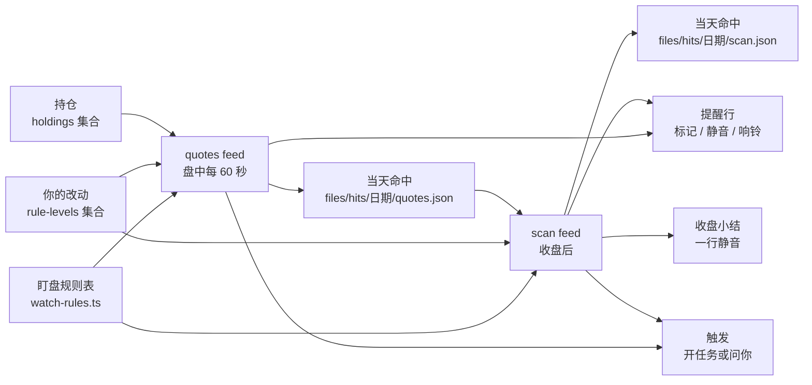

# stock-ta 盯盘规则和事件层级设计

这份设计只出方案，不改代码。它回答 stock-ta 怎样像交易员一样盯盘，怎样支持华尔街常用的规则，又让每条规则只在该说的时候说该说的分量。使用者 2026-11-13 定下的事记在第 1 节，后面的设计都以它们为前提。

文中的频率是 2026-11-13 在旧 Mac 上对模块自己的日线库只读查出来的，样本是自选股 8 只个股加 SPY、QQQ，两年日线（2024-11-12 到 2026-11-13，502 个交易日）。查法在附录。

## 1. 使用者的目标和已经定下的事

**目标。** stock-ta 像交易员一样看盘。它支持常用的盯盘规则，每条规则有一个响应层级，在对的时候告诉你对的分量。规则多了信号就多，组合升级是把许多嘈杂的信号收成少数有意义的提醒的主要办法。

使用者 2026-11-13 定下下面七条。设计不改它们。

1. **事件层级。** 每条规则选一层：
   - 0 只记录。不推送，你问「最近有哪些信号」时看得到。
   - 1 页面标记。网页上标一下，不推送。
   - 2 静音提醒。网页和 Telegram 各一行，Telegram 不响（`disable_notification`）。
   - 3 响铃提醒。一行，手机响。
   - 4 收盘小结。收盘后约 20 分钟、跟着扫描发一份小结，收齐当天 1、2 层的命中。
   - 5 自动开分析任务。一位专家快看一眼，或者研究组一起看。
   - 6 问你。一张带按钮的问题卡片。卡片可以**提议**改自选股或条件，由你决定，和 ADR-0024 一致。

   另有四个修饰：冷却（同一只票同一条规则每天一次）、合并（同一只票同一天进同一个任务）、组合升级（同一只票同一天命中两条规则就升一层，或者命中事先定义好的组合）、免打扰时段（夜里只记录，早上或在小结里补报）。永远不自动交易。
2. **到档分两层。** 个股 5% 是 2 层静音一行加 5 层任务（三人小组）。8% 是 3 层响铃，并进同一个任务。SPY、QQQ 一样，档位是 2% 和 3%。今天每一行到档提醒都响，以后第一档改成静音。
3. **先做三条新规则。**
   - 盘中放量。当天累计成交量对比 20 日均量，按已经过去的交易时段比例折算，门槛从历史数据里测出来。2 层静音，进小结。
   - 52 周新高是 2 层静音，52 周新低是 3 层响铃，都进小结。
   - 收盘由扫描确认站上或跌破 200 日线，开 5 层任务，派结构与形态和趋势与动量（和 ma-break 一样）。

   组合有两个。放量加 52 周新高或新低，开 5 层任务。放量加 200 日线突破，任务里写「放量确认」。
4. **常用规则都要能支持。** 开盘跳空、盘中反转、50 日和 200 日均线的金叉死叉、EMA 8/21（已有 `R-MA-1`）、MACD（已有 `R-MACD-*`）、RSI 70/30（今天 `ta` 没有）、相对 QQQ、SPY 的强弱背离、支撑阻力、形态、道氏、九转（已有 `R-SR-*`、`R-PAT-*`、`R-DOW-*`、`R-TD-*`）、财报临近（已有 `earnings-date` 工具）、VIX。
5. **VIX 用 VIXY 代替。** 今天实测，Massive 套餐对指数 `I:VIX` 的快照和聚合都回 `NOT_AUTHORIZED`，VXX、VIXY、UVXY 的快照能用。波动信号用 VIXY 当天涨跌幅，门槛从历史测（「+10% 一行、+20% 开任务」只是占位），可以和 SPY、QQQ 的档位组合。这些 ETF 跟的是短期 VIX 期货，点位不等于 VIX，涨跌幅比 VIX 小，长期有损耗。真正的 VIX 点位以后经 FRED 拿日数据（晚一天），或者升级套餐。
6. **持仓是例外。** stock-ta 平时只管客观数据。自选股里的票可以另带持仓：成本价（必填），建仓日期、止损线（价格或成本的百分比）、数量（三个都选填）。一只票一行，加仓后你自己更新平均成本。不记成交流水、卖出、已实现盈亏、账户和税。只有你能改，存在私密集合里。票从自选股划掉后，持仓那一行留着，但不再盯。持仓规则有三条：触到止损线（没设时默认成本 −8%），从建仓以来的最高点回撤（默认 15%，没写建仓日期时用 52 周最高），跌破成本价。
7. **新闻和分析师评级不进 stock-ta。** 以后另做一个新闻模块。

## 2. 今天是什么样

- **两个地方会出声。** 报价 feed `quotes` 每 60 秒算一次到档（`bandMove`），到档时发一行提醒（alert）和一条触发（notice）。日线扫描 feed `scan` 每天收盘后跑一次 `ta`，`settings.signals.rules` 里列了的信号（默认只有 `R-MA-2-50`）每条发一条触发。宿主自己还按你设的盯盘条件（`_conditions`）在每一行报价上算一次。
- **层级散在三个地方。** 档位写在 `feeds/quotes/feed.json` 的 `settings.bands`，哪些信号发触发写在 `feeds/scan/feed.json` 的 `settings.signals.rules`，命中后做什么写在 `rules.md` 的 `big-move`、`ma-break` 两段话里，由幕僚长照着做。
- **提醒行一律响铃。** Telegram 客户端发宿主行时写死 `silent: false`（`src/host/telegram/client.ts`）。`bot-api.ts` 支持 `disable_notification`，但上游没有办法要求它。
- **每条触发都花一次幕僚长。** 规则没写到的触发，幕僚长也要读一遍再决定忽略。多开几条信号，花费跟着涨。
- **两个 feed 的线程合不上。** 宿主给线程加的前缀是 feed 的来源名（`thr_stock-ta/quotes:NVDA:2026-11-13` 和 `thr_stock-ta/scan:signal:NVDA:2026-11-13`），所以同一只票同一天，到档开的任务和收盘信号开的任务是两个。
- **没有的东西。** 宿主没有页面标记，没有免打扰，没有按时刻调度的 feed（`when` 只有 `us-market-hours`，`every: "1d"` 按 UTC 零点换格）。`ta` 没有 RSI，也没有 50/200 日均线金叉死叉（`ta` 说的金叉死叉是 EMA 8/21）。报价的快照解析丢掉了开盘价、当天最高最低（`day.o/h/l`）。

## 3. 设计一览



- 一张**盯盘规则表**写清每条规则在哪个 feed 算、门槛多少、默认几层、开任务时派谁，还有组合和免打扰。两个 feed 都读它，`rules.md` 不再写数字和层级。
- 你的改动存在 `rule-levels` 集合里，只记你改过的那几条。生效的规则是「表里的默认」叠上「你最新的改动」。
- 每个 feed 把当天的命中写成一份自己的文件。扫描读报价那份，用来做跨 feed 的组合和收盘小结。
- 宿主改三处，都是通用的：提醒行可以静音，同一模块的 feed 可以共用线程，提醒行可以只做页面标记。别的都在模块里。

## 4. 盯盘规则表

### 4.1 规则放在一张表里

层级、冷却、组合今天散在 feed 设置和 `rules.md` 的散文里。每加一条规则，就要在 feed 代码里多一个分支，在 `rules.md` 里多一段话，幕僚长再按散文判断。所以设计把它们收成一张表，一条规则一行，代码按表办事，没有逐条规则的分支。

表在包根目录的 `watch-rules.ts`，和 `watchlist.ts`、`market-days.ts` 放在一起，两个 feed 和新工具 `hits` 都 import 它。用 TypeScript 写，不用 JSON，是为了让类型检查守住两件事。5、6 层必须写明那一行怎么响，组合只能引用表里有的规则。

```ts
type Level = 0 | 1 | 2 | 3 | 4 | 5 | 6;
/** 直接送到你面前的那一行。1 到 3 层由层级推出，5、6 层要写明。 */
type Line = "none" | "badge" | "silent" | "ring";
/** 开任务时照哪份做法派人。band-move 是三人，structure-trend 是两人，desk-look 是盘面一人，holding-ask 是问你。 */
type Plan = "band-move" | "structure-trend" | "desk-look" | "holding-ask";

interface WatchRule {
	id: RuleId;                 // 例如 "move-1"、"high-52w"、"R-MA-2-200:down"
	title: string;              // 提醒和小结里的短名，例如「52 周新高」
	feed: "quotes" | "scan";
	scope: "stock" | "index" | "vixy" | "holding";
	kind: "event" | "state";    // state：进入这个状态的那一天才算命中
	threshold?: number;         // 单位跟着规则走，写在 title 旁边的说明里
	level: Level;
	line?: Line;                // 只给 5、6 层写
	plan: Plan;                 // 4 层以下也写：你把它调到 5 层时开哪种任务
}

interface Combo {
	id: string;
	all: readonly [RuleId, RuleId];
	then: { level: 5; line: Line; plan: Plan } | { note: string };  // note：写进已经开的任务，不另开
}
```

层级和一行的响法对应如下。数字越大越打扰你，同一次命中只取一个层级。

| 层级 | 记进当天命中 | 页面标记 | Telegram 一行 | 进收盘小结 | 触发 |
|---|---|---|---|---|---|
| 0 | 是 | 否 | 否 | 否 | 否 |
| 1 | 是 | 是 | 否 | 是 | 否 |
| 2 | 是 | 是 | 静音 | 是 | 否 |
| 3 | 是 | 是 | 响铃 | 是 | 否 |
| 4 | 是 | 否 | 否 | 是 | 否 |
| 5、6 | 是 | 是 | 照 `line` | 写「已开任务」 | 是，带 `plan` |

只有 5、6 层发触发。0 到 4 层不叫醒幕僚长，所以表里多开几条低层级的规则不花模型调用。

**冷却不是一个字段。** 命中的 id 是 `<规则>:<代码>:<美东日期>`，宿主对提醒和触发都按 id 去重，所以同一只票同一条规则一天只算一次。到档沿用今天「每个方向只升不降」的做法，两档是两条规则（`move-1`、`move-2`），各算一次。财报临近的 id 用财报日期代替当天日期，一次财报只报一次。

**状态型规则只在进入时算。** 跌破成本价、在止损线下、站在 200 日线下，这些状态会一连持续好多天。`kind: "state"` 的规则只在进入状态的那天命中（昨收还在线的另一边，今天过了线），之后每天的小结里写一句「仍在止损线下」，不再单独提醒。没有这一条，跌破成本价会每天静音提醒一次。

### 4.2 你的改动存在集合里

`rule-levels` 是一个 `record` 集合，级别 `shareable`：

| 字段 | 说明 |
|---|---|
| `rule` | 规则 id，必填 |
| `symbol` | 只对这只票生效，空着就是全部 |
| `level` | 新的层级，空着就是不改层级 |
| `threshold` | 新的门槛，空着就是不改门槛 |
| `note` | 你当时怎么说的 |
| `removedAt` | 写上就是撤回这条改动，回到表里的默认 |

和自选股一样，只加行不删行，同一个 `rule` 加 `symbol` 以最新的一行为准。你在对话里说「52 周新高改成只记录」「TSLA 的第一档改成 7%」，Worker 加一行。两个 feed 都 `reads: ["rule-levels"]`，下一轮就按新的算，不用重启。表里没有的 id、不在 0 到 6 里的层级、不在 0 到 100 之间的门槛、让某只票第一档门槛不低于第二档的改动，feed 报一个问题 `bad-level`，说是哪一行，这一行不生效，其余照算。只检查每个 `rule` 加 `symbol` 最新的一行，带 `removedAt` 的不检查，所以撤回或写对就能清掉。

**为什么不放在 `feed.json` 的 `settings`。** `settings` 是一个 feed 自己的，规则表横跨两个 feed，放进去就要写两份。它是包里的文件，部署时 `cp -R` 会把你在旧 Mac 上改的档位换回仓库的版本，今天的说明书已经要专门提醒这一点。而且你改它，要让一个能写文件的任务去改包。

**为什么不把整张表放进集合。** 宿主还没有实现 `seed.json`，集合一开始是空的。包更新时多了规则，集合里没有它，就得再写一套合并的逻辑。所以只把你的改动放进集合，默认值留在包里跟着版本走。

**为什么不留在 `rules.md`。** `rules.md` 是给幕僚长看的散文，层级靠模型照着做，测不了。设计以后 `rules.md` 只剩一条 `watch-task`，说「照触发里写的 `plan` 开任务」。

**谁能改。** 宿主的权限表允许规则开的任务写数据，所以「只有你能改」和自选股一样，靠技能里写明（ADR-0024 的做法）。这是单人自用的 MVP，不另加宿主的拦截。

### 4.3 组合升级

组合在同一只票同一天的命中之间找，先看事先定义的组合，没有对上的再看通用升级。

**定义好的组合。**

| 组合 | 结果 | 在哪里算 |
|---|---|---|
| 放量加 52 周新高 | 5 层，静音一行，`band-move` | quotes |
| 放量加 52 周新低 | 5 层，响铃一行，`band-move` | quotes |
| 收盘放量加 200 日线突破 | 写进 200 日线的任务：「放量确认（成交量是 20 日均量的 2.4 倍）」 | scan |
| 收盘放量加跌破 50 日线 | 5 层，`structure-trend`（2026-11-13 定：50 日线单独只到 2 层） | scan |
| 个股到档加 SPY 或 QQQ 当天已到档（大盘日） | 不另开任务，并进指数的任务，汇报里列出这只票（2026-11-13 定） | quotes |
| VIXY 第一档加 SPY 或 QQQ 第一档 | 写进指数的任务：「VIXY 同日涨 12.3%」 | quotes |

收盘放量由扫描自己用当天的完整日线算，不用盘中的命中，所以第三个组合不跨 feed。

**通用升级。** 同一只票同一天，第二条 1 到 3 层的规则命中时，这一行升一层（1 变 2，2 变 3），最多升到 3 层响铃，一只票一天最多升一次。下面两种情况不升：

- 这只票今天已经开了任务。后来的命中照自己的层级走，任务已经在看这只票了。不这样的话，5% 档加放量这种常见的搭配（个股 5% 的 177 天里有 62 天同时放量）会让第一档静音的决定落空。
- 0 层的命中不算数。今天 `ta` 每个交易日给 10 只票出大约 11 条信号，要是把 0 层也算进去，几乎每只票每天都会升级。

升了的那一行后面写明原因，例如「（NVDA 今天第 2 条，前一条是 52 周新高）」。

### 4.4 免打扰时段

表里写一个时段，按宿主的本地时间算（宿主是你家里的旧 Mac，本地时间就是你的时间）：

```ts
const QUIET = { from: "22:00", to: "07:00" };
```

美股常规时段（美东 9:30 到收盘）内免打扰不生效，这是使用者 2026-11-13 定的：你在美国西部，开盘是本地 6:30，落在时段里也照常实时提醒。时段只管常规时段以外的命中。

时段里命中的 2、3 层只记录，5、6 层的触发先不发，命中标成 `held`。它们都进下一份收盘小结，小结发出的同时补发留着的触发。小结本身落在时段里时，等时段结束后扫描的第一拍再发。这样早上补报和进小结是同一条路，不另做一个早间的发送者。

## 5. 每条规则在哪里算

盘中的规则在 `quotes` 里算，因为只有它每 60 秒拿到报价。收盘确认的规则在 `scan` 里算，因为只有它拿到当天完整的日线。不新开 feed：新 feed 用 `reads` 只拿得到一个集合最新的 500 行，看不到当天早些时候的报价。

`quotes` 要几样历史数字：52 周最高最低、20 日均量、建仓以来的最高价。它在每天第一轮用只读方式打开模块自己的日线库 `files/ta/ta.sqlite`，算好存进 cursor，当天不再读（`structure` 工具已经这样只读打开它）。读库的代码放在一个新文件 `bars.ts` 里，`scan` 算 RSI 和金叉死叉也用它。日线库里存的是没复权的日线，`ta` 读的时候才按分红调整，所以模块算出的 52 周最高、均线在除息日附近和 `ta` 有很小的差别，对 SPY 一年大约 1%。

报价的快照解析要多留三个字段：开盘价 `day.o`、当天最高 `day.h`、当天最低 `day.l`。

下表的频率是每个交易日的命中次数，样本见开头。「8 只」是 8 只个股合计，「两只」是 SPY 和 QQQ 合计。

| 规则 id | 意思 | 在哪算 | 默认层级 | 实测频率 |
|---|---|---|---|---|
| `move-1` | 当天涨跌到第一档：个股 5%，SPY、QQQ 2% | quotes | 5，静音，`band-move` | 8 只 0.35，两只 0.15 |
| `move-2` | 第二档：个股 8%，SPY、QQQ 3% | quotes | 5，响铃，`band-move`，进同一任务 | 8 只 0.11，两只 0.05 |
| `volume` | 盘中放量：累计成交量 ≥ 门槛 × 20 日均量 × 已过时段比例，美东 10:30 以前不算 | quotes | 2 | 用全天日线近似：≥2 倍时 8 只 0.36，≥3 倍时 0.13 |
| `high-52w` | 当天最高高过此前 252 个交易日的最高 | quotes | 2 | 8 只 0.32（这两年是牛市，偏多） |
| `low-52w` | 当天最低低过此前 252 个交易日的最低 | quotes | 3 | 8 只 0.04 |
| `gap` | 开盘相对昨收跳空 3% 以上 | quotes | 1 | 8 只 0.38 |
| `reversal` | 盘中曾涨（跌）3% 以上，之后翻成跌（涨） | quotes | 1 | 没测，要分钟线 |
| `rel-strength` | 个股和 QQQ 当天方向相反，差 3 个百分点以上 | quotes | 1 | 没测 |
| `vixy-1`、`vixy-2` | VIXY 当天涨到第一档、第二档（占位 10%、20%） | quotes | 2；5，静音，`desk-look` | PR2 测 |
| `R-MA-2-200` | 收盘站上或跌破 200 日线 | scan | 5，不发一行，`structure-trend` | 8 只 0.26（近一年 65 次） |
| `R-MA-2-50:down` | 收盘跌破 50 日线（今天的 ma-break） | scan | 2，静音一行加收盘小结；和放量同一天命中时组合升到 5，`structure-trend` | 8 只 0.38（近一年 97 次） |
| `R-MA-2-50:up` | 收盘站上 50 日线 | scan | 0 | 和跌破差不多 |
| `cross-50-200` | 50 日均线上穿或下穿 200 日均线 | scan，模块算 | 2 | 10 只 0.04 |
| `rsi` | RSI(14) 上穿 70 或下穿 30 | scan，模块算 | 1 | 10 只约 0.64（用简单平均近似） |
| `earnings` | 下一次财报在 5 个交易日内 | scan，查 Finnhub | 1 | 每只每季度一次 |
| `ta-key` | `R-PAT-*`、`R-DOW-1-UE`、`R-DOW-1-DE`、`R-TD-2`、`R-MACD-3` | scan | 1 | 8 只 0.46 |
| `ta-other` | 其余 `ta` 日线信号，例如 `R-SR-*`、`R-MA-1`、`R-MACD-1/2/4`、`R-TD-1` | scan | 0 | 10 只约 11 |
| `stop-loss` | 价格触到止损线，没设时是成本 −8%（状态型） | quotes | 6，响铃，`holding-ask` | 看你的持仓 |
| `drawdown` | 从建仓以来最高点回撤 15%，没写建仓日期时用 52 周最高（状态型） | quotes | 3 | 看你的持仓 |
| `below-cost` | 价格跌破成本价（状态型） | quotes | 2 | 看你的持仓 |

几点说明：

- **放量的门槛先测再定。** 一天的成交量两头大中间小，开盘一小时成交最集中，按时段比例线性折算会在早上高估。所以 10:30 以前不算，门槛在 PR2 用 Massive 的分钟线回放测出来：对每个候选门槛，数盘中命中了、全天却不到 1.5 倍的次数，选误报不到两成的最小门槛。线性折算误报太多时，改成和过去 20 天同一时刻的累计成交量比，分钟线由扫描每天收盘后补一次。
- **VIXY 不算到档。** VIXY 只走自己的 `vixy-1`、`vixy-2`，不进 `move-1`、`move-2`。它的门槛也在 PR2 用两年日线测。
- **RSI 和金叉死叉由模块算。** 不去改 `ta` 的上游仓库和钉住的提交，在 `scan` 里用 `bars.ts` 读出的日线算。RSI 用 Wilder 平滑。
- **财报临近要 `FINNHUB_API_KEY`。** `scan` 的 `secrets` 加上它，每天每只票一个请求。没有密钥时这条规则不算，报一次问题。
- **`ta` 自己的 `notify` 和冷却不用。** `ta` 给每条信号算了是否值得通知（`attention` 为 `key` 且过了冷却），今天的扫描就没用它。层级以规则表为准，`ta` 的 `attention` 以后可以拿来定默认层级。

## 6. 每一层怎么送到你面前

| 层级 | 怎么送 | 宿主要不要改 |
|---|---|---|
| 0 | 写进当天命中的文件。你问「今天有哪些信号」时，新工具 `hits` 读出来 | 不用 |
| 1 | 提醒行带 `push: "badge"` 和 `key`（代码）。宿主存下，不发 Telegram，不闪「今天」，模块卡片上按代码列出当天的标记 | 要，H3 |
| 2 | 提醒行带 `push: "silent"`，Telegram 用 `disable_notification` 发 | 要，H1 |
| 3 | 提醒行，和今天一样 | 不用 |
| 4 | 收盘小结，见第 8 节 | 只用 H1 让它静音 |
| 5 | 触发带 `plan`，`rules.md` 的 `watch-task` 让幕僚长照 `plan` 开任务 | 不用 |
| 6 | 和 5 层一样开任务，做法 `holding-ask` 让领队发一张问题卡片 | 不用 |

**页面标记放在模块卡片上。** 使用者说的是「网页自选股面板上的标记」。今天模块的 feed 没有自选股面板：来源面板 `SourcePanel` 只给宿主自己跑的行情 feed 用，us-market 退役后就没人用了。所以 1 层的标记放在 stock-ta 的模块卡片上，按代码列出当天的命中，例如「NVDA · 52 周新高 · 放量」。卡片上本来就有「今日提醒 n 条」。

**问你的卡片走任务。** feed 不能直接出卡片，只有 Worker 的汇报能带问题和 2 到 4 个选项，所以 6 层是一个开了就提问的任务。你点了按钮，答案回到这个任务（ADR-0006）。按钮能做的事有边界：

- 写数据可以。改持仓的止损线、从持仓划掉、改 `rule-levels`、改自选股都是写集合，规则开的任务能写。你点按钮就是你的决定，所以这和 ADR-0024「只有你能改自选股」不冲突。技能写明只照你点的那个选项写。
- 改盯盘条件不行。宿主只让只听过你本人的对话任务改条件（ADR-0003），规则开的任务点了按钮也不行。卡片要提议改条件时，选项写成你在对话里要说的那句话。

以后要让卡片直接改条件，可以仿照 ADR-0021「批准一条确切的命令」做一张由宿主执行的提议卡片。这一版不做。

## 7. 跨 feed：当天命中、合并和线程

**当天命中各写各的文件。** `quotes` 每一轮把当天的命中整份写进 `files/hits/<美东日期>/quotes.json`，`scan` 写 `scan.json`，都是先写临时文件再改名。一个文件只有一个写者。两个 feed 会同时跑（报价跑到收盘后 20 分钟，扫描收盘后 15 分钟开始），一个文件两个写者就要加锁。分开写就不用。

`quotes` 自己的当天状态（哪些规则命中过、哪档到过）以 cursor 为准，宿主在发完提醒后才存 cursor。文件只是每轮从 cursor 重写一遍的副本，给别人读，所以中途停掉也会在下一轮恢复一致。一条命中长这样：

```json
{ "id": "high-52w:NVDA:2026-11-13", "rule": "high-52w", "symbol": "NVDA", "date": "2026-11-13",
  "at": "2026-11-13T15:41:00Z", "level": 2, "text": "NVDA 创 52 周新高 212.40（此前最高 210.88）。", "bumped": false, "held": false }
```

`scan` 读 `quotes.json` 有两个用处。一是知道哪些票今天已经开过任务，通用升级不升这些票。二是收盘小结要列盘中的命中。`quotes` 不读 `scan.json`，扫描在收盘后才跑。

新工具 `hits` 只读这些文件，回最近几天的命中，可按代码和层级筛。「今天有哪些信号」由领队调 `hits`，「自选股最近有哪些信号值得看」照旧派信号分诊，它多一个 `hits`。文件一天几 KB，不清理。

**同一只票同一天进同一个任务。** `quotes` 的线程今天已经是 `<代码>:<日期>`，同一个 feed 里能合上。扫描的线程也改成 `<代码>:<日期>`，再加宿主的 H2，让同一模块的 feed 共用线程，`thr_stock-ta:NVDA:2026-11-13`。任务还开着时，收盘后的命中直接进这个任务。任务已经结束时，幕僚长按它的提示读线程、转交（`hand_over`），和今天同一 feed 里任务结束后的情况一样。

## 8. 收盘小结

小结由 `scan` 发，不新开调度。`scan` 的 `every` 从 `1h` 改成 `5m`，代码先用 `market-days.ts` 判断有没有到收盘后 15 分钟，没到就直接返回，不起 `ta`（一拍大约 43 毫秒）。所以扫描在收盘后 15 到 20 分钟开始，旧 Mac 上扫 9 只大约 73 秒，小结在美东 16:17 到 16:22 之间发出，提前收盘日跟着提前。不用 `every: "1d"`，它按 UTC 零点换格。

一份小结是一行静音提醒，id 是 `digest:<日期>`。宿主的提醒行最多 1000 字、不能换行，所以按代码用分号隔开：

> 收盘小结 11-13（美东）：NVDA 52 周新高、放量 2.4 倍；TSLA 跌 5.3%，已开任务；META 收盘跌破 200 日线，已开任务；AAPL 财报还有 3 个交易日；SPY 跌 2.1%，已开任务。只记录的 12 条，问「今天有哪些信号」。

- 列 1 到 4 层的命中，5、6 层写「已开任务」，状态型规则写仍在持续的状态，免打扰时段留下的命中也在里面。0 层只写条数。
- 超过 1000 字时，从层级低的开始收成「另有 n 条」。
- 扫描失败时，小结照发盘中的命中，加一句「今天的日线扫描失败，收盘规则没有算」。扫描一直没成功，美东 17:30 照这个样子发。
- 当天什么都没命中时不发。

小结不经模型，所以不用 Router 回复的 200 字限制，也没有模型的花费。

## 9. 持仓

`holdings` 是一个 `record` 集合，级别 `private`：

| 字段 | 说明 |
|---|---|
| `symbol` | 代码，必填 |
| `cost` | 平均成本，必填 |
| `boughtAt` | 建仓日期 |
| `stopPrice` | 止损价 |
| `stopPct` | 止损线是成本的百分之几，例如 -8 |
| `quantity` | 数量 |
| `removedAt` | 写上就是这只不再持有 |

一只票以最新的一行为准，你加仓后说「NVDA 成本改成 152」，Worker 加一行。`removedAt` 不是卖出记录，不算盈亏，只让持仓规则停下来。`stopPrice` 和 `stopPct` 都写了时用 `stopPrice`。只有自选股里还在的票才算持仓规则。

三条规则都在 `quotes` 里算，都是状态型。`drawdown` 要建仓以来的最高价，`quotes` 每天第一轮从日线库取到昨天为止的最高，盘中再和当天最高比。

**私密数据怎么走。** `quotes` 读 `holdings`，它的提醒行写着价格和止损线，直接到你，Telegram 上照全文显示（ADR-0023）。它的触发会给幕僚长看，所以持仓规则的触发只写代码、现价和「触到你的止损线」，不写成本和止损价，任务里的领队要用时自己读 `holdings`。宿主判断一个 feed 是不是私密，只看它写进的集合，不看它读的集合，所以这条「触发不写持仓数字」靠模块代码守，测试里核对。

止损的卡片由 `holding-ask` 做，选项大致是「派研究组看一眼」「止损线不变」「从持仓划掉」。改成新的止损价要一个数，你在对话里说。

## 10. 宿主和模块各改什么

宿主改三处，都不认识 stock-ta：

| 编号 | 改什么 | 碰到的地方 | 在哪一期 |
|---|---|---|---|
| H1 | 提醒行可以静音。feed 的提醒多一个可选的 `push: "silent"`，存进 `host_lines` 的新列（重启后补发时照样静音），Telegram 发的时候用 `disable_notification`，网页不闪「今天」 | `FeedAlert`、`parseCollected`、`Alert`、`HostLinePost`、`HostLine`、`host_lines` 表、`client.ts` 的 `host_line` 分支、`app.mjs` | PR1 |
| H2 | 同一模块的 feed 共用线程。触发多一个可选的 `threadScope: "module"`，宿主把线程写成 `thr_<模块>:<线程>`。模块名没有 `/`，宿主现有的订阅规则（`SOURCE_THREAD`）认得它 | `feed-runner.ts`、`threadId` | PR3 |
| H3 | 提醒行可以只做页面标记。`push` 多一个值 `"badge"`，提醒多一个可选的 `key`。宿主存下，不发 Telegram，模块卡片按 `key` 列出当天的标记 | 同 H1，加上 `ModuleCard`、`view.mjs` | PR5 |

H1 和 H3 改了 ADR-0017「提醒带通知发到所有前端」的说法，PR1 里写一份新的 ADR。新的说法是，提醒行响不响、发不发 Telegram 由模块决定，种类仍然决定它是不是提醒。

不改宿主的有这些：规则表、组合、冷却、免打扰都在模块里；收盘小结用现有的提醒行；5、6 层用现有的触发、规则和问题卡片；按时刻的调度用 `every: "5m"` 加模块自己判断。

## 11. 把 big-move 和 ma-break 搬进规则表

- **big-move。** `settings.bands` 删掉，档位成为 `move-1`、`move-2` 的门槛，SPY、QQQ 的档位是 `scope: "index"` 的门槛。今天 `bySymbol` 能给单只票写档位，以后用 `rule-levels` 带 `symbol` 的一行。`rules.md` 的 `big-move` 换成 `watch-task`，技能 `band-move` 不变。和今天比只改了一处，第一档那一行改成静音。
- **ma-break。** `settings.signals.rules` 删掉，扫描对所有 `ta` 信号查规则表，`ta` 的规则编号就是表里的 id（方向不同层级不同时带 `:up`、`:down`）。`R-MA-2-50:down` 默认 5 层，和今天一样开任务；`R-MA-2-50:up` 默认 0 层，今天它发触发、幕僚长读了不开任务，以后连触发都不发。`ma-break` 并进 `watch-task`。
- **旧 Mac 上的改动。** 你要是在旧 Mac 的包里改过档位，部署前写成 `rule-levels` 的行，`cp -R` 以后就不会丢。
- 搬迁和删旧在同一期做完，不留两套设置并存。

## 12. 噪音预算

按上面的频率和默认层级估每个交易日推送多少，8 只个股加 SPY、QQQ。持仓规则和 VIXY 还没有数据，不算在内。

| 你感到的 | 来自 | 每个交易日 | 今天 |
|---|---|---|---|
| 手机响 | `move-2` 0.16，`low-52w` 0.04，通用升级约 0.05（猜的） | 约 0.25，一周一到两次 | 约 0.66（到档每一行都响） |
| 静音一行 | `move-1` 0.50，`volume` 约 0.36（门槛没定），`high-52w` 0.32，`cross-50-200` 0.04，小结 1 | 约 2.2 | 0 |
| 自动开的任务 | 到档 0.50，`R-MA-2-50:down` 0.38，`R-MA-2-200` 0.26，放量加新高新低 0.05 | 约 1.2 | 约 0.88 |
| 只在页面上 | `gap` 0.38，`rsi` 约 0.5，`ta-key` 0.46，`earnings` 约 0.1 | 约 1.5 | 0 |
| 幕僚长读触发 | 只有 5、6 层 | 约 1.2 | 每条到档和名单里的信号都读 |

- 手机响的次数降到今天的四成左右，主要因为第一档改成静音。
- 任务多了 0.3 个，来自 200 日线。任务扎堆在大跌大涨的日子：两年里最多的一天 9 个（个股 5% 加指数 2%），有 10 天在 4 个以上，超过成员上限的会排队。个股到档的任务有 42% 落在指数也到档的那天（177 次里 75 次）。
- `R-MA-2-50:down` 一年 97 次，是任务的第二大来源。200 日线开任务以后，要不要把它降下来，是第 14 节的一个问题。
- 52 周新高这两年偏多，因为样本是一段牛市。

## 13. 分期交付

每一期是一个 PR，合并后在旧 Mac 部署一次（等你说「部署」），在下一个交易日看一遍。

1. **PR1 规则表和第一档静音。** 宿主做 H1 和新的 ADR。模块加 `watch-rules.ts`（先只有 `move-1`、`move-2`）、`rule-levels` 集合、`rules.md` 的 `watch-task`，删 `settings.bands` 和 `big-move`。
   - 你看到的：5% 和 2% 那一行到了，手机不响；8% 和 3% 响。说「TSLA 的第一档改成 7%」，下一轮就按 7% 算。
   - 检查：fixture 里 5% 出静音提醒和带 `plan: band-move` 的触发，8% 出响铃提醒；`rule-levels` 的一行改了门槛；宿主测试里静音提醒发到假的 Bot API 时带 `disable_notification`，重启补发时还是静音；`just module check`；旧 Mac 上第一档到档那天手机不响。
2. **PR2 盘中的新规则和组合。** `quotes` 加 `volume`、`high-52w`、`low-52w`、`gap`、`reversal`、`rel-strength`、`vixy-1/2`，快照多留 `day.o/h/l`，加 `bars.ts`、当天命中的文件、工具 `hits`、定义好的组合、通用升级、免打扰。先跑测量脚本，用分钟线定放量的门槛，用日线定 VIXY 的门槛，结果写回这份文档。
   - 你看到的：放量和 52 周新高静音一行，52 周新低响，放量加新高开任务；「今天有哪些信号」列出当天全部命中。
   - 检查：每条规则一个 fixture；组合、通用升级、任务已开不升、免打扰留下各一个 fixture；文件写一半停掉后下一轮恢复；测量脚本的输出附在 PR 里。
3. **PR3 收盘以后。** `scan` 改成 `every: "5m"` 加收盘判断，对所有 `ta` 信号查规则表，搬 `ma-break`，加 `R-MA-2-200` 的任务和放量确认、`cross-50-200`、`rsi`、`earnings`、收盘小结。宿主做 H2。
   - 你看到的：美东 16:20 左右收到一行静音的小结；跌破 200 日线开任务；同一只票白天到档、收盘跌破均线时进同一个任务。
   - 检查：扫描的 fixture 覆盖每层；小结超长时收成「另有 n 条」，最长 1000 字；扫描失败时的小结；宿主测试里两个 feed 的触发落在同一个线程；旧 Mac 上一个交易日的小结时刻。
4. **PR4 持仓。** 加 `holdings` 集合、改持仓的技能、三条持仓规则、`holding-ask` 的做法。
   - 你看到的：说「NVDA 成本 150，止损 138」，跌到 138 时手机响，接着收到一张卡片。
   - 检查：三条规则各一个 fixture，状态型只在进入那天命中；持仓规则的触发里没有成本和止损价；`just module try` 里点卡片的「从持仓划掉」写出带 `removedAt` 的一行。
5. **PR5 页面标记。** 宿主做 H3，1 层的规则开始在模块卡片上显示。
   - 你看到的：stock-ta 的卡片上按代码列出今天的标记，手机上没有。
   - 检查：网页视图的测试；在页面上看一次。

这样排是因为 PR1 先把现有的两条规则搬进新结构，不加新东西，搬坏了马上看得出来。PR2、PR3 在这个结构上加规则。持仓和页面标记最后做，前面三期不依赖它们。1 层的命中在 PR5 之前已经记下来，PR3 起进小结。

## 14. 使用者已定的三个问题（2026-11-13）

原来留给使用者拍板的三个问题，使用者都按建议定了：

1. **免打扰在美股常规时段内不生效。** 时段仍是 22:00 到 07:00（旧 Mac 本地时间），只管常规时段以外的命中。见 4.4。
2. **大盘日合成一个任务。** SPY 或 QQQ 当天到档时，同一天个股到档的任务并进指数的那一个，汇报里列出每只到档的自选股，使用者想细看哪只再追问。按两年数据，个股到档任务少开约 42%。合并只发生在指数已经到档的那一天；指数没到档时，个股 5% 照旧开自己的三人任务。
3. **跌破 50 日线不再开任务。** `R-MA-2-50:down` 降成 2 层（静音一行）并进收盘小结。开任务的只有 200 日线的突破和跌破，以及「放量加跌破 50 日线」这个组合。今天旧 Mac 上的 ma-break 仍然开任务，第 3 期搬迁时改。

设计替你定了下面几件事，你不同意可以直接说：

- 通用升级只在 1 到 3 层之间升，这只票今天开过任务就不升，一天最多升一次。
- 状态型规则（跌破成本、止损、回撤）只在进入那天提醒，之后在小结里写一句。
- 页面标记放在 stock-ta 的模块卡片上，因为模块的 feed 没有自选股面板。
- 收盘小结是一行静音提醒，当天没有命中时不发。
- 持仓多一个 `removedAt`，让你说「NVDA 不持有了」时停掉持仓规则。它不是卖出记录。

## 附录：测量方法

频率都来自旧 Mac 上模块的日线库，只读打开：

```bash
sqlite3 -readonly <状态目录>/modules-data/stock-ta/files/ta/ta.sqlite
```

- **规则信号的条数。** `select rule_id, timeframe, count(*) from signals group by rule_id, timeframe;`，再按 `direction`、近一年（`data_start_ms` 晚于 2025-11-13）和是否是 SPY、QQQ 分开数。
- **到档。** 对 `bars` 的日线用窗口函数取昨收，数 `abs(close/昨收 - 1)` 过 5%、8%（个股）和 2%、3%（SPY、QQQ）的天数。这是收盘的涨跌幅，盘中到过档、收盘又回来的天数会比它多。
- **52 周新高新低。** 当天 `high` 高于此前 252 根日线的最高，`low` 低于最低。只数有满 252 根历史的 250 个交易日。
- **放量。** 当天 `volume` 除以此前 20 根日线的平均量。这是全天的量，盘中折算的命中次数要等 PR2 用分钟线测。
- **200 日线、金叉死叉。** 收盘价和 200 根日线的简单平均比，50 日均线和 200 日均线比。只数有满 200 根历史的 302 个交易日。和 `ta` 的 `R-MA-2-200` 对过，近 300 个交易日 76 次和 79 次。
- **RSI。** 14 天涨跌的简单平均算的近似值，不是 Wilder 平滑，只用来估数量级。
- **组合。** 同一只票同一天几条规则同时成立的天数，只数有满 252 根历史的 250 个交易日。
