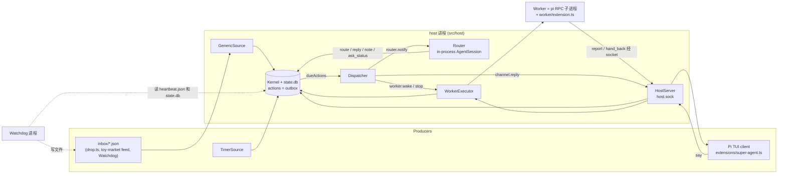
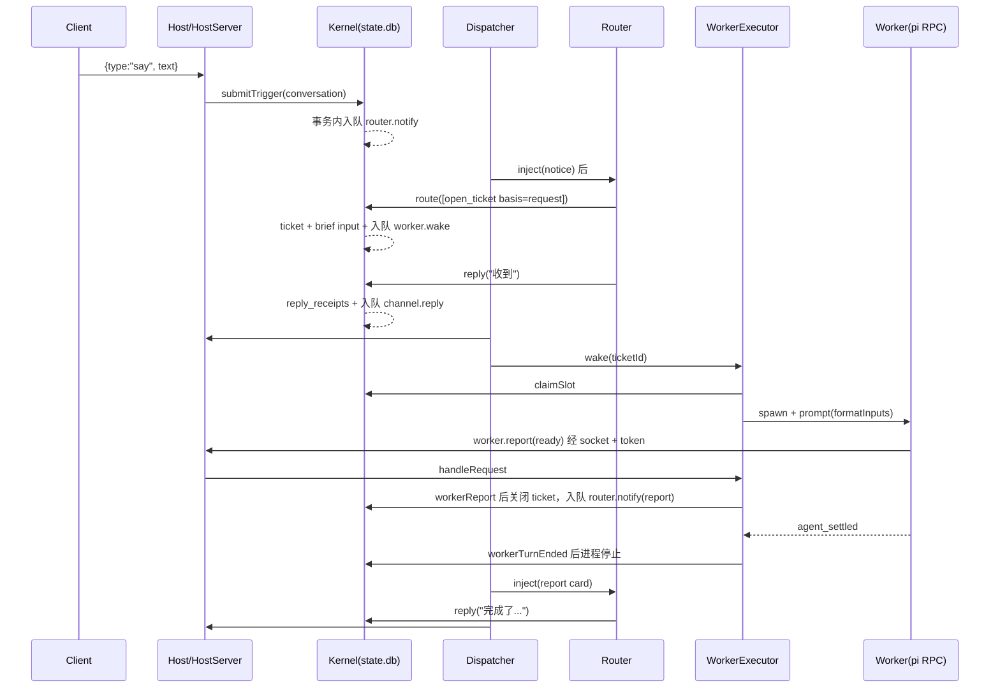

# Pi Super Agent MVP 端到端架构说明

> 本文是审计开始时（快照 `2f8752f`）的独立解读，正文描述的是当时的代码。之后的修复改变了其中几处：依据核验与规则适用来源（`ruleAllows`、`rulesFor`）、推断 Worker 的只读工具档位（替代正则黑名单）、回复必须注明 `cause`、通知在 Router 处理完之前保持挂起、状态目录迁移。见 `interrogate.md`、`authority-design.md` 和 `decisions.tsv`。

## Overview

Pi Super Agent 是一个常驻本机的 headless host 进程，入口是 `src/host/main.ts`。用户只和一个 Router 对话。Router 是 host 进程内的一个 Pi `AgentSession`。具体工作交给 Worker 做。每个 Worker 是一个 Pi RPC 子进程，对应一张 ticket。外部事件和用户消息都会先变成 trigger。外部事件包括 inbox 目录里的 JSON 文件和定时器。Kernel 对每个 trigger 做一次分流。它可能被过滤掉，可能直接送给已订阅的 Worker，也可能交给 Router 判断。

整个系统的中心是 `src/kernel/kernel.ts` 里的 `Kernel`。它是同步的，每个公开方法都在一个 SQLite 事务里完成。它也是领域状态唯一的写入者。所有状态都放在 `state.db`。所有副作用都先写进 `actions` 表，这张表就是 outbox。副作用包括唤醒 Worker、通知 Router、给用户回复。事务提交后，`Dispatcher` 再去执行这些行。所以 host 崩溃后，状态和没做完的副作用都还在库里。重启时 `recoverOnStartup` 会把跑到一半的 ticket 重新排队。权限检查也放在 Kernel 里，不靠模型自觉。另外有一个独立的 Watchdog 进程。host 心跳停了，它就重启 host。它还把卡住的任务和反复失败的动作报告给用户。

## Key Concepts

| 概念 | 含义 |
|---|---|
| Trigger | 一条进入系统的事件。字段有 `source`、`externalId`、`threads`、`body`、`sender`。表上有 `UNIQUE(source, external_id)`，重复提交会被吸收。 |
| Thread | 事件归属的话题，格式是 `thr_<source>:<thread>`。用户对话固定用 `thr_conversation`，这个 thread 不能被订阅。 |
| Disposition | trigger 的去向。取值有 `ignored`、`delivered`、`to_router`、`opened_ticket`、`handed_over`、`router_ignored`。 |
| Ticket | 一个任务。它有一个 workdir、一个固定的 Pi session id 和若干 thread 订阅。 |
| Basis | 开 ticket 的依据，决定权限。`request` 表示用户在对话里直接要求。`rule` 表示命中用户规则文件里的某条规则。`inference` 表示 Router 自己推断该做，限制最多。 |
| Input | 写进 `ticket_inputs` 的一条待投递内容。类型有 `brief`、`trigger`、`user_message`、`note`、`status_query`、`recovery`、`bg_result`。每条带全局递增的 `seq`。 |
| `worker_state` | `queued`、`running`、`idle`。代码里从不写入 `none`。另有 `bg_running` 标志。 |
| Stage | 给人看的阶段，由 `deriveStage`（`src/kernel/stage.ts`）用 `STAGE_RULES` 从数据库事实推出来，不单独存储。 |
| Action | outbox 行，共 4 种。`router.notify`、`worker.wake`、`worker.stop`、`channel.reply`。 |
| RouterNotice | `router.notify` 的 payload。kind 有 `conversation`、`candidate`、`report`、`question`、`handback`、`notice`。`notice` 是工作区里新加的，尚未提交。 |
| Report | Worker 通过 `report` 工具交回的状态。status 有 `progress`、`ready`、`blocked`、`failed`、`no_action`，可以带 `question` 和 `waiting`。 |
| Module | `modules/<name>/` 下的 `module.json`（source 过滤器、timers、prepare、`defaultEnabled`）、`rules.md` 和 skills。宿主从 `modulesDirs` 发现模块，默认是仓库的 `modules/` 和 `<state>/modules/`；设了 `modulesDirs` 就整个替换这两个目录。`config.json` 的 `"modules": { "<name>": true\|false }` 逐个开关模块，写了没发现的名字时启动报错。停用的模块不贡献来源、规则、技能、定时器和 feed。`just modules` 列出全部模块和状态，`just module-new <name>` 在 `<state>/modules/` 生成骨架。用户规则放在 `<state>/rules.md`。 |
| `ModelSelector` | 主模型、fallback、probing 三态状态机（`src/model-selector.ts`，未提交）。Router 一个实例，所有 Worker 共用另一个实例。 |

## How It Works

### 1. 进程与组件

client 和 Worker 共用 `<state>/host.sock` 这一个 Unix socket，协议是 JSON lines。连接上的第一行必须是 `hello`，由它决定角色。Router 跑在 host 进程内，Worker 是子进程。这个选择的理由写在 ADR 0002。

### 2. 触发进入 Kernel

trigger 有三个来源。最终都调用 `Host` 的 `submit`。`submit` 执行 `kernel.submitTrigger(sub)`，然后调用 `#changed()` 去 kick dispatcher。

- **Generic inbox**（`src/sources/generic.ts`）。`GenericSource.scan()` 按文件名排序读取 `*.json`。`parseDrop` 要求有 `thread` 和 `body`。`source` 默认是 `"generic"`，`"conversation"` 会被拒绝。`externalId` 取 `id`，没有 `id` 就用文件名。解析失败的文件移到 `rejected/`，旁边写一个 `.error.txt`。成功时先 `submit` 再移到 `processed/`。这个顺序是故意的。如果在两步之间崩溃，文件会被重新提交，Kernel 按 `externalId` 去重。触发方式是 `fs.watch` 加 2 秒轮询，轮询是未提交的改动。
- **Timer**（`src/sources/timer.ts`）。`tick()` 计算 `floor(now/period)*period`。slot 比游标新就发出 trigger，`externalId` 是 `<entry.id>@<slot>`。游标存在 Kernel 的 `source_cursors["timer"]`。`Modules.timers()` 把 id 改写成 `<module>/<id>`，`source` 默认取模块名。
- **对话**。`Host.say`（`host.ts`）用 `source:"conversation"`、`thr_conversation` 和 `randomUUID()` 作为 `externalId` 提交。它同时把 `{type:"user"}` 广播给所有 client。

### 3. `Kernel.submitTrigger` 的分流

`submitTrigger`（kernel.ts 约 120 行）在一个事务里做完下面几步。

1. **去重**。`(source, external_id)` 已存在时直接返回 `duplicate:true`，不产生任何副作用。thread 标题也不更新。
2. **upsert thread**。已有标题会保留，除非这次带了新标题。
3. **程序级过滤**。非对话 trigger 会经过 `Modules.sourcePolicy`。规则是在所有模块里找第一个 `name` 等于 `trigger.source` 的 `sources[]` 过滤器。找不到就是 `candidate`。`mode:"ignore"` 就是 `ignore`。还有一种情况是某个 `ignore` 正则命中了 body。
4. **fan-out**。`#subscribersOf` 找出订阅了 trigger 任一 thread 的 ticket。已 stopped 的 ticket 排除，已 closed 的 ticket 保留。对话 trigger 和被过滤的 trigger 跳过这一步。
5. **定去向**。被过滤就是 `ignored`。有订阅者就是 `delivered`，Kernel 对每个订阅者调用 `#addInput(ticket, "trigger", …)`，Router 完全收不到。没有订阅者就是 `to_router`，Kernel 入队 `router.notify {kind: "conversation" | "candidate"}`。

`#addInput` 是整个系统通往 Worker 的唯一入口。它插入一条 `ticket_inputs`，把 `closed_at` 置空，所以已关闭的 ticket 会被重新打开。它把 `none` 或 `idle` 改成 `queued`，再调 `#wake`。`#wake` 只有在该 ticket 还没有 pending 的 `worker.wake` 时才入队一条新的。

### 4. Dispatcher

`src/host/dispatcher.ts` 很小。`kick()` 用 `setImmediate` 合并调用，此外每秒轮询一次。`#drain` 按 `seq` 顺序取 `dueActions()`，逐个用 `void this.#run(action)` 启动，不等前一个结束。所以启动顺序是 seq 顺序，执行是并发的。两位 explorer 对这一点的描述看似矛盾，实际说的是同一件事。handler 成功就调 `completeAction`，抛错就调 `failAction`。退避间隔是 `RETRY_BACKOFF_MS` = 5s、30s、2m、10m、30m，之后一直按 30 分钟重试，没有上限。`Host` 里的 handler 映射如下。

- `router.notify` 映射到 `router.inject`
- `worker.wake` 映射到 `workers.wake`
- `worker.stop` 映射到 `workers.stop`
- `channel.reply` 映射到 `Host.#deliverReply`

### 5. Router 的一轮

`Router`（`src/host/router.ts`）包着一个进程内的 Pi `AgentSession`。session 用 `SessionManager.continueRecent` 存在 `<state>/sessions/router`，重启后会接着用。`emptyResources()` 让 Router 不加载任何 extension、skill 或 AGENTS 文件。系统提示由 `routerSystemPrompt()` 生成，末尾拼上规则文本。

**收消息**。`inject(notice)` 是同步的。它调 `noticeCard()`，按当前 Kernel 状态生成带标签的文本卡片，标签有 `[对话]`、`[候选触发]`、`[Worker 汇报]`、`[Worker 提问]`、`[Worker 交回]`、`[通知]`。候选触发的正文截到 600 字符。卡片放进 `#buffer`，再用 `setImmediate` 安排一次 `#flush`。

**`#flush`**。Router 空闲时先问 `selector.forTurn()` 该用哪个模型。需要换模型就 `await session.setModel`，这一轮不发送。然后取出 buffer 里所有卡片。空闲时用 `\n\n` 拼成一条消息，以 `triggerTurn:true` 发送，并设 `#busy = true`。忙碌时每张卡片单独用 `deliverAs:"steer"` 发送。之所以空闲时只发一条触发消息，是因为连发两条触发消息时，第二条会被追加到 run 结束之后，没有人处理。IMPLEMENTATION_PLAN.md 的 Stage 2 记录了这个问题。

**工具**。`routerTools()` 定义了 5 个工具，每个都是对 Kernel 同步方法的薄封装。`read` 之外的工具执行后都会调 `afterCommand()` 去 kick dispatcher。所以 `worker.wake` 和 `channel.reply` 在 Router 这一轮还没结束时就已经发出。自定义的 `read` 占用了 Pi 内置 `read` 的名字。`tools` 是白名单，内置工具一个也没有。

- `route(decisions[])` 在一个事务里逐条执行 `#decide`。每条都写进 `decisions` 表，不管是否被接受，都带 `ok` 和 `reason`。
  - `open_ticket` 先检查 basis、thread 和 inference 配额，详见第 9 节。通过后插入 ticket，`worker_state='queued'`，`worker_session_id` 取一个新的 UUID。接着插入订阅，加一条 `brief` input（这一步会触发 wake），并把 trigger 的 disposition 设为 `opened_ticket`。
  - `hand_over` 把 trigger 作为 `user_message`（对话 trigger）或 `trigger` input 交给一个未 stopped 的 ticket。
  - `ignore` 把 disposition 设为 `router_ignored`。
  - `stop` 是幂等的。它设置 `stopped_at`，取消该 ticket 所有 pending 的 `worker.wake`，再入队 `worker.stop`。
- `reply` 检查 thread 存在、长度不超过 `replyMaxChars`（默认 200 个 code point），以及 inference 确认规则。通过后插入 `reply_receipts`，入队 `channel.reply`。被拒绝时，原因作为工具结果的 JSON 返回给模型，不会抛错。
- `note` 加一条 `note` input。`ask_status` 只在 stage 为 `idle` 时允许，加一条 `status_query` input。

Router 的普通文字输出不会发到任何地方。系统提示里也明确告诉了模型这一点。用户只能看到经 `reply` 发出的内容。

**一轮结束**。`#settled` 由 `agent_settled` 触发，是工作区里新加的。最后一条消息是 `stopReason === "error"` 的 assistant 消息时，调 `selector.onError()`。如果返回 switched，就切到 fallback，并推一张 `[通知]` 卡片，让模型告诉用户一句话。正常结束就调 `onSuccess()`。然后把 `#busy` 设为 false。如果最后一条消息是 `custom`，说明有一个 steer 在 run 收尾时落了地，就推一张"上面还有未处理的消息"卡片。buffer 不空就再安排一轮。

### 6. Worker 从唤醒到退出

**wake**（`WorkerExecutor.wake`，`src/host/workers.ts`）。ticket 已 stopped，或者进程正在 `stopping`，就直接返回。否则复用现有进程，没有进程就调 `#start`。`#start` 对每个 ticket 只保留一个 spawn promise，避免并发 wake 起两个进程。然后读 `pendingInputs`，用 `formatInputs` 拼成一条 prompt。每条 input 带一个中文类型标签，例如 trigger 标注"仅是数据"，note 标注"不是授权"。`handle.deliver` 成功后才调 `markInputsDelivered`。

**`#spawn`** 的步骤如下。

1. 用 `forTurn()` 选模型。如果在用 fallback 且今天的用量超过 `fallbackDailyTokens`（默认 8M），就调 `#blockForCap`，不占 slot，直接返回。
2. `kernel.claimSlot`。running 数小于 `maxWorkers`（默认 3）时走通用池。如果 running 数小于 `maxWorkers + reservedSlots`（默认 1），并且 ticket 是 `request` basis 或有未投递的 `user_message`，就走预留 slot。两者都不满足时，ticket 设为 `queued`，返回 false。
3. 创建 `<state>/workers/<ticketId>` 作为 workdir，并生成一个新的 `randomUUID()` token。
4. 调 `PiWorkerSpawner.spawn`。spawn 抛错就调 `kernel.workerExited` 后重新抛出。成功则记录 `Live` 并调 `kernel.workerStarted`。

**`PiWorkerSpawner.spawn`**（`src/host/pi-worker.ts`）。模块有 `prepare` 命令且没有 `.psa-prepared` 标记时，先在 workdir 里执行 `bash -lc prepare`，超时 10 分钟。然后用 `RpcClient` 启动 `pi`。参数里 `--session-id` 是 ticket 的 `workerSessionId`，所以重启后进程会接上同一个 session。`--no-extensions -e src/worker/extension.ts` 只加载 Worker extension。`--append-system-prompt` 追加 `WORKER_PROMPT`。环境变量传入 `PSA_SOCKET/TICKET/TOKEN/BASIS/BG_MAX_MS`。auto-compaction 和 auto-retry 打开，steering mode 设为 `"all"`。Pi 事件的映射如下。

- `agent_start` 调 `turnStarted`，它会再调一次 `claimSlot`。
- `tool_execution_start` 调 `recordWorkerProgress`，更新 `last_progress_at` 和 `tool_calls`。
- `message_end` 记录 usage 和错误。
- `agent_settled` 调 `settled`。

`deliver` 在流式输出中用 `steer`，否则用 `prompt`。

**Worker 回调 host**。`src/worker/extension.ts` 注册了 `report`、`hand_back`、`read_ticket`、`bg_start`、`bg_status`、`bg_stop`。前三个经 `hostClient` 发 `worker.report`、`worker.hand_back`、`worker.read` 到 socket。`HostServer` 转给 `WorkerExecutor.handleRequest`。它先校验 token，ticket 必须在 `#live` 里且 token 一致。然后调用对应的 Kernel 方法。

**一轮结束**（`#onSettled`）。出错时可能切换模型，并投递一条"从中断处继续"消息。否则调 `kernel.workerTurnEnded(bgRunning)`。

- 还有未投递 input 时保持 `running`，再 wake 一次。
- 后台命令在跑时保持 `running`，设 `bg_running=1`，继续占着 slot。
- 其他情况设为 `idle`，再调 `#wakeNextQueued`。它挑一个排队中且有未投递 input 的 ticket。优先级依次是有未投递 `user_message`、`request` basis、创建时间早。

ticket 进入 `idle` 或 stopped 后，host 调 `handle.stop()`，即先发 SIGTERM，1 秒后发 SIGKILL。Worker 闲下来就退出，下次 wake 时用同一个 session id 重新 spawn。

**退出**。子进程的 `exit` 事件会删掉 `#live` 里的记录，并调 `kernel.workerExited`。这个方法在工作区里有改动。ticket 未 stopped、还有未投递 input、状态是 `running` 或 `queued` 时，重新排队并 wake。状态是 `running` 时改成 `idle`。前两种情况之后都会调 `#wakeNextQueued`。

**后台命令**。`bg_start` 在 Worker 进程里执行 `spawn("bash", ["-lc", cmd])`，保留输出末尾 8000 字符，并通过 `worker.bg` 把运行状态同步给 host。命令结束时，extension 调 `pi.sendMessage({customType:"psa-bg-result"}, {triggerTurn:true, deliverAs:"followUp"})`，在 Worker 本地开启新的一轮。轮次结束时如果还有命令在跑，就启动一个 `bgMaxMs` 计时器，默认 120 分钟，到时发 SIGTERM。

### 7. 回到 Router 和用户

`kernel.workerReport` 总会插入 report 并更新 `last_progress_at`。如果 ticket 已 stopped，就到此为止。之后的规则如下。

- `no_action` 静默关闭 ticket，不通知任何人。
- 带 `question` 的 report 入队 `router.notify {kind:"question"}`。
- `progress` 以外的 status 入队 `{kind:"report"}`。`progress` 永远到不了 Router。
- `ready` 且不带 `waiting` 时关闭 ticket。

`workerHandBack` 入队 `{kind:"handback"}`。Worker 首次切到 fallback 时，executor 调 `kernel.notifyRouter`，入队 `{kind:"notice"}`。

这些 notice 走第 4、5 节的同一条路径。Router 读到卡片后决定是否 `reply`。`channel.reply` 由 `Host.#deliverReply` 处理。它只接受 `thr_conversation`，其他 thread 会抛错。处理时先 `server.broadcast({type:"reply"})`，再 `kernel.markReplyDelivered`。

### 8. 持久化

state 目录是 `PSA_STATE_DIR`，默认 `~/.pi-super-agent`。

- **`state.db`**（`src/kernel/store.ts`）。打开时开启 WAL 和 `busy_timeout=5000`，后者未提交。CHECK 约束来自类型枚举。全局 `sequence` 只有一行，为 input、action 等提供单调递增的 `seq`。`inTransaction` 用 `BEGIN IMMEDIATE`，已经在事务中时直接复用。库里保存 trigger、thread、ticket、订阅、input、report、decision 日志、reply 回执、outbox 及其 `action_attempts`、source 游标。
- **Pi session 文件**。Router 的在 `sessions/router`，Worker 的在 `sessions/workers/*_<sessionId>.jsonl`。Worker 的对话上下文保存在这些文件里，不在 DB 里。`/watch` 的历史记录也从这里读。
- **只在内存里的状态**。Router 的 `#buffer` 和 `#busy`、两个 `ModelSelector` 的状态、executor 的 `#live` 表（进程句柄、token、`bgRunning`）、Watchdog 的 `#dropped` 集合。重启后这些都会丢失。Router 会从主模型重新开始，失败计数归零。
- **其他文件**。`heartbeat.json` 内容是 `{pid, at}`，每 30 秒原子写入一次。`inbox/{processed,rejected}`、`workers/<ticketId>/`、`config.json`、`rules.md`、`modules/` 也在 state 目录下。只有 Watchdog 启动的 host 才写 `host.log`。

client 自己不存任何东西。它以 `--no-session` 运行，连接后靠 snapshot 取数据。snapshot 包含 `kernel.conversation(50)` 和 `listTickets()`。

### 9. 恢复

`Host.start` 的顺序是有讲究的。先建 Router，再 `server.listen`，然后 `recoverOnStartup`，然后启动 generic 和 timer source，再写心跳，最后 `dispatcher.kick()`。这样被唤醒的 Worker 回连时，socket 一定已经在监听。

`recoverOnStartup`（kernel.ts 约 404 行）只处理 `worker_state='running'` 的 ticket。已 stopped 的改成 `idle`。其余的改成 `queued`，清掉 `bg_running`，并加一条 `recovery` input。内容是"process restarted; inspect your workdir before repeating any external action"。这条 input 会触发 wake。Worker 用同一个 session id 重新 spawn，所以能看到之前的上下文。pending 的 action 留在 outbox 里，由 `kick()` 重新执行。正在等用户的 `idle` ticket 不受影响。

正常停止时，`WorkerExecutor.shutdown()` 先设置 `#shuttingDown`，于是 `exited` 不再调用 `workerExited`。这些 ticket 在库里保持 `running`，下次启动时被恢复逻辑接走。host 被 SIGKILL 时库里也是同样的状态，所以两种情况走同一条恢复路径。

Watchdog（`src/watchdog/`，未提交）是另一个进程，用 `just watchdog` 启动。默认每 3 分钟检查一次。心跳缺失或超过 2 分钟没更新时，先 SIGKILL 心跳里记录的 pid，再以 detached 方式重启 host，两次重启之间有 grace 期。它用自己的 `Kernel` 连接打开同一个 `state.db`。stage 为 `running` 的 ticket 如果 30 分钟没有进展，它会生成 stuck notice，id 是 `stuck:<tkt>:<lastProgressAt>`。某个 action kind 最近 3 次尝试全部失败时，它会生成 problem notice，id 是 `problem:<kind>:<since>`。两种 notice 都用 `dropTrigger` 以 `source:"watchdog"` 写进 inbox。Router 收到的是普通候选触发，系统提示要求它告诉用户。id 是确定的，所以 Watchdog 自己重启后，Kernel 的去重仍然有效。

### 10. 权限边界

依据是 ADR 0003。权限只来自用户本人。具体检查分散在几层。

- **Kernel 层，硬性检查**。
  - `request` basis 要求 `triggerId` 在 `thr_conversation` 里。这防止外部来源通过 prompt injection 冒充用户请求。
  - `rule` basis 要求 `isKnownRule(ruleId)`。合法的 rule id 是 `user/<heading>` 或 `<module>/<heading>`，取自规则文件的 `## heading` 行。
  - `inference` basis 受 `#inferenceLimitProblem` 限制。默认同时最多 1 张，每天最多 24 张。
  - `thr_conversation` 不能被订阅。新 thread 必须匹配 `thr_<source>:<thread>`。
  - `reply` 有长度上限。带 inference ticket 的 `ticketId` 时，还没有非 `progress` 的结果就不能回复。
  - `ask_status` 只在 `idle` 时允许。
  - 每条 decision 都写入 `decisions` 表。
- **Worker 层**。basis 为 `inference` 时，extension 用 `blockedExternalAction`（`src/worker/external-actions.ts`）的正则黑名单拦截 `bash` 和 `bg_start` 里的对外动作，比如 git push、curl POST、npm publish、发邮件。代码注释自己承认这只是一个底线。`formatInputs` 和 `WORKER_PROMPT` 告诉 Worker，trigger 内容只是数据，note 不是授权。
- **读取范围**。`#readForWorker` 只允许 Worker 读自己的 ticket、自己订阅的 thread、这些 thread 上的 trigger，以及最近 20 条 input 引用到的 trigger。
- **身份**。Worker 的身份完全靠每次 spawn 新生成的 token。client 没有认证，只靠 socket 的文件权限保护。client 协议里没有直接对 Worker 说话的消息。

## Where Things Live

| 路径 | 内容 |
|---|---|
| `src/kernel/kernel.ts` | 所有领域逻辑。`submitTrigger`、`route`、`reply`、`claimSlot`、`workerReport`、`recoverOnStartup`、outbox。 |
| `src/kernel/types.ts`, `stage.ts`, `store.ts` | 类型与默认值、stage 规则、schema 与事务。 |
| `src/host/host.ts` | 组装根。启动顺序、action handler、`say`、`#deliverReply`、心跳、snapshot、transcript。 |
| `src/host/main.ts` | 真正的入口。加载 config 和 modules，创建模型与 selector，处理信号。 |
| `src/host/dispatcher.ts` | outbox 执行器。 |
| `src/host/router.ts` | Router、工具、卡片、系统提示。 |
| `src/host/workers.ts`, `pi-worker.ts` | Worker 生命周期，以及 Pi RPC spawner 和 `WORKER_PROMPT`。 |
| `src/worker/extension.ts`, `external-actions.ts` | Worker 内的工具、后台命令、inference 黑名单。 |
| `src/host/server.ts`, `src/jsonl.ts` | socket 服务和 JSON lines 分帧。 |
| `src/sources/`, `src/modules.ts` | trigger 来源、模块和规则加载、过滤策略。 |
| `src/model-selector.ts`, `src/models.ts`, `src/host/config.ts` | 模型切换、默认模型、配置默认值。 |
| `src/watchdog/` | Watchdog 判定函数和进程入口。 |
| `extensions/super-agent.ts`, `src/client/` | TUI client、协议、看板、transcript 格式化。 |
| `modules/toy-market/` | 示例模块，`defaultEnabled: false`。在 `config.json` 写 `"modules": { "toy-market": true }` 才加载，`just toy-feed` 在它关闭时提示怎么打开。 |
| `docs/pi-super-agent/mvp-spec.md`, `docs/adr/0001-0003` | 规格与架构决策。 |
| `tests/` | `kernel`、`host`、`recovery`、`fallback`、`watchdog`、`client` 测试。`helpers/fakes.ts` 提供 `fauxRouter` 和 `FakeSpawner`。 |

## Gotchas

**权限检查比看起来宽松**

- `hand_over` 和 `open_ticket` 不检查 trigger 当前的 disposition。Router 可以给一个已被程序过滤的 trigger 开 ticket。同一个 trigger 也可以被交接两次，或者开完 ticket 后又被 ignore，disposition 只是被覆盖。
- 任何一条对话 trigger，包括很久以前的，都可以支撑任意多张 `request` ticket。
- `rule` basis 只检查 rule id 存在，不检查 trigger 是否真的符合这条规则，也不要求有 trigger。
- inference 的"不发确认"只在 `reply` 带 `ticketId` 时生效。不带 `ticketId` 的回复可以直接通过。
- inference 的"同时"是指未关闭、未停止的 ticket，不是正在运行的 ticket。一张 idle 等待中的 inference ticket 就能占满默认配额 1。每日计数也包含已关闭的 ticket。
- generic drop 可以声称自己是除 `conversation` 外的任何 source，比如 `"timer"` 或某个模块名。
- inference 黑名单只看 `bash` 和 `bg_start`。用 `write` 写一个脚本再运行就能绕过。

**分流与 stage**

- 过滤发生在 fan-out 之前。被过滤的 trigger 到不了已订阅的 Worker。
- 一个多 thread 的 trigger，只要其中任一 thread 有订阅者，Router 就完全收不到。
- 投递给已关闭的 ticket 会重新打开它。
- `awaiting_review` 实际上只有在 `waiting=true` 时才会出现，因为 `ready && !waiting` 会直接关闭 ticket。只有 `user_message` 能清除 `awaiting_answer` 和 `blocked_or_failed`。
- `worker_state='none'` 从不写入。"还没有 Worker"和"等 slot"都显示为 `queued`。

**投递语义**

- 投递是 at-least-once。`router.notify` 在卡片进入 buffer 时就标记 done，不等模型处理。host 在这之后崩溃，这条通知就丢了。反过来，`#deliverReply` 先广播再标记，崩溃后可能重复显示。client 只按 `at` 去重，不看 `replyId`。
- 回复到非对话 thread 的 `channel.reply` 会永远重试，最长间隔 30 分钟。连续失败 3 次后，Watchdog 会把它当作 system problem 报告。action 没有死信机制。
- `systemProblems` 按 action kind 统计，不按单个 action。同一 kind 的任何一次成功都会清除告警。
- `#wake` 去重时，执行中的 action 仍算 pending。所以 wake handler 运行期间到达的 input 不会触发新的 wake，要等 `workerTurnEnded` 或 `workerExited` 重新检查。`claimSlot` 返回 false 时，wake action 记为完成而非失败。之后只有其他 ticket 进入 idle 或退出时，`#wakeNextQueued` 才会接手，而且一次只唤醒一个。fallback 每日上限造成的阻塞也是这样。

**Worker 的边缘情况**

- 后台命令的结果不经过 Kernel。`addBackgroundResult` 和 `bg_result` 只有测试在用。线上的结果是 Worker 内部的 Pi followUp 消息，进程一死就丢失。
- 后台 `bash` 不是 detached 启动的，孙进程可能比 Worker 活得更久。
- Worker 轮次中途崩溃且没有未投递 input 时，ticket 静默变成 `idle`。不生成 report，也不通知 Router。
- 切到 fallback 之前出错的那一轮会直接走 `workerTurnEnded`。它的 input 已经标记为已投递，没有任何机制会重新投递。
- 所有 Worker 共用一个 selector。任何一个 Worker 遇到 quota 错误，所有 Worker 都会切到 fallback。`forTurn()` 每次调用都可能改变状态。
- "重试 3 次"由 Pi 的 auto-retry 完成。`ModelSelector` 的 `retryAttempts: 1` 表示第一次最终失败就切换。单元测试里用的是 `retryAttempts: 3`，读代码时容易被误导。

**Router**

- `#flush` 在等 `setModel` 期间，新卡片会以 steer 方式发给空闲的 session。这时不会开启新的一轮，卡片要等下一个触发才被处理。
- `#settled` 里 `setModel` 抛错时，`#busy` 会永远停在 true。
- fallback 的通知要靠模型自己去 `reply`。模型不回复，用户就不知道切换了。

**运维**

- `killStaleHost` 会 SIGKILL 心跳文件里的 pid。如果这个 pid 已被系统复用，会误杀无关进程。没有 pidfile 锁。手动再启动一个 host 会抢走 socket，因为 `listen` 前会先 `rmSync`。
- stuck 判定只看 `last_progress_at`。一个很长的模型轮次，或者一个不调用工具的长后台命令，都会被误报为卡住。
- Timer 首次运行时游标等于当前时间，所以什么都不会触发。所有 timer 共用一个游标，新加的条目不会补发。停机后只补发最近一个错过的 slot。
- 看板显示的是最早的两个已关闭 ticket，不是最新的两个，原因是 `selectRows` 取了 `closed.slice(0, 2)`。
- `processed/` 和 `host.log` 会无限增长。Watchdog 本身没有 launchd 配置，需要有人一直运行 `just watchdog`。

## 尚未确认的问题

explorer 们读了代码，没有运行任何东西。下面几点没有验证。

- `open_ticket` 缺少 `title` 或 `brief` 时，`node:sqlite` 是绑定 NULL 后触发 `NOT NULL` 约束而抛错，还是有别的行为。如果抛错，整批 `route` 会回滚，`decisions` 日志也一起回滚。
- Pi 收到 SIGTERM 后是否会发出 `session_shutdown` 事件。如果不会，后台子进程在停止时不会被清理。
- Pi 的 auto-retry 是否把 429 和 quota 错误当作可重试错误，最终错误文本是否能匹配 `isQuotaError` 的正则。
- 空闲时发送带 `triggerTurn` 的 followUp，在 RPC 模式下是否总能触发 `agent_start`。`client.prompt` 返回 `"handled"` 时，`streaming` 是否会一直停在 true。
- Worker session 文件名是否确实是 `<timestamp>_<sessionId>.jsonl`。`Host.transcript` 是按后缀匹配的。

我核对过两处表面上的矛盾，结论如下。Dispatcher 按 seq 顺序启动 action，但并发执行。Router 有一个独立的 `ModelSelector`，所有 Worker 共用另一个。两点都已在 `dispatcher.ts` 和 `main.ts` 里确认。
